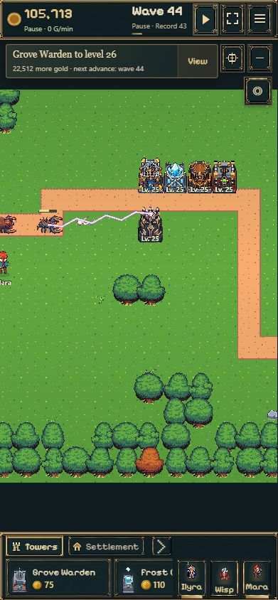
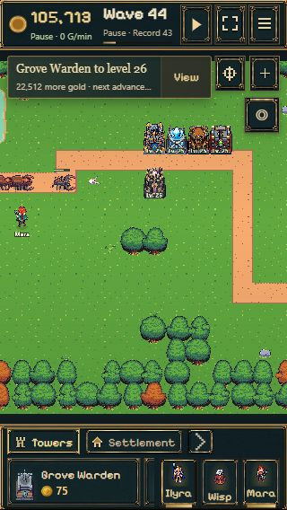

# Gesamtprüfung aller fünf Türme · 30.10.2026

**Urteil: Die Turmdarstellung besteht die Prüfung. Den Branch in seiner jetzigen Form noch nicht unverändert nach main übernehmen.** Vorher müssen die beabsichtigte Test-Speichertrennung und die Testoberfläche für den Produktionsbetrieb umgeschaltet werden. Keine neue Gameplay- oder Grafikentwicklung nötig. Dieser Auftrag verändert keinen Laufzeitcode und führt keinen Merge aus.

Geprüft: Branch `codex/tower-evolution-playtest`, HEAD `a8765d0d09dadbc97845ed2b4e3a8e171a021ec3`, veröffentlichter Spielcode `3bdb038630b1c48597fb193bc92c86d75c0e1c71`. Aktuelles main `93703cb66e369ed7f3a724f0e42575775cc12bc4`; vor der Prüfung frisch gefetcht. Kein fremder oder ungesicherter Ausgangsdiff.

## Ergebnisse

| Turm | Skins / tatsächliche Schüsse / passende Impacts automatisiert | Erneute Sichtprüfung im öffentlichen Spiel |
|---|---|---|
| Waldwächter | 8/8 | [Alle acht Stufen, Welle 43](audit-warden-all.png) |
| Frostkristall | 8/8 | [Alle acht Stufen, Welle 43](audit-frost-all.png) |
| Steinschleuder | 8/8 | [Alle acht Stufen, Welle 47](audit-stone-all.png) |
| Scharfschütze | 8/8 | [Alle acht Stufen, Welle 45](audit-sniper-all.png) |
| Sturmlicht | 8/8 | [Alle acht Stufen, Welle 43](audit-storm-all.png) |

Alle Reihen: **1 / 2 / 3 / 5 / 10 / 15 / 20 / 25**. Die höheren Stufen behalten die letzte Optik. Im Browser wurde jede gesamte Reihe im laufenden Kampf angesehen; damit ist nicht behauptet, jede einzelne Angriffsanimation manuell isoliert abgenommen zu haben. Die vollständige Einzelmatrix prüft die echten Schuss- und Trefferereignisse automatisiert.

- **437/437 Spieltests**, keine übersprungenen Tests. [Vollständiges Protokoll](combined-audit-tests.log).
- **Produktionsbuild ohne VITE_FEATURE_PREVIEW erfolgreich**, einschließlich TypeScript. [Buildprotokoll](combined-audit-build.log). Auch dieser normale Build enthält den Test-Datenbanknamen, Testtitel und tower-test.html: die unten genannten Merge-Hindernisse sind keine reine Vermutung.
- **14/14 zusätzliche Wald-/Frost-Prototyptests**: Schussfolgen, Richtungen und Zeitverhalten bestanden.
- Alle fünf vorhandenen `verify-assets.py` erfolgreich: Originalgrafiken unverändert, kompakte Grundfläche, maximal 57,96 Kartenpixel Ruhehöhe. Zusätzlich 12.607 Frostposen, 128 Frost-/Mischpaarungen, 1.800 neue Steinwaffenrichtungen und 2.880 Scharfschützenrichtungen geprüft.
- Zusätzlicher, reproduzierbarer [Renderer-Audit](combined-renderer-audit.mjs), [Rohdaten](combined-renderer-results.json): **40 Einzelkämpfe plus 32 gemischte Kämpfe** (acht Stufen jeweils bei 15/30/60/120 Renderaufrufen pro Sekunde), **81.960 Renderdurchläufe**. Echte Vite-transformierte Darstellungsmodule und echte Kampfsimulation, strenger Szenenadapter mit PNG-Abmessungen und gültigen Texturframes. Keine fehlenden Texturen/Frames, nicht endlichen Positionen, Änderungen am Kampfsnapshot oder übrig gebliebenen Renderobjekte. Pause, Save-Wiederherstellung und Fortsetzung gegen eine parallele Simulation ohne Renderer verglichen.
- Ergänzende **gleichzeitige Wiedergabe aller 40 realen Schusspayloads**, 101 Flugpositionen, anschließend 280 Trefferanforderungen: Begrenzung auf **96 Treffer-Sprites und 48 Blitzlinien**, maximal 231 gleichzeitig registrierte Bildobjekte einschließlich Turmkörper/Waffen; vollständig aufgeräumt. Bewusst ein Render-Stresstest, keine Behauptung eines normalen 40-Turm-Kampfs oder einer GPU-FPS-Messung.
- Vorberechnete neue Texturen insgesamt **19,78 MiB rohe Pixel** einschließlich Frostanimationen, Sturmlicht-Abschussframes und aller 40 Impacts. Originaltexturen, Bildobjekte, Browserverwaltung sowie zusätzliche CPU-/GPU-Kopien kommen hinzu. Keine Texturerzeugung pro Treffer; mehrfaches Vorbereiten erzeugt keine Duplikate.
- Kampfrechnung, Save-Store/Schema, Session-/Offline-Logik und public/assets sind gegenüber main unverändert. Der relevante Speicherunterschied liegt in der Auswahl des Datenbanknamens in main.ts, nicht im Format.

**Grenze der technischen Aussage:** Der Szenenadapter prüft reale Renderlogik, Lebenszyklen und Datenintegrität, zeichnet aber keine GPU-Pixel. Die Bildratenmatrix ist keine gemessene Bildrate auf einem Smartphone. Physische iOS-/Android-Hardware und ein GPU-Dauertest wurden nicht geprüft.

## Gemeinsamer Browserkampf und kritische Sichtbewertung

Alle fünf Türme gemeinsam auf Level 25 im veröffentlichten Branch bei **390×844 und 320×568** getestet; Einzelreihen überwiegend **1280×800**, Waldwächter zuerst bei der normalen Fenstergröße von etwa 843×800. Keine JavaScript-Warnungen oder -Fehler in den abgefragten Browserlogs. Geführte Testpartien verwenden eigene Probe-Saves; die laufende Nutzerpartie blieb unangetastet.

Pause und Reload im gemischten Kampf: **105.713 Gold, Welle 44 / Rekord 43, 18 von 22 Gegnern** vor und nach Reload identisch; weiterhin pausiert, **0 Offlinegold**. Alle fünf Türme bleiben sichtbar. Alte und historische Save-Anforderungen zusätzlich durch die unveränderte vollständige Suite abgedeckt; keine Migration in diesem Auftrag.

| Gemeinsamer Level-25-Kampf, 390 px mit Zoom | Derselbe Save nach Reload, 320 px |
|---|---|
|  |  |

Die kompakten Gebäude funktionieren zusammen. Hohe Stufen werden durch Konstruktion und Farbflächen erkennbar, ohne immer höhere Mauern. Keine neue dauerhafte Überdeckung wichtiger Bedienelemente gesehen. Bei 320 px in der Gesamtansicht verschwinden feine Details; Formen/Farben und vorhandener Zoom bleiben sinnvoll. Viele gleichzeitige Sturmlicht-Treffer verdecken einzelne Gegner kurz und ergeben deutliches Feuerwerk, aber keine großflächige Dauerblendung. Treffer und Linien laufen zeitlich begrenzt aus.

**Wichtige Testinterpretation:** Sturmlicht 25 erledigt wegen seiner bestehenden Reichweite und Stärke oft Gegner, bevor die übrigen Türme feuern. In den ersten 24 Sekunden der gemischten automatisierten Level-25-Aufstellung feuert nur Sturmlicht. Das ist kein Nachweis defekter anderer Türme und keine durch diesen Branch geänderte Balance. Deshalb zusätzlich 40 Einzelkämpfe und der gleichzeitige Payload-Stresstest; der bloße gemischte Test hätte die anderen vier Reihen nicht ausreichend abgedeckt.

Zwei automatische Wartevorgänge beim Szenariowechsel liefen vor Abschluss des Ladens ab; die anschließend geladene Oberfläche ließ sich normal bedienen. Die Bildaufnahme eines Prüftabs fiel später aus; ein neuer Prüftab stellte sie wieder her. Alle fünf Reihen und beide mobilen Vergleichsbilder wurden schließlich tatsächlich aufgenommen. Diese Werkzeugprobleme sind nicht als Spielfehler gezählt.

## Vor einer Main-Übernahme zu erledigen

1. **P1 – Hauptspielstände weiterhin unter ihren bisherigen Namen öffnen.** [main.ts:94](../../../../experiments/idle-bastion/src/main.ts#L94) ruft bedingungslos `towerPreviewDatabase(probeSlot)` auf. Auch ohne Preview-Flag liest der Build daher `spire-idle-bastion-tower-evolution` statt `spire-idle-bastion`; bestehende normale Probe-URLs würden ebenfalls im falschen Namensraum landen. Reproduziert mit Fake IndexedDB: gültiger Hauptstand vorhanden, neuer Standardzugriff meldet `empty`, ursprünglicher Hauptstand unverändert. Ein direkter Merge würde wie ein verlorener Spielstand wirken; er löscht diesen nicht. Für Produktion die bisherigen Main-/Probe-Namen erhalten und nur den tatsächlichen Preview-Betrieb isolieren. Anschließend ausdrücklich mit vorhandenem Hauptsave und vorhandener Probe-URL plus Reload prüfen. Keine pauschale Kopiermigration zwischen Test- und Hauptständen.
2. **P2 – Testoberfläche nicht als Hauptspiel veröffentlichen.** index.html enthält noch „Tower test branch“ im Titel und den Testauswahl-Link im Spielmenü; vite.config.ts baut den Teststarter immer mit. Preview-Kamera/-Navigation, Titel, Menü und README für den jeweiligen Build eindeutig trennen. Die synthetischen Aufstellungen mit Testgold gehören zur Preview. Der normale Produktionsbuild darf bestehende Spieler nicht in diese Testpartien führen.
3. Danach den tatsächlichen Produktionsbuild mit den unveränderten Hauptspiel-Speicherkennungen noch einmal kurz prüfen: alter Save, alte Probe-URL, frische Partie, normaler Kampf, Reload und Offline-Rückkehr. Ein kurzer Test auf einem echten Smartphone ist wegen der zusätzlichen Texturen sinnvoll; aus dieser Prüfung folgt keine Leistungsgarantie für alle Geräte.

**Empfehlung:** Die fünf Turmreihen beibehalten. Kein weiterer grafischer Umbau und keine Balancekorrektur aus dieser Prüfung nötig. Erst die kleine Produktions-/Preview-Trennung erledigen und den anschließenden Main-Save-Smoke bestehen lassen, dann ist die Übernahme aus meiner Sicht vertretbar. Aktuell keine Freigabe für einen unveränderten Branch-Merge. Main, Deployment und Kongregate-Export wurden bei dieser Prüfung nicht verändert.
