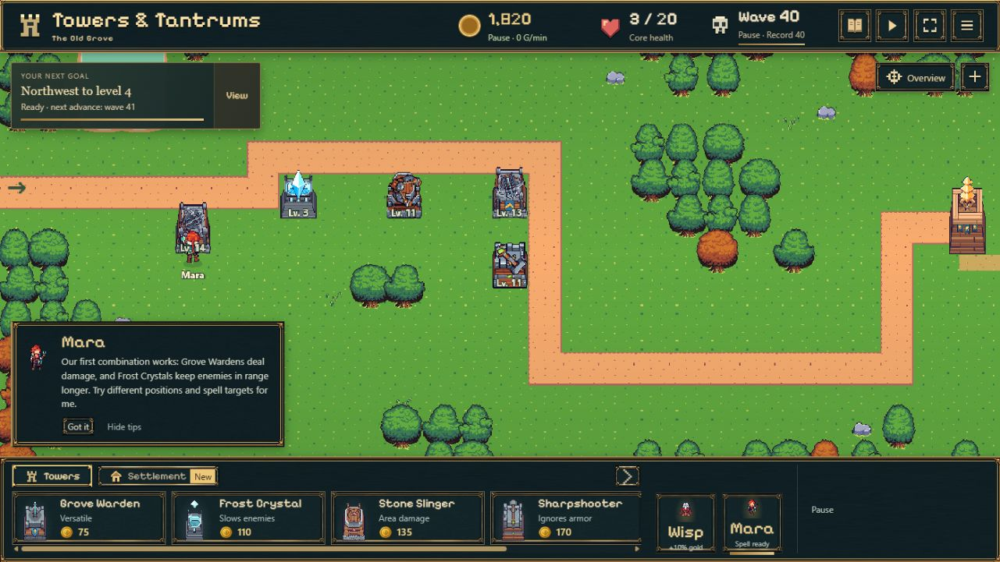
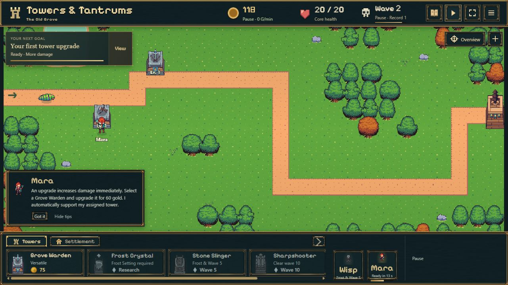

# Main-Integration · 31.10.2026

Ausgang: main `93703cb66e369ed7f3a724f0e42575775cc12bc4`, Testbranch `2cf020de4827a5d60db80f8937268e7db0255f1f`. Übernahme nach bestandener Prüfung ausdrücklich beauftragt; kein Kongregate-Paket.

## Korrekturen

- Produktion verwendet weiterhin `spire-idle-bastion` und `spire-idle-bastion-probe-<id>`, einschließlich bisheriger Validierung. Nur `VITE_FEATURE_PREVIEW=1` verwendet den bisherigen isolierten Turmtest-Namensraum. Keine Kopiermigration, kein neues Saveformat.
- Normaler Titel, kein Turmtest-Menülink, kein `tower-test.html`-Buildinput und keine aktive Testkamera im Produktionsbuild. Preview erhält diese Funktionen. README erklärt Hauptspiel und separate Testadresse.
- Alle fünf freigegebenen Turmreihen bleiben unverändert: acht Skins/Projektile/Impacts pro Art. `battle.ts`, `battle-session.ts`, `save-store.ts`, `offline.ts` und Originalassets gegenüber Main unverändert.

## Prüfung

- **439/439 Tests**, keine übersprungenen Tests: [Protokoll](main-integration-tests.log). Zwei neue Namensraum-/historische Save-Regressionsprüfungen; bestehende historische Migrationen, Manipulationsschutz, Kämpfe und Offline-Einmalauszahlung weiter grün.
- Produktionsbuild inklusive TypeScript erfolgreich: [Log](main-integration-build.log). Zusätzlich Preview separat gebaut: [Log](main-integration-preview-build.log). Ausgaben geprüft: Produktion ohne Testtitel/-Link/-Starter/-Kamerabutton; Preview mit allen vier Elementen.
- Vorheriger [40-Stufen-Gesamtaudit](COMBINED_REVIEW.md) gilt für die unveränderte Grafik-/Kampflogik weiter; keine neue Grafik oder Balanceänderung.
- Browserprüfung läuft gegen den tatsächlich gebauten Produktionsstand auf einem separaten lokalen Origin; keine privaten Nutzer-Saves ausgelesen oder überschrieben. [Reproduzierbarer lokaler Fixture-Server](integration-browser-server.mjs), nicht Teil des veröffentlichten Builds.
- Hauptslot: echter historischer Schema-26-Export `earned-balanced-late.json`, 1.820 Gold, Welle 40, fünf Türme Level 14/13/3/11/11, pausiert. Nach Laden und Reload vollständiger Battle-Snapshot exakt gleich dem dokumentiert migrierten Original.
- Alter Probe-Link: unveränderte Schema-1-Fixture aus dem ursprünglichen Modell, zwei Türme, Welle 1, 0,4 Sekunden. Laden, Reload und `/idle-bastion/?probe=integration-old#legacy` erhalten Daten sowie Query/Hash. [Persistierter Vorher-/Nachhervergleich](integration-persisted-before-combat.json).
- Schema-2-Kampf plus gezielt konstruierter, gültiger historischer Offlinebeleg: ausgeschöpfte Zwei-Stunden-Grenze, 7.200 Gold. Reload vor Einsammeln erhält Anspruch; nach Auszahlung erneuter Reload: 7.200 Gold, +0 neue Gutschrift. Acht-Stunden-Lagergrenze unverändert und in Suite abgedeckt. Die erste Browser-Offlinefixture hatte fälschlich ein pausiertes Fenster mit bereits verdientem Ertrag kombiniert und wurde korrekt als ungültig abgewiesen; nur Fixture korrigiert, keine Savevalidierung gelockert.

- Frische Partie öffnet das normale Tutorial 1/14 mit 75 Gold und neuer UUID-Probe-Adresse. Hauptsave bleibt anschließend exakt erhalten, Preview-Stand weiterhin unberührt.
- Historischen Kampf fortgesetzt: Welle 2, 118 Gold, 1/7 Gegner verbleibend. Pause und Reload erhalten diese Werte exakt, +0 Offlinegold. Keine Browserwarnungen/-fehler in der finalen Logabfrage. [Abschließende Speicherwerte](integration-persisted-final.json); dort sind Unterschiede im Probe-Kampf beziehungsweise Offlinekonto beabsichtigt (gespielter Kampf / ausgezahlte 7.200 Gold).

**Lokale Abnahme bestanden: Übernahme nach main vertretbar.** Die beiden Integrationshindernisse sind behoben. Korrekturcommit `3af45cc`, anschließend Merge `46a1e156968e7f4dd9c7f73870c06dcd58381cef` nach main. [Main-Pages 41189905584](https://github.com/emfau88/TD/actions/runs/41189905584) erfolgreich. Öffentliches Hauptspiel startet mit separater frischer Probe; normaler Titel und Menü ohne Testauswahl. Veröffentlichtes Laufzeitbundle `main-lr3GkZZQ.js` stimmt mit dem Linux-CI-Buildprotokoll überein und enthält Main-/Probe-Namen sowie neue Turmdarstellung, keine Testkamera oder Preview-Datenbank. Die lokalen Windows-Bundlehashes unterscheiden sich; die Zuordnung wurde daher gegen den tatsächlichen CI-Build geprüft.

Die Testseite wird anschließend über den bestehenden genehmigten Preview-Workflow wieder bereitgestellt; dabei bleiben Main-Dateien bytegleich. Keine Kongregate-Erstellung. Die technische Prüfung ersetzt keine Leistungsmessung auf physischer Smartphone-Hardware.
