# Isolierter Turmtest · 29.10.2026

- Branch: `codex/tower-evolution-playtest`, Basis `93703cb66e369ed7f3a724f0e42575775cc12bc4` (`main`). Kein Merge nach main.
- [Spielbarer Teststart](https://emfau88.github.io/TD/previews/tower-evolution/tower-test.html) · [Pages-Lauf 40956723521](https://github.com/emfau88/TD/actions/runs/40956723521) erfolgreich. Ausgelieferter Spielcode `a5db53339e42263df903ed4dd44ed9ad0d828413`; Herkunft `93703cb66e369ed7f3a724f0e42575775cc12bc4`.
- Nutzer hat das Hinzufügen **genau dieses Branches** zur Pages-Freigabeliste ausdrücklich bestätigt. Bestehende Freigaben erhalten; Guard bestätigt alle **604 Main-Dateien bytegleich**. Öffentlichen Teststarter und Kampf im Browser geprüft; keine Warnungen/JS-Fehler. Kein Merge nach Main.

- Beide freigegebenen kompakten Reihen im tatsächlichen Phaser-Spiel: Skins 1/2/3/5/10/15/20/25, ab 25 letzter Skin. Andere Turmarten behalten ihr Rendering.
- Waldwächter: Originalwaffenanimationen 1–3, Rückstoß für neue Waffen; höchstens drei visuelle Pfeile pro Schuss, später 2+1 beziehungsweise 1+1+1. Frost: Originalanimation 1, vorhandene Vorschau-Choreografie 2–25 als einmalig vorbereitete Atlanten, eisblaue Projektile und Einschläge.
- Auswahl verwendet das echte Level; gespeichertes `visualStage`, Turmwerte, logische Projektile, Schaden, Cooldowns, Gegner, Spielstandschema und Offline-Regeln bleiben unverändert. Mehrfachpfeile sind ausschließlich Darstellung eines vorhandenen logischen Schusses.
- Teststarter: gemischte oder sortenreine Aufstellung, alle acht Stufen oder vier Türme einer gewählten Stufe. Synthetische Grafiktests auf Grundlage der dokumentierten Welle-40-Karte, normale Kauf-/Upgradebefehle, 100.000 Restgold. Kein Balancenachweis. Der geschützte Startturm bleibt erhalten.
- Jeder vorbereitete Start erhält einen neuen UUID-Spielstand in `spire-idle-bastion-tower-evolution-*`; auch normale frische Branch-Partien nutzen ausschließlich diesen Namensraum. Hauptspielstände und deren UI-Storyhistorie werden nicht geöffnet. Allgemeine Sprache/Toneinstellungen bleiben browserweit.

## Prüfungen

- Finale Vollsuite **428/428** erfolgreich. Darin alle 27 Szenario-/Stufenkombinationen und nach Nutzerpräzisierung jede der **16 optischen Stufen einzeln mit echten Schüssen**, Aufwerten/Verkaufen und Save-Roundtrip; eindeutige pausierte Slots und bytegleicher Hauptspielstand in IndexedDB. Zusätzlich **7/7** gezielte Tests vor diesem erweiterten Abschlusslauf.
- TypeScript und Vite-Produktionsbuild erfolgreich. Beim erneuten lokalen Verpacken hielt der Python-Testserver eine MP3-Datei offen (EBUSY). Nach Stoppen des Servers `package-pages.mjs` erfolgreich; kein Quellcode- oder Deploymentfehler.
- Echte Browserprüfung: gemischter Kampf auf Desktop und 390/320 px, Pause und Reload mitten in Welle 43 mit gleichen Türmen, Gold und Gegnerzahl. Frost separat mit allen acht Stufen bis Welle 43; alle acht Waldwächter sichtbar und im Kampflauf bis Welle 50, zusätzlich vier Level-25-Waldwächter bis Welle 44. Menürückkehr zum Teststarter funktioniert. Keine Browserwarnungen oder JavaScript-Fehler in diesen Spielabläufen.
- Neue Runtime-Dateien: `tower-evolution.ts`, `evolution-view.ts`; kleine Anschlüsse in `battle-scene.ts`, `combat-effects.ts`, `main.ts`. Teststarter, Vite-Eintrag, README und branchgebundene Preview-Veröffentlichung ergänzt. Originalassets nicht verändert; keine Kongregate-Neupackung.

- Zusätzlich **14/14** Prototyp-Tests; Assetprüfungen erfolgreich: 12.607 Frostposen, unveränderte Originalatlanten, maximal 57,96 Kartenpixel Höhe, freie hintere Waffen/Kristalle in allen untersuchten Nachbarpaarungen.

## Sichtbewertung

Alle 16 zugeordneten Skins sind korrekt geladen und sichtbar; kompakte Grundkörper und Waffen sitzen passend zusammen. Frost bleibt durchgehend eisfarben. Beide Reihen funktionieren im echten Kampf, ohne zusätzliche logische Schüsse oder veränderte Trefferwerte. Auf 390 px lassen sich die Stufen gut unterscheiden; 320 px profitiert vom bestehenden Zoom. Späte Waldwächter sind optisch detailreicher und unruhiger als Frost, bleiben aber im genehmigten Größenrahmen.

Der vorbereitete Welle-40-Test ist für Level 25 deutlich unterfordernd: unverändert etwa 15.350 Schaden beim Waldwächter bzw. 7.675 bei Frost; Reichweiten 162 bzw. 156 Kartenpixel. Zusammen mit der Aufstellung am Eingang und dem Hochkant-Ausschnitt können Gegner schon außerhalb des sichtbaren Ausschnitts sterben. Das ist kein neuer Schadens-/Reichweitenfehler. Für besser sichtbare Angriffe einzelne Stufen und die Übersicht verwenden; die ursprünglichen Werte wurden bewusst erhalten.

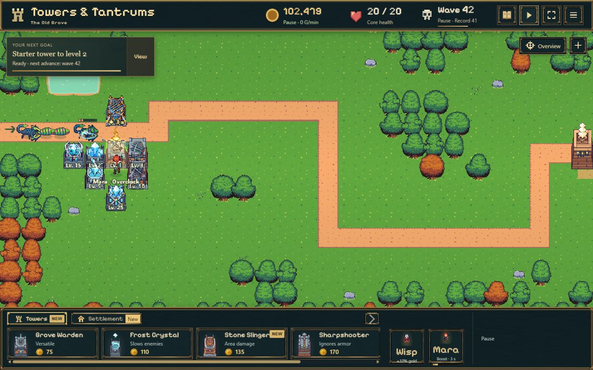

| Waldwächter, alle acht Stufen, 390 px | Frost, alle acht Stufen, 390 px | Frostkampf bei 320 px |
| --- | --- | --- |
| 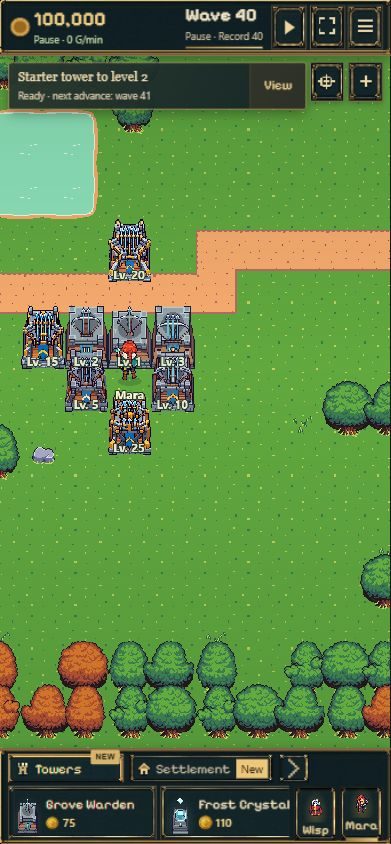 | 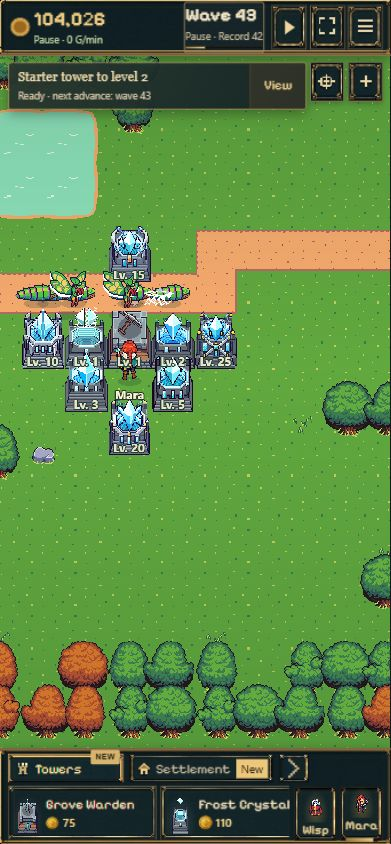 | 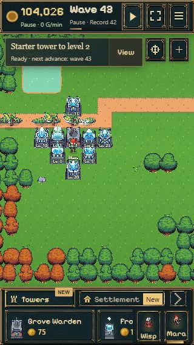 |

## Grenzen

- Bewusst ein Testbranch, keine Produktionsfreigabe. Waldwächter 5–25 behalten den im Prototyp gezeigten einfachen Rückstoß; keine neuen handgezeichneten Waffenframes.
- Echte Kampfzyklen sind kürzer als in der freien Grafikvorschau; die Frostphasen richten sich nach dem vorhandenen Schusszeitpunkt. In dichter Verteidigung können starke Türme Gegner erledigen, bevor hintere Türme schießen. Einzelstufen lassen sich deshalb gesondert starten.
- Auf sehr kleinen Ansichten bleiben hohe Stufen kompakt; die bestehende Zoomfunktion erleichtert die Sichtprüfung. Keine zusätzliche Smartphone- oder Leistungsoptimierung zugesagt.
- Die Vorschau wird neben ein bytegleich geprüftes Main-Pages-Artefakt gelegt. Eine spätere normale Main-Veröffentlichung entfernt diesen temporären Unterpfad; erneuter Workflow-Start auf diesem Branch stellt ihn wieder her. Hauptspiel-Dateien werden beim Preview-Packaging durch SHA-256-Vergleich geschützt.

## Commits

- `a5db533`: vollständige isolierte Spielintegration, Szenariostarter, Speichertrennung, Tests, Screenshots, README und Preview-Workflow.
- Nachfolgender Abschlusscommit enthält nur erweiterten Test/Nachweise/README; veröffentlichter Spielcode bleibt `a5db533`.

## Sichtbare Testarena · Folgeauftrag 29.10.2026

Türme auf mittlere Wegstrecke versetzt; unbenutzter Startturm sicher hinten. Einzelstufen zeigen einen Turm pro Art. Wave 41 läuft über normale Updates bis zum sichtbaren Anmarsch, danach pausierter Save. Kamera zeigt Anmarsch und Schusszone, ◎ zentriert erneut. Keine Änderung an Kampfwerten, Maplayout, Saveformat oder Offline-Regeln. Alte Probe-URLs bleiben gültig.

7/7 gezielte Tests bestanden (27 Aufstellungen, 16 Einzelstufen mit realen Schüssen und Save-Roundtrip); Produktionsbuild erfolgreich. Tatsächlicher Level-25-Waldwächterkampf auf Desktop und 390 px geprüft: Gegner vor Turm sichtbar, Treffer im Ausschnitt. Mobiler Kamerabutton auf Symbol gekürzt. Steinschleuder-Erweiterung folgt als separates Paket.

## Steinschleuder und finale Arena · 29.10.2026

**Veröffentlicht und live geprüft:** Runtime `1d6219829e5081690eb41b6bffbed148ce87c1d1`; [Pages-Lauf 40963076081](https://github.com/emfau88/TD/actions/runs/40963076081) erfolgreich. Herkunft per öffentlicher `feature-preview.json` bestätigt. Guard bestätigt sämtliche **604 Main-Dateien bytegleich**, Main weiter `93703cb66e369ed7f3a724f0e42575775cc12bc4`. Öffentliche Auswahl, alle acht Steinschleudern, Kampf bis Welle 42 und Pause geprüft; keine Browserwarnungen/Fehler. Arena separat als `d1fbc75` gesichert. Vorherige Abschnitte dokumentieren den damaligen Zwei-Turm-Stand; aktuell sind drei Turmarten enthalten.

- Steinschleuder (Tower 03) mit acht Skins 1/2/3/5/10/15/20/25. Erste drei aus dem vorhandenen Paket, fünf neue kompakte Konstruktionen und passende Steinprojektile. Basis und Waffe getrennt; alte Waffen-/Projektilanimationen 1–3 unverändert. Neue Stufen: kurzer Rückstoß, ein sichtbarer rotierender Stein pro logischem Schuss und vorhandener Steineinschlag. Keine mehrphasige neue Spann-/Nachladeanimation behauptet.
- Quellen und Prompts unter `prototypes/steinschleuder-evolution/sources/`, erzeugt mit eingebautem Imagegen; native PNGs in `assets/compact/`, Vergleich und Montage in README/manifest. Originalatlanten per SHA-256 unverändert; keine Farbfilter.
- Neue Gebäude bleiben 52,92 Kartenpixel hoch und 40,32 breit; Originalstufen kompakt auf höchstens 57,96. 1.800 neue Waffenrichtungen geprüft, überall unter 58 Pixeln Gesamthöhe. Nearest-Neighbor, transparente native Pixel und begrenzte Palette.
- Arena wegen der größeren Steinschleuder-Reichweite vorgezogen: erster sichtbarer Gegner bei x≥260, pausiert vor dem ersten Turmschuss. Kamera umfasst den Anmarsch; keine HP-/Schaden-/Tempo-/Reichweitenänderung. Einzelstufe ein Turm pro Art; gemischt drei. Kamerasymbol separat unter der Ansichtssteuerung, ohne mobilen Zielbutton zu verdecken. Alte Lesezeichen bleiben gültig; neu starten für die neue Aufstellung.

**Technik:** Vollsuite **428/428**, gezielte Tests **7/7**, TypeScript/Produktionsbuild erfolgreich. Tests umfassen alle 36 Szenario-/Stufenkombinationen, alle 24 optischen Einzelstufen mit echten Schüssen und anschließend Upgrade, Verkauf und Save-Roundtrip. Jeder Start hat eigenes pausiertes IndexedDB-Save; Hauptsave unverändert. Test prüft zusätzlich, dass vor dem Start noch kein Turmprojektil unterwegs ist. Keine Änderungen an battle.ts, Originalassets, Saveformat, Gegnern, Balance oder Offline-Regeln.

**Echter Browser:** alle acht Steinschleudern geladen und Kampf bis Welle 42; 1280×800, 390×844 und 320×568 geprüft. Einzelne Level-25-Steinschleuder, Level-25-Waldwächter und Level-20-Frost in neuer Arena geprüft. Pause/Reload bei Welle 42: 102.347 Gold, acht verbleibende Gegner und alle Türme erhalten, weiterhin pausiert. Keine Warnungen/JavaScript-Fehler. Ein `waitFor` direkt nach Reload lief vor Abschluss des Ladens ab; anschließende sichtbare Rückkehrkarte und Fortsetzung erfolgreich, kein Spielfehler. Nicht jeder der 24 Einzelfälle wurde zusätzlich separat im Browser geöffnet; diese vollständige Matrix ist automatisiert geprüft.

**Sichtbewertung:** klarer Materialausbau ohne höhere Türme. 20/25 unterscheiden sich durch Panzerplatten, Gabelenden und goldene Beschläge; bei 320 px sind feine Unterschiede begrenzt. Die neue Testkamera verhindert verdeckte Einstiegstreffer. Gegner sterben auf hohen Stufen weiterhin rasch gemäß Originalwerten. Nur technischer Testbranch, visuelle Nutzerabnahme bleibt offen. Kein Main-Merge und kein Kongregate-Export.

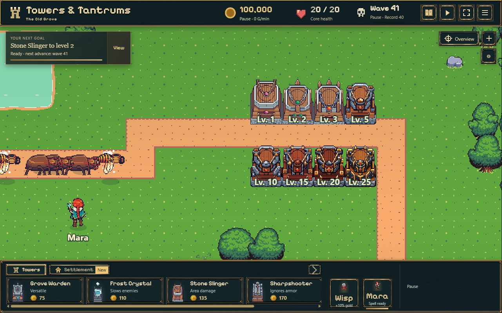

| 390 Pixel | 320 Pixel | Einzelstufe 25 |
|---|---|---|
| 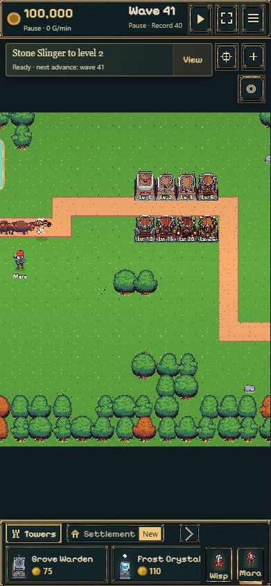 | 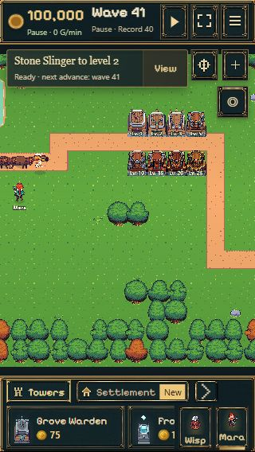 | 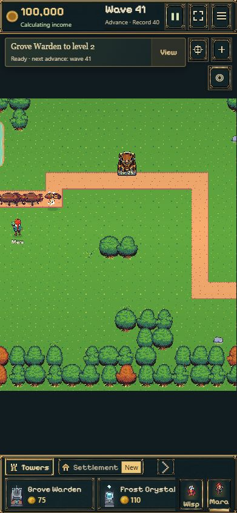 |

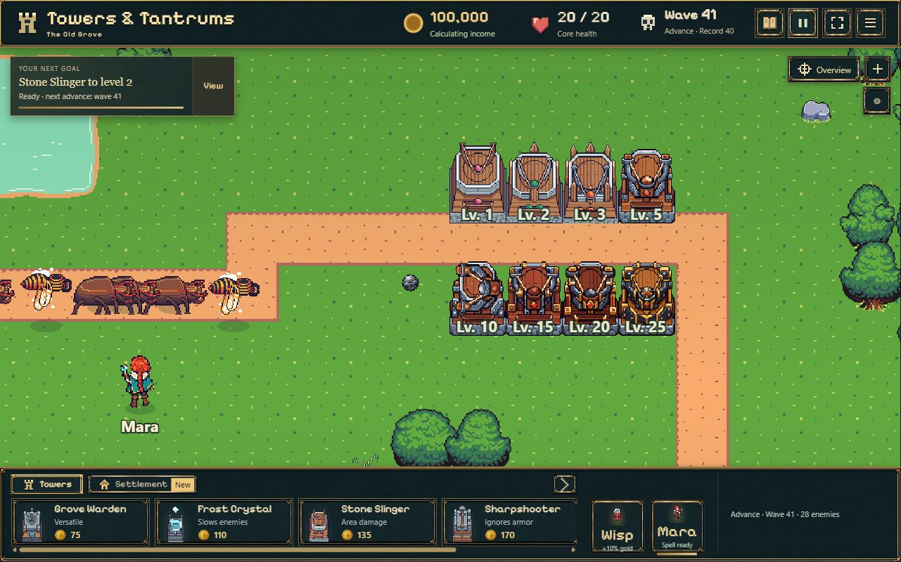

## Scharfschütze · 29.10.2026

- Basis `ca1ae79`; nur vorhandener Testbranch. Stufen 1/2/3 aus Original Tower 04, fünf neue Skins und passende grüne Projektile 5/10/15/20/25. Getrennte Basen/Wurfarme, alte Animationen 1–3 vollständig erhalten. Hohe Stufen mit kurzem Rückstoß; Trefferwirkungen noch unverändert. Asset-/Promptnachweis im [Scharfschützen-Verzeichnis](../../../../prototypes/scharfschuetze-evolution/README.md).
- Grundkörper maximal 57,96 Kartenpixel hoch, neue Stufen 53,55; Breite 40,32. Originalarme kompakt mit 0,53 gerendert, neue mit 0,63; Originaldateien unverändert. 2.880 Ausrichtungen einschließlich neuer Rückstoßreserve bestanden, keine Waffe unterhalb des Bodenabschlusses. Bauvorschau verwendet denselben Maßstab.
- Teststart jetzt bei sichtbarem Anmarsch x≥220, vor dem ersten Turmschuss auch mit Scharfschützenreichweite. Vier Turmarten, 45 vorbereitete Aufstellungen, 32 optische Einzelstufen mit echtem Kampf, Upgrade/Verkauf/Save-Roundtrip. **428/428 Tests**, gezielt **7/7**, TypeScript/Produktionsbuild bestanden.
- Browser: alle acht Scharfschützen geladen und Kampf bis Welle 43, Desktop 1280×800, Hochkant 390×844 / 320×568. Pause/Reload erhält Welle 43 und 104.030 Gold; zusätzliche Einzelstufe 25 geprüft. Keine JavaScript-Warnungen/Fehler. Browserverbindung einmal neu initialisiert, danach vollständig zugänglich. Nicht alle 32 Einzelstufen zusätzlich separat manuell geöffnet; vollständige Matrix automatisiert.
- Keine Änderungen an Kampfwerten, Saveformat, Offline-Regeln, Originalassets oder Main. Kein Kongregate-Export. Neuer Deploymentnachweis folgt nach Push. Nach Abschluss separat beauftragt: Impact-Vorschläge und Vergleich für alle vier Turmarten, vorerst ohne Integration.

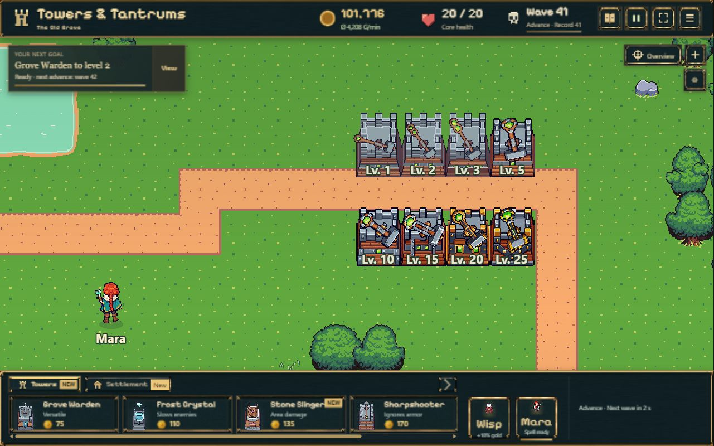

| 390 Pixel | 320 Pixel | Einzelstufe 25 |
|---|---|---|
| 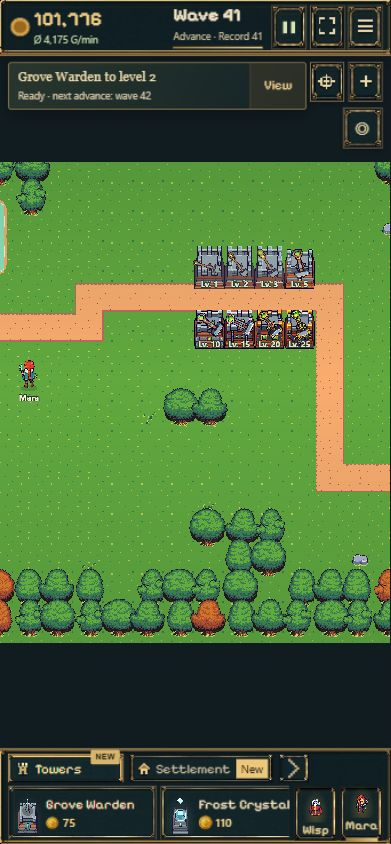 | 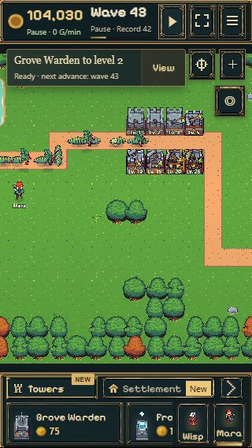 | 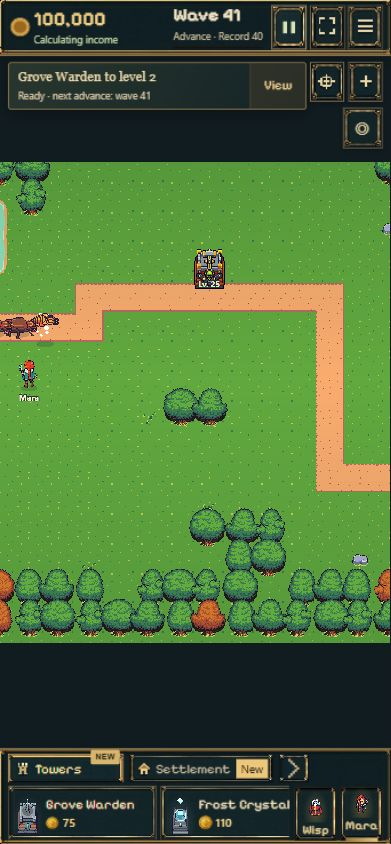 |

### Veröffentlichung Scharfschütze / anschließende Impact-Studie

- Spielcode 3072b9da90f7890a9945336b0e2d8874fe784df0, gepusht auf codex/tower-evolution-playtest. [Pages 40966998098](https://github.com/emfau88/TD/actions/runs/40966998098) erfolgreich; Metadaten mit SHA öffentlich geprüft, alle 604 Main-Dateien bytegleich erhalten. Main bleibt 93703cb66e369ed7f3a724f0e42575775cc12bc4.
- Öffentlicher Browser-Smoke: Scharfschütze/all, echte Wellen 41–48, 20/20 Kern, keine Warnungen/Fehler. [Liveaufnahme 390](sniper-live-390.png).
- Danach separate [Impact-Designstudie](../../../../prototypes/tower-impact-study/README.md), keinerlei Änderung an CombatEffects oder sonstigem Spielcode. Vorlage/10/20 für alle vier Türme; Browser-/Bildnachweise und bewusst verbleibende Gestaltungsfragen dort. Kein Main-Merge, kein Kongregate-Export.

- Impact-Studie e4f59ee: [Pages 40968759103](https://github.com/emfau88/TD/actions/runs/40968759103) erfolgreich, öffentliche Seite/Assets ohne Warnungen/Fehler geprüft, erneut 604 Main-Dateien bytegleich. Kleine abschließende Montagekorrektur: Sonderfont nur für 2/5/8 statt für alle Ziffern, 1/3/0 dadurch wieder lesbar; Neupackung/2.880-Richtungsprüfung bestanden, Laufzeitassets unverändert.

## Impact-Studie Revision 3

Auf Nutzerkorrektur Originale niedriger Main-Stufen plus echte Steigerung je Skin. 16/36 Vergleichsfelder, mehr Feuerwerk, eigener Level-15-Effekt. Nur Prototyp: keine Spielcodeänderung. Aktuelle Prüfung und Performance-Messung in [README](../../../../prototypes/tower-impact-study/README.md). Die frühere Empfehlung „drei Wirkungsgruppen reichen“ ist damit verworfen.

## Impact-Studie Revision 4 · 30.10.2026

Neue Pixelzeichnungen, Materialfarben und Trefferfolgen für jede Skin-Stufe; eigene Formen ab 5. Frostkrone/Prismenkreuz/Polarstern, Gold-/Smaragdsalven, Glut-/Feuer-/Meteoreinschläge und Präzisionslanzen ersetzen die reine Größensteigerung. Unveränderte niedrige Main-Originale bleiben als Referenz sichtbar. Keine Spielcode-/Balance-/Saveänderung.

32 Profile/2.720 Zeitposen, Originalhashes und Syntax bestanden; Browser Desktop/390/320 ohne Warnungen/Fehler. Höchstens 11,25 MiB rohe Pixel im vollständigen Spritecache; Mikrobenchmark 96 Level-25-Treffer: Ø 0,13 ms / P95 0,20 ms CPU-Zeichenzeit. Kein vollständiger GPU-/Spiel-/Smartphone-Benchmark. Screenshots, technische Grenzen und Sichtbewertung in der [Studien-README](../../../../prototypes/tower-impact-study/README.md). Gestalterische Freigabe weiter offen.

Revision 3 wurde zuvor als 9b7efa0 mit Pages 40971886603 veröffentlicht. Revision 4: `03520cf61662cbec430215ecf8d8da5d16a85bb8`, [Pages 40974609788](https://github.com/emfau88/TD/actions/runs/40974609788) erfolgreich inklusive Produktionsbuild. Öffentliche Metadaten und Browserseite ohne Warnungen/Fehler geprüft, 604 Main-Dateien bytegleich; Main weiterhin 93703cb66e369ed7f3a724f0e42575775cc12bc4. Kein Main-Merge und kein Export.

## Impact-Studie Revision 5 · 30.10.2026

Auf Nutzerkritik Stilbrüche korrigiert: Stein 20/25 führen die Feuerwolke mit mehr Volumen, Hitze und Nachbrand fort. Scharfschütze behält seinen grünen Originalkontaktstern; Durchschlag, diagonale Strahlen und Nachimpulse bauen additiv aufeinander auf. Frühester Kontakt wieder mindestens 350 ms sichtbar. Keine Spielintegration oder Änderung von Kampfwerten.

32 Profile/2.720 Zeitposen, endliche Geometrie und Framegrenzen geprüft. Alle 16 Wald-/Frostprofile zeichnen identisch zu Revision 4. Desktop mit kompletter Scharfschützenreihe, 390-Pixel-Dichtvergleich, 320 Pixel/36 Felder ohne Overflow und Browserfehler geprüft. Mikrobenchmark 96 Treffer: L25 Ø 0,19 ms / P95 0,40 ms CPU-Zeichenzeit, keine GPU-/Smartphone-Aussage. [Bilder und aktuelle Bewertung](../../../../prototypes/tower-impact-study/README.md). Revision 5 als `9053954e2bf1130c22992786304fe4978442c9e4` veröffentlicht; [Pages 41095111417](https://github.com/emfau88/TD/actions/runs/41095111417) einschließlich Produktionsbuild erfolgreich. Öffentliche Metadaten und Browserseite ohne Warnungen/Fehler geprüft; alle 604 Main-Dateien bytegleich erhalten. Nutzer-Sichtfreigabe offen.

## Freigegebene Impacts im echten Testbranch-Spiel · 30.10.2026

**Auftrag:** Revision 5 wurde vom Nutzer als stimmiger bestätigt und für alle vier Türme im Testbranch beauftragt. Basis `9a85281`; Main weiterhin `93703cb66e369ed7f3a724f0e42575775cc12bc4`. Kein Main-Merge, kein Export.

- Waldwächter, Frostkristall, Steinschleuder und Scharfschütze verwenden nun die freigegebene Folge **1/2/3/5/10/15/20/25** im tatsächlichen Kampf. Zwischenstufen behalten den letzten erreichten Skin-Impact; oberhalb 25 bleibt die höchste Wirkung.
- Gemeinsame Quelle `prototypes/tower-impact-study/effects.js`: Spiel und Vergleich zeichnen dieselben zehn Posen, Materialien, Farben und Nachimpulse. Einmalige Vorbereitung aller 32 Atlanten (960×96, ~11,25 MiB rohe Pixel; zusätzliche Canvas-/GPU-Kopien möglich), keine neue Zeichnung oder Asset-Anfrage pro Treffer.
- Auswahl aus dem abgefeuerten Geschosslevel: ein zwischenzeitliches Upgrade oder Verkauf verändert den fliegenden Schuss nicht. Bestehende Flächentreffer-Deduplizierung, Bodentiefe, Kampfzeit/Pause, Cleanup und Grenze von 96 Effektsprites bleiben erhalten. Stormlight und Baustaub unverändert. Ausschließlich Trefferdarstellung; Schaden, Reichweite, Anzahl logischer Schüsse, Saveformat und Offline-Regeln unverändert. Zusätzliche Projektilspuren der Designstudie wurden nicht separat übernommen.
- **434/434 vollständige Tests bestanden**, kein Skip; gezielt **16/16** nach finaler Test-Helper-Typisierung. TypeScript und Produktionsbuild erfolgreich. Sechs neue Regressionstests decken alle 32 echten Kampf-/Trefferkombinationen mit unverändertem Save-Roundtrip, Schwellen bis Level 120, Atlas-Cache, Flächenschaden, Ablauf/Pause/Rollback und die Spritegrenze ab. Der erste Build erkannte eine rekursive Typinferenz im neuen Test-Double; korrigiert, erneuter Produktionsbuild bestanden.
- **Browser:** Vier Level-25-Türme gemeinsam im Desktopkampf (1280×720), Steinschleuder 25 separat, Frost 20 bei 390×844 und 320×568 einschließlich normalem Kartenzoom. Gemischte Gruppe beendet Welle 41; Pause/Reload erhält exakt 101.776 Gold, Welle 41/Record 41 und 20/20 Kern. Keine Browserwarnungen/-fehler. Alle 32 Stufen automatisiert im echten Kampfsystem, nicht jede Kombination zusätzlich einzeln manuell geöffnet.
- **Grenzen:** Ein einzelner Frostturm ist weiterhin keine vollständige Welle-41-Verteidigung und wechselt bei Niederlage regelgerecht ins Farming; dies ist kein Balancetest. Treffer bleiben kurz (300–550 ms). Kein vollständiger FPS-/GPU-Benchmark und kein physisches Smartphone getestet. Der begrenzte Cache ist kein Nachweis für die Leistung jedes Endgeräts. Nutzerbeurteilung des gesamten Gefechts bleibt Zweck dieses Branches.

Geänderte Laufzeitstellen: `src/evolution-impacts.ts`, `src/combat-effects.ts`, Ladevorbereitung in `src/battle-scene.ts`; dazu Typen/Framekonstanten der gemeinsamen Studie, Launcherhinweise, neue Tests und Dokumentation. Veröffentlicht als `52cdfaea66adbb7d38843de4b80dc57e116346c7`; [Pages 41098071728](https://github.com/emfau88/TD/actions/runs/41098071728) erfolgreich, einschließlich erneutem Produktionsbuild. Öffentliche Metadaten bestätigen den Branch-Commit und unveränderten Main-SHA. Alle 604 Hauptspiel-Dateien bytegleich erhalten. Öffentlicher Level-25-Kampf bis Wellenende 41, 101.776 Gold und 20/20 Kern, ohne Browserwarnungen/-fehler; anschließend pausiert. Abschließender Folgecommit enthält nur diesen Nachweis und die Aufnahme.

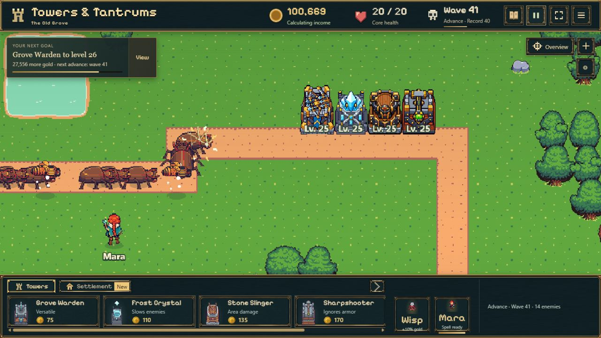

## Sturmlicht als fünfte Reihe · 30.10.2026

Nur `codex/tower-evolution-playtest`, Ausgangscommit `dc3577b`, Main bleibt `93703cb66e369ed7f3a724f0e42575775cc12bc4`. Acht Skins **1/2/3/5/10/15/20/25**, gleiche 57,96 Kartenpixel Gebäudehöhe, getrennte Basis/Emitter, Originalangriffe 1–3, neue korrekt zur Flugrichtung ausgerichtete Projektile und kurze Abschussreaktionen ab 5. Eigene farbige Kettenblitze und elektrische Impacts für alle acht Stufen. Die Flugbahn wird an jeder echten Kettenetappe aktualisiert; keine zusätzlichen Treffer oder veränderten Kampfwerte.

- **437/437 Tests**, keine ausgelassenen Tests; `storm-tests.log`. TypeScript und Produktionsbuild erfolgreich, `storm-build.log`.
- 54 Szenario-/Stufenkombinationen und alle 40 optischen Einzelstufen mit echten Schüssen, Upgrade/Verkauf/Save-Roundtrip; zusätzliche Sturmlicht-Ketten-, Reload-, Liniengeometrie- und Effektbereinigungstests. Kettenzahl und Schadensabfall unverändert.
- Assetprüfung aller acht Stufen und Originalhashes bestanden. 872 Effektposen und 265.576 Zeichenaufrufe geprüft; eigene Sturmlicht-Formen bleiben innerhalb ihrer 96-Pixel-Frames. Alle Zeichenoperationen der übrigen vier Reihen sind exakt identisch zum vorher veröffentlichten Stand.
- Echter lokaler Produktionsbuild: Desktop 1280×720, 390×844 und 320×568. Alle acht Skins in zwei Reihen sichtbar, Angriffe im Kampf, bis Welle 43 gespielt. Pause/Reload hält **104.282 Gold, Welle 43, 14 verbleibende Gegner und 20/20 Kernleben**; Rückkehr 0 Offlinegold, Türme erhalten. Neue Studie mit allen Stufen und hohen Impacts angesehen. Keine Browserwarnungen oder JavaScript-Fehler.
- Nicht jede einzelne Stufe wurde separat manuell gestartet; vollständige Matrix automatisiert. Viewport-Emulation, kein physisches Smartphone und kein Gesamtspiel-GPU-Benchmark. Zwei unmittelbar nach UI-Wechseln erstellte Aufnahmen waren noch alte Frames und wurden nach sichtbarer Aktualisierung ersetzt. Ein Label-Selektor der Vergleichsansicht schlug fehl; Auswahl über vorhandene DOM-ID erfolgreich.
- Budget: 40 Impact-Atlanten ~14,06 MiB rohe Pixel, zusätzliche Sturmlicht-Abschussatlanten ~2,11 MiB; Verwaltungs-/GPU-Kopien nicht enthalten. Bestehende Grenzen 96 Treffer-Sprites / 48 kurze Kettenlinien erhalten.
- Neue Quellen und Prompts: [Sturmlicht-README](../../../../prototypes/sturmlicht-evolution/README.md). Hauptänderungen: tower-evolution.ts, evolution-view.ts, storm-visuals.ts, evolution-impacts.ts, combat-effects.ts, tower-test-probes.ts, Launcher, Tests und gemeinsame Vergleichsstudie. Keine Änderungen an battle.ts, Speicherung, Offline-Regeln, Originalassets oder Kongregate-Export.

Kritische Sichtbewertung: kompakte, gleich hohe Gebäude; neue Materialien und Spulen tragen die Entwicklung. 20/25 bleiben bewusst verwandt, Meisterring und elektrische Verzweigungen unterscheiden sie. Auf 320 px in der Gesamtansicht verschwinden Details; größere Farbflächen und vorhandener Zoom bleiben lesbar. Starke gleichzeitige Treffer verdecken Gegner kurz, kein dauerhaftes Leuchten oder großer Flächenblitz. Gestalterische Nutzerabnahme steht aus.

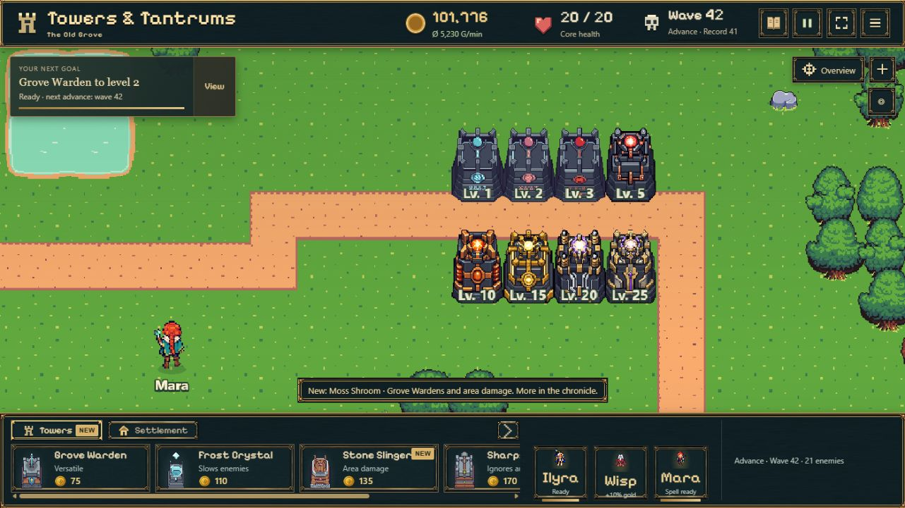

| 390×844: echter pausierter Kettenangriff | 320×568 nach Reload |
|---|---|
| 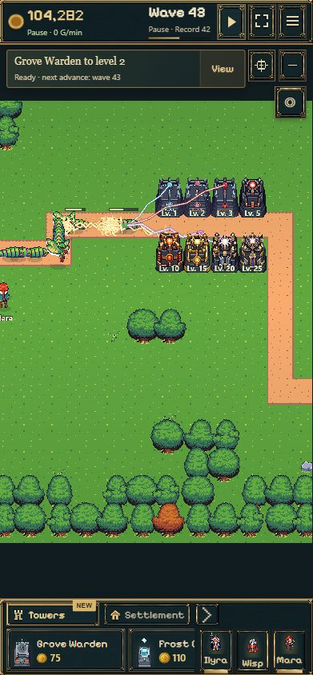 | 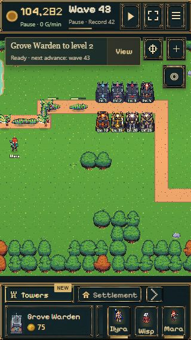 |

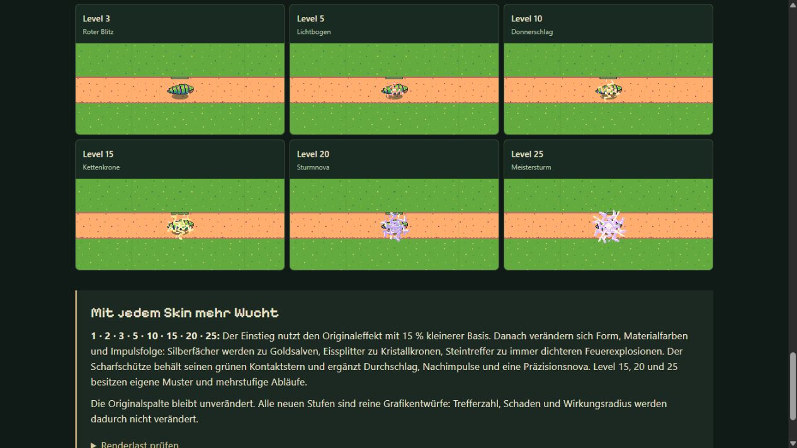

**Veröffentlicht:** Spielcode `3bdb038630b1c48597fb193bc92c86d75c0e1c71`, [Pages-Lauf 41110381033](https://github.com/emfau88/TD/actions/runs/41110381033) erfolgreich, einschließlich CI-Produktionsbuild. Deployment-Guard: sämtliche **604 Main-Dateien bytegleich**. Öffentliche `feature-preview.json` bestätigt Branch- und Main-SHA; [kompakter Nachweis](storm-deployment.json). Main bleibt `93703cb66e369ed7f3a724f0e42575775cc12bc4`.

Öffentliche Testauswahl mit fünf Türmen und Level 25 gestartet; Sturmlicht im Kampf bis Welle 42, Blitze und Impacts sichtbar. Am Ende pausiert: 102.249 Gold, 10 Gegner, 20/20 Kernleben. Keine Browserwarnungen oder JavaScript-Fehler. Der anschließende Abschlusscommit enthält nur Dokumentation, Metadaten und diesen Screenshot; veröffentlichter Spielcode bleibt `3bdb038`. Kein Main-Merge, kein Export.

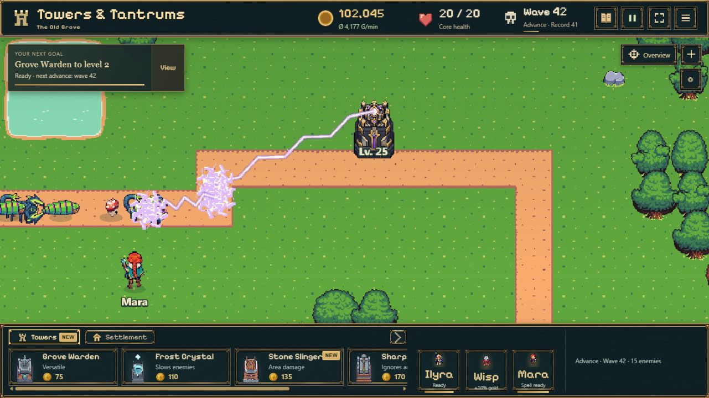

## Erneute Gesamtprüfung aller fünf Türme

[Prüfergebnisse, aktuelle Spielaufnahmen und Main-Übernahmevoraussetzungen](COMBINED_REVIEW.md). 437/437 Tests und alle zusätzlichen Prüfungen erfolgreich; vor einem unveränderten Main-Merge bestehen noch die dokumentierten Produktions-/Preview-Integrationspunkte. Dieser Folgeauftrag ändert keinen Laufzeitcode.
