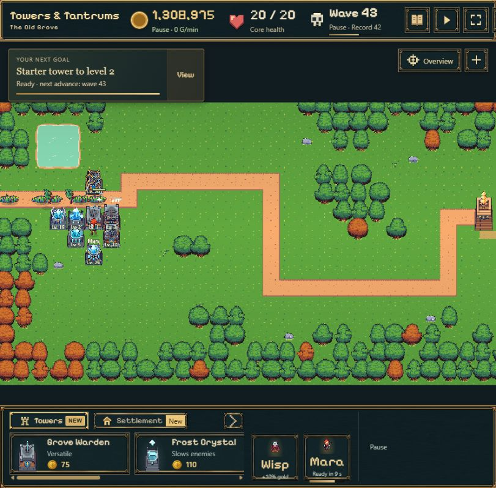

# Isolierter Turmtest · 29.10.2026

- Branch: `codex/tower-evolution-playtest`, Basis `93703cb66e369ed7f3a724f0e42575775cc12bc4` (`main`). Kein Merge nach main.
- [Spielbarer Teststart](https://emfau88.github.io/TD/previews/tower-evolution/tower-test.html) · Öffentlicher Link noch nicht aktiviert: automatische Freigabeprüfung verweigert die neue branchgenaue Pages-Deploymentberechtigung ohne ausdrückliche Nutzerzustimmung. Bestehende Freigabeliste unverändert. [Bereits lokal spielbar](http://127.0.0.1:5192/tower-test.html).
- Beide freigegebenen kompakten Reihen im tatsächlichen Phaser-Spiel: Skins 1/2/3/5/10/15/20/25, ab 25 letzter Skin. Andere Turmarten behalten ihr Rendering.
- Waldwächter: Originalwaffenanimationen 1–3, Rückstoß für neue Waffen; höchstens drei visuelle Pfeile pro Schuss, später 2+1 beziehungsweise 1+1+1. Frost: Originalanimation 1, vorhandene Vorschau-Choreografie 2–25 als einmalig vorbereitete Atlanten, eisblaue Projektile und Einschläge.
- Auswahl verwendet das echte Level; gespeichertes `visualStage`, Turmwerte, logische Projektile, Schaden, Cooldowns, Gegner, Spielstandschema und Offline-Regeln bleiben unverändert. Mehrfachpfeile sind ausschließlich Darstellung eines vorhandenen logischen Schusses.
- Teststarter: gemischte oder sortenreine Aufstellung, alle acht Stufen oder vier Türme einer gewählten Stufe. Synthetische Grafiktests auf Grundlage der dokumentierten Welle-40-Karte, normale Kauf-/Upgradebefehle, 100.000 Restgold. Kein Balancenachweis. Der geschützte Startturm bleibt erhalten.
- Jeder vorbereitete Start erhält einen neuen UUID-Spielstand in `spire-idle-bastion-tower-evolution-*`; auch normale frische Branch-Partien nutzen ausschließlich diesen Namensraum. Hauptspielstände und deren UI-Storyhistorie werden nicht geöffnet. Allgemeine Sprache/Toneinstellungen bleiben browserweit.

## Prüfungen

- Vollsuite **428/428** erfolgreich; zusätzlich nach der finalen Testgeld-Anpassung **7/7** gezielte Tests. Darin alle 27 Szenario-/Stufenkombinationen, echter Kampf, Aufwerten/Verkaufen, Save-Roundtrip, eindeutige pausierte Slots und bytegleicher Hauptspielstand in IndexedDB.
- TypeScript und Vite-Produktionsbuild erfolgreich. Beim erneuten lokalen Verpacken hielt der Python-Testserver eine MP3-Datei offen (EBUSY). Nach Stoppen des Servers `package-pages.mjs` erfolgreich; kein Quellcode- oder Deploymentfehler.
- Echte Browserprüfung: gemischter Kampf auf Desktop und 390/320 px, Pause und Reload mitten in Welle 43 mit gleichen Türmen, Gold und Gegnerzahl. Frost separat mit allen acht Stufen bis Welle 43; alle acht Waldwächter sichtbar und im Kampflauf, zusätzlich vier Level-25-Waldwächter bis Welle 44. Menürückkehr zum Teststarter funktioniert. Keine Browserwarnungen oder JavaScript-Fehler in diesen Spielabläufen.
- Neue Runtime-Dateien: `tower-evolution.ts`, `evolution-view.ts`; kleine Anschlüsse in `battle-scene.ts`, `combat-effects.ts`, `main.ts`. Teststarter, Vite-Eintrag, README und branchgebundene Preview-Veröffentlichung ergänzt. Originalassets nicht verändert; keine Kongregate-Neupackung.

- Zusätzlich **14/14** Prototyp-Tests; Assetprüfungen erfolgreich: 12.607 Frostposen, unveränderte Originalatlanten, maximal 57,96 Kartenpixel Höhe, freie hintere Waffen/Kristalle in allen untersuchten Nachbarpaarungen.

## Sichtbewertung

Alle 16 zugeordneten Skins sind korrekt geladen und sichtbar; kompakte Grundkörper und Waffen sitzen passend zusammen. Frost bleibt durchgehend eisfarben. Beide Reihen funktionieren im echten Kampf, ohne zusätzliche logische Schüsse oder veränderte Trefferwerte. Auf 390 px lassen sich die Stufen gut unterscheiden; 320 px profitiert vom bestehenden Zoom. Späte Waldwächter sind optisch detailreicher und unruhiger als Frost, bleiben aber im genehmigten Größenrahmen.

Der vorbereitete Welle-40-Test ist für Level 25 deutlich unterfordernd: unverändert etwa 15.350 Schaden beim Waldwächter bzw. 7.675 bei Frost; Reichweiten 162 bzw. 156 Kartenpixel. Zusammen mit der Aufstellung am Eingang und dem Hochkant-Ausschnitt können Gegner schon außerhalb des sichtbaren Ausschnitts sterben. Das ist kein neuer Schadens-/Reichweitenfehler. Für besser sichtbare Angriffe einzelne Stufen und die Übersicht verwenden; die ursprünglichen Werte wurden bewusst erhalten.

| Waldwächter, alle acht Stufen, 390 px | Frost, alle acht Stufen, 390 px | Frostkampf bei 320 px |
| --- | --- | --- |
|  |  |  |

## Grenzen

- Bewusst ein Testbranch, keine Produktionsfreigabe. Waldwächter 5–25 behalten den im Prototyp gezeigten einfachen Rückstoß; keine neuen handgezeichneten Waffenframes.
- Echte Kampfzyklen sind kürzer als in der freien Grafikvorschau; die Frostphasen richten sich nach dem vorhandenen Schusszeitpunkt. In dichter Verteidigung können starke Türme Gegner erledigen, bevor hintere Türme schießen. Einzelstufen lassen sich deshalb gesondert starten.
- Auf sehr kleinen Ansichten bleiben hohe Stufen kompakt; die bestehende Zoomfunktion erleichtert die Sichtprüfung. Keine zusätzliche Smartphone- oder Leistungsoptimierung zugesagt.
- Die Vorschau wird neben ein bytegleich geprüftes Main-Pages-Artefakt gelegt. Eine spätere normale Main-Veröffentlichung entfernt diesen temporären Unterpfad; erneuter Workflow-Start auf diesem Branch stellt ihn wieder her. Hauptspiel-Dateien werden beim Preview-Packaging durch SHA-256-Vergleich geschützt.
