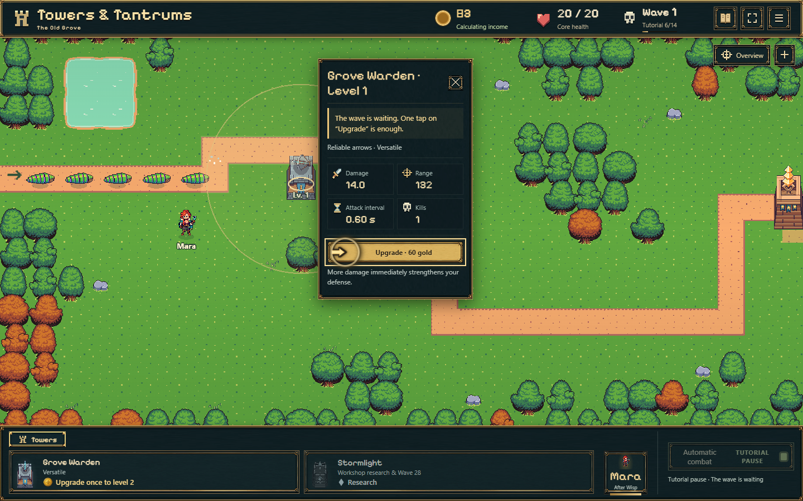

# Kleine Turmwerte-Icons · 27./28.10.2026

Vier dekorative Pixel-SVG-Symbole ergänzen die vorhandenen Beschriftungen und tatsächlichen Zahlen: Schwert/Schaden, Zielkreuz/Reichweite, Sanduhr/Angriffsintervall und Schädel/Abschüsse. Dieselben SVG-Helfer bedienen statische Kontrollsymbole und die dynamisch aktualisierten Turmwerte. Kleine Wertefelder verwenden die vorhandene UI-Palette und Pixelschrift. Keine neuen Rasterassets, Bibliotheken, Kampfregeln oder Saveänderungen.

## Geprüft

Produktionsbuild einschließlich TypeScript erfolgreich. Echte frische Spielstarts mit erstem Turmbau, Öffnen des Turms, vier unterschiedlichen dekorativen Icons, vier erhaltenen Bezeichnungen und funktionierendem Aufwerten geprüft: 1440×900 Englisch, 390×844 Englisch, 320×568 Deutsch. Keine Seitenfehler, keine überlaufenden Wertefelder. Die vorhandenen statischen Menüsymbole bleiben montiert; das entfernte Koordinatenfeld bleibt verborgen.

844×390 Englisch wurde durch Drehen eines im Hochkantformat geöffneten Turmmenüs geprüft, einschließlich Aufwerten und automatischem Fortsetzen. Ein erster automatisierter Direkteinstieg im Querformat traf den Turm über die Pfeilkoordinaten nicht zuverlässig; daraus wird keine bestätigte Querformat-Tutorial-Abnahme abgeleitet. Eine erste Textprüfung erwartete irrtümlich „Attack every“; sie wurde an die bestehende Übersetzung „Attack interval“ angepasst. Keine Spieltexte dafür verändert.

Der [Browsercode](check-browser.mjs) enthält alle vier Profile; die abschließende gezielte [Messdatei](browser-results.json) enthält die Querformat-Nachprüfung. Die drei zuvor bestandenen Profile sind zusätzlich durch die folgenden Screenshots dokumentiert. [Buildausgabe](build.txt).

[Hochkant 390 px](tower-390-en.png) · [320 px Deutsch](tower-320-de.png) · [Querformat](tower-844-en.png)

Browseremulation, keine physische Smartphone-Abnahme. Subjektive Nutzerbewertung offen.

## Tutorial: Befund und Vorschlag, noch keine Änderung

Nach Schritt 9 (Frostturm) setzt das Modell die erste Einführung auf „done“. Die Anschlussführung ist bereits auf „wisp“, aber die Wisp-Karte erscheint erst nach Frostforschung und Sieg über Welle 5. Der Zähler „10/14“ bleibt im kleinen Kopfzeilentext. Vor dem Lager (14/14) entsteht eine vergleichbare Lücke bis zum Sieg über Welle 8. Beim Sparen für Forschung ersetzt außerdem bereits ein kompakter Sparhinweis die größere Lernkarte.

Empfehlung: In allen Zwischenphasen einen schmalen, nicht blockierenden Zielstreifen mit dem vorhandenen Tutorialzähler beibehalten. Zum Beispiel „Tutorial 10/14 · Besiege Welle 5 – danach lernst du Wisp kennen“, darunter den echten Stand „Welle 3/5 gemeistert“. Beim Erreichen des Ziels geht der Streifen automatisch in die nächste Erklärung über. Keine künstlichen zusätzlichen Wartezeiten oder Bestätigungen. Das ist der erbetene Vorschlag, noch nicht umgesetzt.

## Ergänzende Prüfung der vorhandenen Hinweise · 28.10.2026

Die Frost-Kombination stammt unter anderem aus currentGoal() in progress-ui.ts (Frost platzieren, ersten Treffer beobachten, Kombination arbeitet / Welle 5). Diese Zielanzeige steht bereits oben links, wie auch kompakte Lernkarten, Sparhinweise und QuickWinGuidance. Der erste Frosttreffer kann zusätzlich den kurzlebigen combat-message-Hinweis auslösen. main.ts blendet bei aktiver Anschluss-Erklärung Ziel-/Kampfhinweis aus; QuickWinGuidance unterdrückt bei Sichtbarkeit wiederum Zielanzeige, Kampfmeldung und normale Tipps. Vor Wisp bzw. Lager liefert discoveryStep() noch keine sichtbare Erklärung, sodass die vorhandene Zielanzeige dort sinnvoll weiterarbeitet.

Der Vorschlag wurde deshalb präzisiert: die vorhandene Hinweisfläche um Tutorialzähler und die nächste Voraussetzung erweitern; keine weitere unabhängig positionierte Box. Aktive Erklärungen und Frost-/Ausbauhinweise teilen denselben Bereich, mit jeweils nur einer ausführlichen Meldung. Kontextbezogene Frostinhalte bleiben erhalten; in Zwischenphasen zeigt eine kleine Folgezeile beispielsweise „Danach: Welle 5 meistern – Wisp kennenlernen“. Kurze Rückmeldungen werden über die vorhandenen Prioritäten berücksichtigt, keine ungeprüfte zusätzliche Überlagerung. Nur Quellcodeprüfung und Empfehlung, ausdrücklich keine Änderung dieser Hinweise.

## Veröffentlichung

`93e010b` auf Main; [Pages-Lauf 40599673734](https://github.com/emfau88/TD/actions/runs/40599673734) erfolgreich. Die anschließende Live-Prüfung bei 390×844 bestätigt vier unterschiedliche dekorative Icons mit echten Werten, erhaltene Beschriftungen, funktionierendes Aufwerten und automatisches Fortsetzen, ohne Seitenfehler. [Messungen](live-results.json) · [Live-Turmmenü](live-tower-390-en.png).
