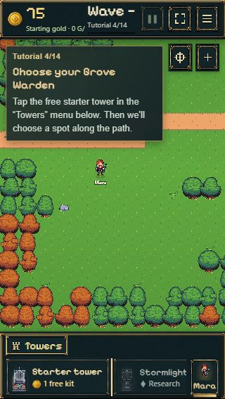
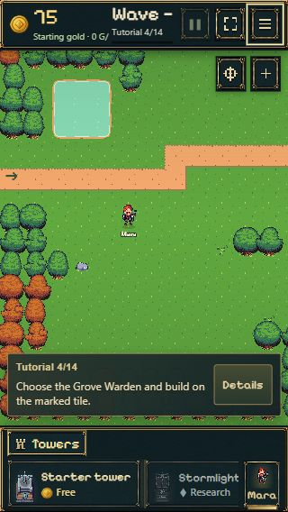

# Tutorialkorrektur · 28.10.2026

Ausgangsbasis: f11fbe2ad69462df574f5257a6cfd6860c0998e3, sauberer und mit origin/main synchroner Main-Checkout.

## Ergebnis

- Aktionsrahmen ziehen sich einmal in 650 ms von 18 auf 3 px Abstand zusammen und pulsieren danach sanft im 2-s-Takt. Keine Größenänderung des Buttons, kein Abfangen von Eingaben. Bei prefers-reduced-motion: reduce bleibt der Rahmen statisch.
- Gemeinsame Tutorialkarte unten mittig, mit Abstand über der Bauleiste. Standardmäßig nur Schrittzähler, nächstes Ziel und „Details“; Erklärungen aufklappbar. Erforderliche Originalbuttons bleiben auch eingeklappt sichtbar und funktionsfähig. Hinweise auf Niederlagen bleiben vollständig lesbar.
- Erklärung bei knapper Höhe intern begrenzt scrollbar; Aktionsbuttons bleiben außerhalb dieses Bereichs. Einklappzustand gilt für die laufende Ansicht, nach Reload wieder kompakt. Kein neues Savefeld.
- Verständliche DE/EN-Texte für kostenlosen Startturm, Werkstatt, Frostkristall und Taverne statt „Kit/Bausatz“. Baukosten, Freischaltungen und Vorräte unverändert.
- Bestehender Frostpfeil und Bauplatzmarkierung erhalten; kostenloser Bau am empfohlenen Platz im Browser bestätigt.
- Zähler bleibt bei 14 Schritten. Keine Änderungen an Kampf, Balance, Offlineabrechnung, Charakteranimationen oder Saveformat.

## Prüfung

- Vollsuite: **421/421 bestanden**, keine übersprungenen Tests ([Log](tests.log)).
- Produktionsbuild einschließlich TypeScript erfolgreich ([Log](build.log)). Ausschließlich normaler Pages-Build; kein Kongregate-Build oder ZIP.
- Vier zusätzliche Regressionstests: Einklappen mit unveränderten Originalaktionen, laufende Ziele/DE-EN-Wechsel, vollständig lesbare Niederlagenhinweise, Integration der Steinschleuder-Hinweise.
- Im Browser entdeckte Zwischenregression vor Veröffentlichung behoben: QuickWinGuidance suchte verschobene Buttons innerhalb ihrer alten Karte. Feste Referenzen auf dieselben Buttons erhalten Updates, Übersetzungen und Eventhandler. Integrationstest und tatsächlicher Übergang zur nächsten Lektion danach erfolgreich.
- Echte Browseransichten: Desktop und 390×844, 360×800, 320×568; kompakt/ausgeklappt, Sprache DE/EN, Tastaturbedienung, Reload, Rückkehrbeleg, Frostplatzierung, Wellenziel, Wisp begrüßen, Maras Aktion, Weiter und Steinschleuder-Hinweis bis Schritt 14. Kein horizontaler Seitenüberlauf bei den gemessenen Mobilansichten. Kompakte Karte dort ca. 62 px hoch, 10 px Abstand zur Bauleiste.
- Frischer Einstieg 1–4 separat bis zur Bauauswahl geprüft. Einzelne Browserautomation-Eingaben hatten CDP-Timeouts; ein vollständiger zusammenhängender Durchlauf 1–14 wird deshalb nicht behauptet. Die Schritte 5–8 sind durch die bestehenden Modell-/Kamera-/Platzierungstests abgedeckt.
- Reduced Motion im CSS berücksichtigt; eine separate Betriebssystem-Emulation wurde nicht durchgeführt.
- Frischer Browserlauf ohne JavaScriptfehler. Nach dem Hinweis-Fix keine neuen Fehler in der fortgesetzten Testpartie.

## Echte Bildschirmaufnahmen

Gleicher Bauschritt, EN, 320×568: Vorheraufnahme aus der vorhandenen Release-Abnahme; Nachher neu aus dem Spiel.

| Vorher | Nachher |
| --- | --- |
|  |  |

Weitere Nachweise: [Desktop](tutorial-after-desktop.png), [390 px](tutorial-after-mobile.png), [Wisp mit Originalaktion, 360 px](tutorial-after-goal-360.png), [Frost-Empfehlung, 320 px](tutorial-after-frost-320.png).

## Geänderte Bereiche

tutorial-guide.ts/css, premium.css, lesson-pointer.ts, quick-win-guidance.ts, Bauhinweise in main.ts, onboarding-ui.ts, hud.ts, progress-ui.ts, englische Übersetzungen, zwei Testdateien und Roadmap. Keine neuen Assets oder Bibliotheken.

## Veröffentlichung und Grenzen

Implementierung als **5bc197b9622067243c99b526b0322b88bbc0d373** direkt auf main gepusht.
[Pages-Lauf 40765706375](https://github.com/emfau88/TD/actions/runs/40765706375) erfolgreich (deploy: 1m18s).
Anschließender Live-Smoke bei 390×844 bestätigt kompakte Karte unten mittig, 650-ms-/2-s-Animation, per Tastatur aufklappbare Erklärung und sichtbare Frost-Bauempfehlung. Keine JavaScriptfehler. [Live-Aufnahme](live-390.png).
Dieser Veröffentlichungsnachweis wird als separater Dokumentationscommit mit übersprungener CI gesichert.
Die neue Position hält den oberen Kampfbereich frei. Eine aufgeklappte Erklärung kann weiterhin einen Teil des unteren Kartenbereichs überdecken; sie bleibt freiwillig und jederzeit einklappbar.
Bestehendes Kongregate-Paket auf ausdrücklichen Nutzerwunsch nicht neu erzeugt und nicht verändert. Keine Einreichung.
