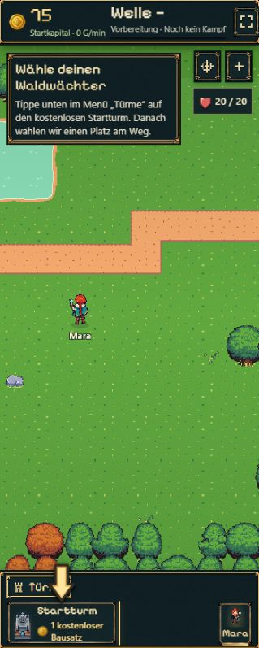
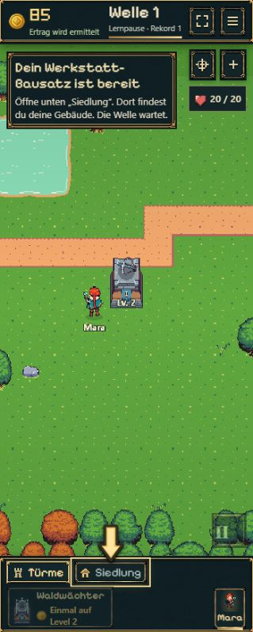
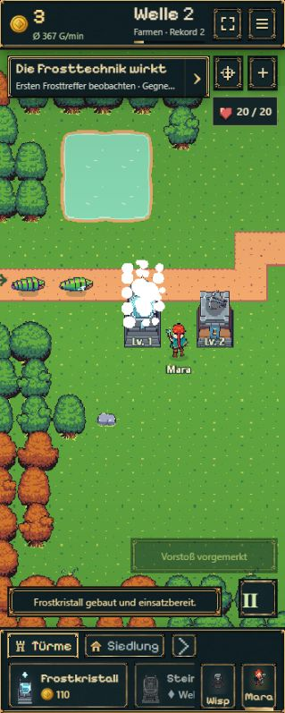

# Tutorialfokus und flüssiger Frostabschluss · 21.10.2026

## Änderungen

- Menüpfeil von 25×38 auf 34×51 CSS-Pixel, Kartenpfeil von 32×48 auf 40×60 vergrößert; dunkler Kontrastsaum und Zielumrandung. Zwei dezente zum Ziel schrumpfende Ringe beim Erscheinen, einmalige Erinnerung nach zehn Sekunden. Kein Dauerhüpfen; reduzierte Bewegung erhält eine statische Markierung. Bestehender Schutz vor Textüberdeckung bleibt erhalten.
- Frostturmauswahl führt weiterhin einmalig zum empfohlenen Platz; normale Turmkäufe behalten ihre Kamera. Frostbau beendet die Anleitung sofort. Kein „Kombination ansehen“ oder „Selbst weiterspielen“ mehr. Beim ersten tatsächlich verlangsamten Gegner erscheint einmalig ein kurzer, automatisch verschwindender Synergiehinweis ohne Lernpause. Wisp-/Mara-/Lager-Anschluss bleibt erhalten.
- Alte gespeicherte Frost-Abschluss-/Beobachtungspausen werden beim nächsten Simulationsschritt ohne zusätzliche Bestätigung abgeschlossen. Keine neuen Savefelder, keine Erstattung oder geänderte Kosten.
- Konkreter Wiederöffnungsfehler: BattleScene speicherte bei `canRender=false` jeden Tap als Koordinate. Während eines Bau-Commits konnte dadurch ein weiterer Tap warten und anschließend als Auswahl des nun vorhandenen Turms wirken. Eine eigene Eingabefreigabe verwirft Taps während Benutzeraktionen; reine Hintergrundspeicherung darf weiterhin einen Tap vormerken. Ein Wechsel des Platzierungsmodus verwirft außerdem alte Koordinaten. Frische Turmauswahl und Auswahl bei manueller Pause bleiben möglich.

## Kompakte Prüfung

- Vier gezielte Tests aus `onboarding.test.ts` bestanden: kompletter legaler Kaufablauf aller Startplätze, Rollback, Lernpause/Reload, Werkstatt-Bausatz. Der Ablauf prüft zusätzlich automatisches Ende, einen einzigen Frosthinweis und alte Abschluss-Saves.
- `node experiments/idle-bastion/scripts/check-tutorial-input.mjs` bestanden: tatsächliche Scene-Eingabemethoden ohne Renderer, Aktionssperre, Hintergrundspeicherung, Moduswechsel/frischer Tap sowie begrenzte Animation und reduzierte Bewegung.
- TypeScript und Produktionsbuild bestanden.
- Reguläre Browserprobe in schmaler Hochkantansicht vom Begrüßen über Startturm/Upgrade/Siedlung/Forschung bis Frostbau; echte Klicks und Kämpfe, kein manipuliertes Gold. Größere Pfeile zeigen auf Startkarte und Siedlung; Kamera kehrt bei Frost-Auswahl zum Bauort zurück. Nach Frostbau freies Spielfeld und automatischer Kampf. Kein physischer Gerätetest.

## Bereits bestehende Testabweichungen

Beim einmaligen Lauf der gesamten alten Onboarding-Datei: 8/11 bestanden. Drei Fehler treten auch mit dem unveränderten `battle.ts` aus Commit `8106dd3` auf (separat abgeglichen):

1. „real v14 veteran …“ vergleicht mit einem alten Schema, ohne später hinzugekommene Tavernen-/Ilyra-/Social-Felder auszunehmen.
2. „schema 15 saves …“ etikettiert einen aktuellen Snapshot als Schema 15 und bildet damit keinen echten alten Datenvertrag ab.
3. „intro command waits …“ erwartet, dass eine zweite Benutzeraktion einer bereits laufenden Benutzeraktion folgt; die heutige Transaktionssperre lehnt diese ab.

Diese Altprüfungen sind nicht als grün ausgegeben und bleiben zur gezielten Bereinigung im B14-Testbestand vermerkt. Keine Änderung der produktiven Migrationen für einen veralteten Test.

