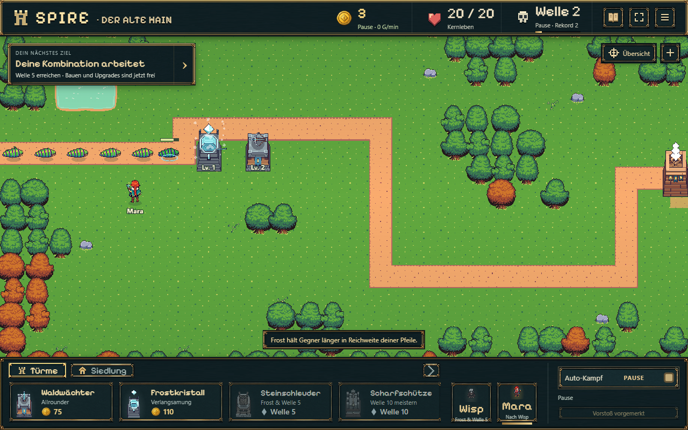
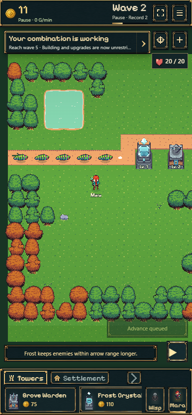

# Q3 · Tutorial-Turmpositionen, Variante B

24.10.2026 · Branch `codex/tutorial-tower-positions` · Basis main `b246605`.
Der Nutzer hat nach dem Vergleich der beiden echten Ingame-Varianten die empfohlene Variante B zur Umsetzung freigegeben und anschließend auch die geprüfte Übernahme nach main ausdrücklich beauftragt. A1 und Q1/Q2 sind bereits Bestandteil dieser Basis.

## Ergebnis

| Empfehlung | Vorher | Variante B |
| --- | --- | --- |
| Waldwächter | Feld (6,6), Welt (260,260) | Feld (10,5), Welt (420,220) |
| Frostkristall | Feld (4,6), Welt (180,260) | Feld (8,5), Welt (340,220) |

Die Türme stehen vier Felder weiter rechts, eine Reihe nördlich und gemeinsam an der kleinen Wegkurve. Der Frostkristall deckt die Gegner vor dem Waldwächter ab. Die vorhandenen Reichweiten überlappen auf dem Weg sinnvoll. Es werden ausschließlich Empfehlungen, das dazugehörige begrenzte Tutorial-Baufenster und dessen Kameraführung angepasst.

Beim fertigen Paar beginnt die erste geometrisch erreichte Reichweite jetzt nach etwa 194 statt 40,5 Weltpixeln Weg. Bei ungebremsten 45 Pixeln/s entspricht das rund **3,4 Sekunden zusätzlichem Anlauf**. Das ist eine geometrische Vergleichsrechnung für Waldwächter Level 2/Frost Level 1, kein künstlich verzögerter Angriff. Die tatsächlichen Browserläufe bestätigen zwei sichtbare, noch unbeschossene Gegner kurz nach dem Wellenstart und die vollständige Anlaufstrecke im Bild.

Auf Smartphones nimmt der Tutorialausschnitt Eingang und Türme gemeinsam auf. Er bleibt nach dem letzten Lernschritt ruhig stehen; Pan wird nicht überschrieben. Gezielter Objektfokus, Übersicht und manuelles Zoomen stellen den normalen Kameramaßstab her. Bei einem gespeicherten Tutorial wird der passende Ausschnitt vor Freigabe des Ladebildschirms gesetzt. Werkstatt und Forschung behalten ihren Objektfokus.

Bereits gebaute alte Starttürme werden nicht versetzt. Für diese bleiben die bisherige Starterfamilie und die dazu passende Frostempfehlung erhalten. Ein alter noch leerer Bauzustand kann das neue Angebot verwenden. Aktuelle Saves akzeptieren beide eng begrenzten Familien; die historischen Schema-Validatoren erhalten ihre alten Grenzen. Keine Schemaerweiterung oder Migration.

**Mara, auf Nutzerfrage nur geprüft:** Ihr bestehender Startplatz (5,7), Welt (220,300), liegt rund 215,4 Pixel vom neuen Waldwächter und 144,2 Pixel vom Frostkristall entfernt. Beide liegen innerhalb ihrer unveränderten 240-Pixel-Zauberreichweite. Daher keine Positions- oder Steuerungsänderung. Eine ausdrückliche Turmzuweisung außerhalb der Reichweite berechnet einen Laufweg bis in Reichweite; die automatische Zauberaktivierung selbst erzeugt keinen neuen Weg.

## Prüfung

- `npm run build`: erfolgreich, einschließlich TypeScript und Pages-Paketierung.
- `npm test`: **319/336 bestanden**, **17 bekannte Altfehler**, keine neuen Fehler, keine Skips. Alle Fehlertitel automatisch mit dem dokumentierten A1/Q1/Q2-Hauptstand verglichen: identisch. Namen stehen getrennt in [test-results.json](test-results.json).
- 13 neue Tests: neue/alte Empfehlungen, sämtliche sechs angebotenen Startfelder überstehen Welle 1 mit 20 Leben ohne Mara, wirklicher Lernablauf mit Reload nach Käufen, unveränderte Ausgaben, historische Saves und ungültige Vorbereitung; Kamerageometrie einschließlich Pixeldichte, tatsächliche Szenenmethoden bei Kandidat/Rotation, Pan und Tutorialende sowie manuellem Fokus/Zoom.
- `node experiments/idle-bastion/scripts/check-tutorial-input.mjs`: bestanden; Kauf-/Speichertaps, Auswahlwechsel, frische Eingaben und Lernpfeil einschließlich reduzierter Bewegung erhalten.
- Reproduzierbarer Browserlauf: [check-q3-tutorial.mjs](../../../../experiments/idle-bastion/scripts/check-q3-tutorial.mjs), Chrome mit Desktop 1280×800/Deutsch und Smartphone-Hochkant 390×844/Englisch. Tatsächliche Buttons, Kartenklicks beziehungsweise Touch und reguläre Spieluhr; keine simulierten Käufe oder beschleunigte Modellzeit. Testinstrumentierung beobachtet ausschließlich die tatsächliche Szene. Details in [browser-checks.json](browser-checks.json).
- In beiden Profilen regulärer kostenloser Startturm, Ready-Reload, Wellenstart, Level-2-Kauf, kostenloser erster Werkstattbausatz, Frostforschung und Frostbau mit 20 erhaltenen Leben. Ausgaben unverändert 0/60/0/60/110 Gold; Desktopaufnahme nach 14 Kills/3 Gold, mobile Aufnahme etwas später nach 15 Kills/11 Gold. Alte leere und bereits bebaute Vorbereitungen bleiben fortsetzbar. Hochkant-Rotation erhält beide vollständigen Turmkörper und 268 Pixel Anlaufstrecke; bewusster Zoom beendet den Tutorialausschnitt korrekt.
- Zwei zusätzliche Proben des tatsächlichen Produktionsbuilds ohne Szeneninstrumentierung: Desktop und Hochkant/Touch, neuer Einstieg, tatsächlicher kostenloser Bau auf (10,5), 75 Gold sowie identischer Ready-Save nach Reload. Keine JavaScriptfehler; vollständiger mobiler Turmkörper und Eingang sichtbar. [Produktionsbelege](production-checks.json).

Keine nativen Smartphonegeräte geprüft; die Hochkantaufnahme stammt aus Chrome mit echter Touch-Eingabe im emulierten Geräteprofil. Neue Bilder, Tavernen-/Charaktersteuerung und andere Pakete sind nicht Teil dieser Änderung.

## Echte Ingame-Aufnahmen

Desktop: tatsächlicher Tutorialdurchlauf mit beiden Türmen und sichtbarem Weg.

Smartphone-Hochkant: derselbe reale Aufbau mit sichtbarer Anlaufstrecke.

Weitere Aufnahmen: [Desktop vor dem ersten Angriff](desktop-de-enemy-approach.png), [Smartphone vor dem ersten Angriff](mobile-en-enemy-approach.png), [gespeicherter neuer Startturm Desktop](desktop-de-new-ready.png), [gespeicherter neuer Startturm Smartphone](mobile-en-new-ready.png), [Smartphone nach Kampf-Reload](mobile-en-combat-reload.png).

## Geänderte Dateien

- `src/tutorial-placement.ts`, `src/battle.ts`: begrenzte Empfehlungen, Starterfamilien und Kompatibilität der Vorbereitung.
- `src/tutorial-camera.ts`, `src/battle-scene.ts`, `src/main.ts`: zu den wirklichen Positionen passender Tutorialausschnitt und Initialisierung beim Fortsetzen.
- `tests/tutorial-placement.test.ts`, `tests/tutorial-camera.test.ts`: Positions-/Save- und Kameraregressionen.
- `tests/browser/q3-session.html`, `tests/browser/q3-session.ts`, `scripts/check-q3-tutorial.mjs`: rein lokale alte Vorbereitungsfixtures und reproduzierbarer tatsächlicher UI-Lauf. Kein neuer Produktions-Einstieg.
- `.gitignore`: lokale Rohprüfdateien ausschließen. `ROADMAP.md` sowie dieser Bericht mit Prüfdaten und Aufnahmen.
