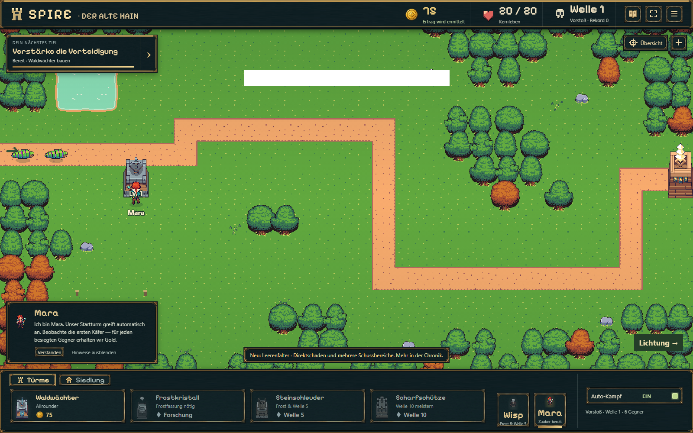
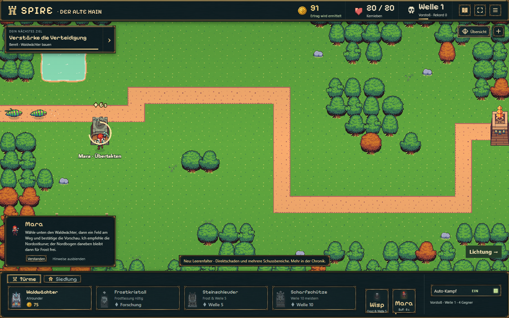

# HUD-Nachbesserung nach B13 — 19.10.2026

## Befund und Korrektur

Der dunkle Balken ist kein leerer Spielstatus. Er wurde im laufenden Chromium/WebGL-Spiel mit dem langen Gegnerhinweis reproduziert: Der untere Hinweis liegt bei x=562…1038, y=802…838; das schwarze Rechteck bei denselben X-Koordinaten und vertikal gespiegelt bei y=162…198. Am oberen Ort liegen keine HUD-DOM-Elemente. Ein kurz erzwungener Neuaufbau der Canvas-Ebene ließ den Fehler nur vorübergehend verschwinden.

Die funktionierende Korrektur setzt ausschließlich den Hinweis (`.combat-toast`) auf Deckkraft 0,999. Das umgeht den beobachteten Fehler bei der Überdeckung des WebGL-Bereichs durch eine vollständig deckende Fläche. Rahmen und Text bleiben praktisch unverändert; Canvas-Auflösung, Kamera, Kampf, Speicherformat und Balance werden nicht angefasst. Keine Engine- oder Treiberänderung.

## Kompakte Prüfung

- `npm run idle:build`: TypeScript und Produktionsbuild erfolgreich.
- Ein frisches Desktop-Profil (1600 × 1000) und ein Hochkant-Profil (430 × 932 CSS-Pixel, Pixeldichte 2), getrennte Probe-Spielstände.
- Reproduktion als reine Darstellungsprobe: vorhandenen Hinweistext „Neu: Leerenfalter …“ setzen und `#combat-message[hidden] { display:block!important; }` kurzzeitig ergänzen. Das ist kein Nachweis, dass der frische Spielstand Welle 28 erreicht hat; Simulation und Saves wurden nicht verändert.
- Im fertigen Build nach 3,5 Sekunden laufender Darstellung beide Aufnahmen ohne schwarzen Balken. Auf der betroffenen Desktop-Zeile: vorher 475 schwarze Pixel im 476 Pixel breiten Bereich, nachher 0.
- Chronik über Goldanzeige geöffnet/geschlossen, Zoom bedient; Desktop zusätzlich Übersicht. Keine Seiten-/Ressourcenfehler, kein horizontaler Seitenüberlauf. Nach Entfernen der Diagnose-Regel verschwindet der Hinweis korrekt.
- [Messdaten](hud-smoke.json). Keine komplette Balance-/15-Minuten-Wiederholung für diese CSS-Änderung. Browseremulation, keine Behauptung eines physischen Handytests.

| Vorher | Nachher |
| --- | --- |
|  |  |

[Hochkantaufnahme](hud-mobile.png)

## Vorschläge getrennt von der Korrektur

Neun normale Gegner plus Rosenspiegel sind in `experiments/idle-bastion/docs/ENEMIES.md` erfasst. Dort stehen auch Mooskröte, Runenschnecke und Wurzeltrommler samt vorgeschlagenem gemeinsamen Produktionsablauf. Die Roadmap beschreibt eine ruhige Begrüßung durch Mara, einen selbst platzierten kostenlosen Startturm und einen ausdrücklichen ersten Kampfstart. Beides ist nur Planung; keine neuen Grafiken, Gegner oder Tutorialmechaniken wurden umgesetzt.
