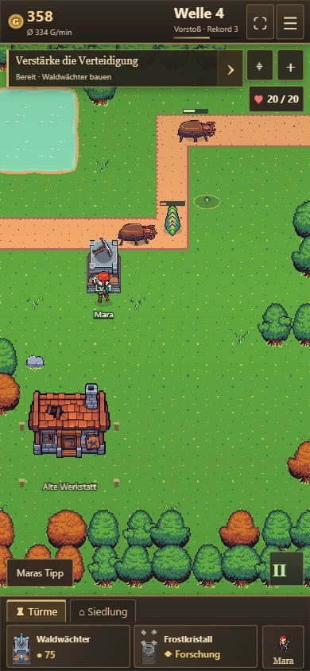

# Mobile-Nachbesserung — mehr Karte, weniger Rahmen

18.10.2026, auf Wunsch anhand des Smartphone-Screenshots. Ausschließlich mobile Darstellung und Bedienung; Kampf, Speicherung und Desktop-Layout bleiben unverändert.

- Statusleiste 56 statt 76 px, Dock 96 statt 132 px. Keine zusätzlichen Safe-Area-Leerflächen im normalen Browserfenster; begrenzte Geräteabstände nur im Vollbild. Die App nutzt die dynamisch verfügbare Fensterhöhe.
- Zielstreifen ohne zusätzliche Überschrift und Fortschrittsbalken; Ziel und Goldbedarf bleiben lesbar.
- Maras Hinweise sind mobil zunächst als „Maras Tipp“ eingeklappt, jederzeit aufklappbar und wieder schließbar. Desktop-Hinweise bleiben wie zuvor.
- Vollbild oben rechts. Die Chronik öffnet sich auf dem Telefon über Gold oder Welle. Ein nicht unterstützter Vollbildversuch zeigt einen verständlichen Hinweis im Menü.

Geprüft: TypeScript/Produktionsbuild; normale Hochkantansicht 390×844 mit rund 692 px Kartenhöhe (vorher 636 px), Hinweis öffnen/schließen, Vollbild ein/aus und Chronik über Wellenanzeige. Keine Browserfehler. Kurze Desktop-Abgrenzung: weiterhin 68 px HUD / 136 px Dock, kein mobiler Tipp-Schalter. Keine zusätzliche Gerätematrix oder Wiederholung der Balancing-/Speichertests. Die Prüfung erfolgte im Browser, nicht auf dem abgebildeten Android-Gerät.

[Playlink](https://emfau88.github.io/TD/idle-bastion/). Veröffentlicht aus `7b74a7b`; [Pages-Lauf 39073600914](https://github.com/emfau88/TD/actions/runs/39073600914) erfolgreich. Die öffentliche Ansicht zeigte den laufenden Kampf, 56 px HUD / 96 px Dock, Vollbild-Schalter und eingeklappten Tipp.