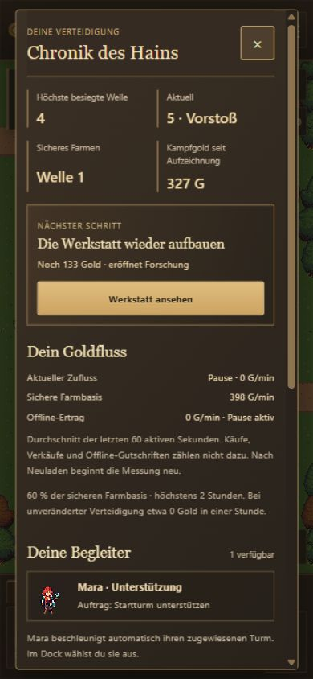

# B07b — Orientierung, Chronik und warme Spieloberfläche

Stand: 17.10.2026. Ergänzt den [B07a-Bericht](REPORT.md). Der verbindliche Paket- und Freigabestatus steht in der [Roadmap](../../../../experiments/idle-bastion/ROADMAP.md).

## Ergebnis

Das HUD zeigt Gold, zuletzt gemessenen Goldzufluss, aktuelle Welle, Vorstoß/Farmen und höchste besiegte Welle. Kernleben bleiben auch hochkant sichtbar. Ein kleiner Zielstreifen zeigt den nächsten sinnvollen Einstiegsschritt, fehlendes Gold und eine direkte Aktion zum passenden Bau-/Forschungsfenster. Details sind über das Buchsymbol oder die Gold-/Wellenanzeige erreichbar.

Die Chronik trennt laufenden Zufluss, sichere Farmbasis und tatsächliche Offline-Rate. Sie zeigt Maras Auftrag, den verfügbaren Begleiter und Wisp ausdrücklich als noch nicht verfügbaren späteren Inhalt. Vorstöße und Farmdurchläufe besitzen getrennte Versuchs-, Sieg- und Niederlagenzähler. Nach einer Niederlage erklärt die Oberfläche den Rückzug und den erhaltenen Ausbau. Holz-/Kohletöne, Bronzekanten und helle Schrift verbinden HUD, Dock und Fenster; vorhandene Originalsprites bleiben die Illustrationen. **Keine neuen Bilder generiert.**

## Daten und Grenzen

- Kampfsnapshot 5, unveränderte Kampfregeln 3. Schema 4 behält Geld, Kampf, Forschung und gültige Farmnachweise. Frühere Versuchszahlen werden nicht aus dem Rekord erfunden. Die erste vollständige gezählte Welle beginnt nach der Migration; die Chronik erklärt den Aufzeichnungsbeginn.
- Einkommen: reguläres Kampfgold, erste Schätzung nach 15 aktiven Sekunden, gleitendes Messfenster bis 60 Sekunden. Käufe, Verkaufserlöse und Offline-Claims zählen nicht dazu. Nach Reload beginnt die kurzfristige Messung neu; die gespeicherte Chronik bleibt erhalten.
- Historie: letzte 100 verschiedene Wellen einzeln, Gesamtsummen darüber hinaus erhalten. Ein laufender Versuch hat zunächst kein Ergebnis. Reload erzeugt keinen weiteren Versuch. Zahlen werden zusammen mit dem Kampfzustand gespeichert und bei fehlgeschlagenem Commit ebenfalls zurückgesetzt.
- Der ursprüngliche `earned`-Zähler enthält auch Offline-Gold. Deshalb verwendet die neue Rate einen eigenen reinen Kampfgoldzähler. Die Wirtschaft selbst wurde nicht geändert.
- Maras Fernunterstützung/freie Bewegung und zusätzliche Handlungsschilder an der Werkstatt bleiben vorgemerkt. B08-Inhalte und G1-Freigabe sind nicht Bestandteil dieser Umsetzung.

## Gezielte Prüfung

- `npm run idle:build`: TypeScript und Produktionsbuild bestanden.
- `npm run idle:test`: **131 Tests bestanden**. Sieben neue Fälle decken Zählung, Niederlage/Farmwechsel, Reload, Migration samt gültigem Farmnachweis, ungültige Historien, begrenzte Aufbewahrung und die Ertragsmessung ab. Bestehende Transaktions-/Offline-/Kampftests bleiben grün. Keine erneute vollständige Balancing-Abnahme.
- Bestehende B07a-Browserpartie wurde mit erhaltenem Wellenrekord 15, Werkstatt und Frosttechnik geladen; die neue Historie kennzeichnet fehlende Altaufzeichnungen. Die zusätzliche abschließende UI-Probe läuft separat unter `?probe=ui-b07b-final`.
- Regulärer Browserablauf bei 1×, ohne Gold-/Zustandsinjektion: Zielaktion → Bauplatzwahl Nordost → Waldwächter → Upgrade. Das nächste Ziel wechselte zur Werkstatt und zeigte den fehlenden Goldbetrag. Die Karte blieb bedienbar.
- Chronik auf Desktop und Hochkant geöffnet, Farmfilter und leerer Zustand geprüft. Pause zeigt 0 G/min live und offline. Reload bei Welle 5: Gold **267**, Kampfgold **327**, **5 Versuche / 4 Siege / 0 Niederlagen** und Pause erhalten. Kein zusätzlicher Versuch; Rückkehrvergütung während Pause 0 Gold.
- Ansichten 1366×768 und 390×844 visuell geprüft, zusätzlich 360×800 ohne horizontalen Dokumentüberlauf. Die Chronik scrollt intern; Kernleben, Buchsymbol, Zielaktion und Pause bleiben erreichbar. Browserkonsole ohne Warnungen/Fehler. Einzelne CSS-Pixel können durch den Browser-Override gerundet werden.
- Hochkantprüfung im Desktop-Browser mit Pointerbedienung. **Keine reale Smartphone- oder iOS-Safari-Abnahme.** Die vorhandenen B07a-Prüfungen decken Kartenziehen und die übrigen Kauf-/Rückkehrabläufe ab.

## Echte Entwicklungsaufnahmen

Die reguläre Partie lief während der Prüfung weiter; die Aufnahmen sind keine neuen Zeitmessungen für G1.

| Hochkant · HUD und Karte | Hochkant · scrollbare Chronik |
| --- | --- |
|  |  |

[Im Browser testen](https://emfau88.github.io/TD/idle-bastion/) · [Unabhängige frische Probe](https://emfau88.github.io/TD/idle-bastion/?fresh=1). Veröffentlicht aus `2c96642` einschließlich B07a `d0566cf`: [GitHub-Pages-Lauf 39072783215](https://github.com/emfau88/TD/actions/runs/39072783215) erfolgreich. Auf der öffentlichen URL wurden der laufende Kampf, der gemessene Goldzufluss, Wellenrekord und die geöffnete Chronik bestätigt; Konsole ohne Warnungen/Fehler.
