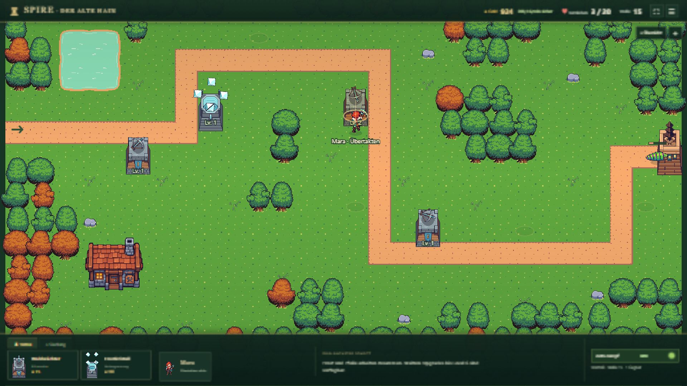

# B07a — Karte, Dock und funktionale Hochkantansicht

Stand: 17.10.2026. Technischer UI-Nachweis; G1 bleibt eine offene Nutzerabnahme. Paketstatus und vorgemerkte Folgeideen stehen ausschließlich in der [Roadmap](../../../../experiments/idle-bastion/ROADMAP.md).

## Änderung

Die Welt verwendet die verfügbare Fensterfläche. Eine schmale Statusleiste und ein kompaktes Baudock ersetzen den äußeren Seitenrahmen und die dauerhafte Detailleiste. Auf Desktop nimmt der Bereich zwischen HUD und Dock bei 1366×768 ungefähr 75 %, bei 1920×1080 ungefähr 81 % der Höhe ein. Ein ausgewählter Turm oder ein Gebäude öffnet ein schließbares Kontextfenster; Speicherinformationen und Hilfe liegen im Menü. Die Kartenillustrationen verwenden vorhandene Spielsprites. Es wurden keine neuen Bilder generiert.

Hochkant zeigt die Kamera einen lesbaren Ausschnitt, der sich horizontal verschieben lässt. Bau-/Figurenkarten fokussieren den passenden Bereich. Große Schaltflächen für freie Bauplätze ergänzen das Antippen der Karte. Details erscheinen oberhalb des Docks; die Übersicht zeigt die ganze Welt und „+“ wieder den nahen Ausschnitt. Pause/Fortsetzen ist als eigenes Symbol erreichbar. Geräte-Schutzabstände werden berücksichtigt, native Auswahlelemente nutzen 16-px-Schrift gegen automatisches Browser-Zoomen.

Preise, Forschungsbedingungen, Mara-Verhalten und Speicherformat wurden nicht geändert. Zusätzlich wurde ein beim Browserdurchlauf gefundener Speicherfehler behoben: Der nicht mehr benötigte Spawn-Timer lief nach dem letzten Gegner weiter ins Negative. Ein durch Frost verlängertes Wellenende überschritt dadurch die zulässige Speichergrenze. Der Timer wird bei leerer Spawn-Warteschlange nun auf null gesetzt, ohne Spawn- oder Kampfabläufe zu verändern. Die neue Gestaltung bildet die vorhandenen B07-Funktionen ab; B08-Inhalte und die neu diskutierte Fernunterstützung sind nicht umgesetzt.

## Tatsächlich geprüft

- `npm run idle:build`: TypeScript und Produktionsbuild bestanden, auch nach dem letzten Kamerafix.
- `npm run idle:test`: 124 Tests bestanden, einschließlich einer neuen Regression mit regulär finanziertem Frost-Ausbau und fortlaufender Speicherprüfung bis Welle 16. Der Fehler war zuvor bei Welle 15 nach 501,575 Simulationssekunden reproduzierbar. Keine Wiederholung des vollständigen 90-Sekunden-Balancingtests.
- Reguläre Browserpartie `?probe=ui-b07a-1` bei 1×, ohne Ressourcen-/Zustandsinjektion: Waldwächter über Dock und Kartenklick gebaut, aufgewertet, Mara zugewiesen; Werkstatt für 400 Gold repariert und Frostfassung für 60 Gold erforscht.
- Bei 390×844 Frostkristall für 110 Gold über „Nordwest“ gebaut. Einen Waldwächter an der Südkurve gebaut und verkauft; Auswahlwechsel über das native Bauplatzfeld geprüft.
- Ziehen verschiebt die Karte ohne Kauf oder Goldänderung. Übersicht, Rückkehr zum Ausschnitt und Wechsel zwischen Hoch-/Querformat geprüft. Die anfängliche Ausrichtung der kleinen Gesamtübersicht wurde auf eine mittige Darstellung korrigiert.
- Pause blockiert Käufe und zeigt den Grund. Nach Fortsetzen ist ein regulärer Kauf wieder möglich; Bauhilfe und Kontextfenster überlagern sich dabei nicht.
- Reload aus Pause: gleiche Welle und gleiches Gold wiederhergestellt; Rückkehr zeigte 0 Gold für die pausierte Abwesenheit. Forschung, Türme und Werkstatt blieben erhalten. Rückkehraktion, Menü und sichere Farmbasis im Menü geprüft.
- Ansichten: 1366×768, 1920×1080, 390×844, zusätzlich 360×800 und 844×390. Bei 360×800 und 844×390 kein Überlauf des Dokuments über den Viewport. Größenangaben sind Zielmaße des Browser-Overrides; einzelne Maße werden intern auf den nächsten CSS-Pixel gerundet.
- Browserkonsole nach den Bedienabläufen ohne Warnungen oder Fehler.

Die Hochkantprüfung erfolgte im Desktop-Browser mit schmalem Viewport und Pointerbedienung. **Kein reales Smartphone, kein iOS-Safari- und kein Multitouch-Test.** Funktionales Hochkant ist damit eine überprüfte Layout-/Bediengrundlage, keine vollständige Mobile-Abnahme. Das Weltbild in der expliziten Übersicht ist auf dem Telefon absichtlich klein; für normales Spielen dient der verschiebbare Ausschnitt.

## Aufnahmen

Echte Aufnahmen der regulär gespielten UI-Probe. Die Spielzeit lief während der Prüfung weiter; diese Bilder liefern keine neuen Meilensteinzeiten.

| Bauplatzwahl 390×844 | Kontextaktionen 390×844 |
| --- | --- |
|  |  |

## Offene Einordnung

Die vorhandene sichere Farmrate ist weiterhin keine Messung des laufenden Goldzuflusses. Fortschrittsübersicht und Versuchshistorie wurden anschließend als B07b beauftragt. Verständlichere Werkstattkennzeichnung und Maras Fernunterstützung bleiben vorgemerkt. Dieser Bericht beschreibt den B07a-Zwischenstand; die Karte bleibt auch im folgenden Paket Hauptfläche.

[Playlink](https://emfau88.github.io/TD/idle-bastion/) · [Unabhängige frische Probe](https://emfau88.github.io/TD/idle-bastion/?fresh=1). B07a wurde zusammen mit B07b veröffentlicht; aktueller Nachweis einschließlich Pages-Lauf unter [B07b](PROGRESS.md).
