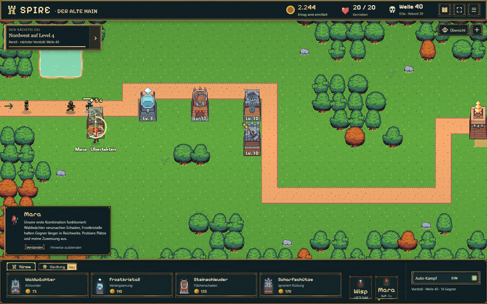
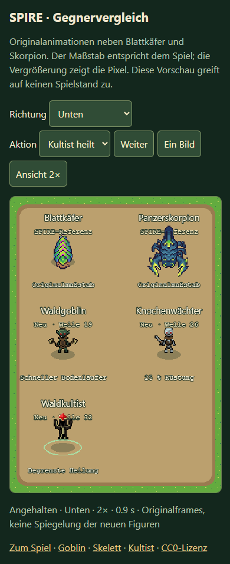

# W01 — Wave-Rework und drei zusätzliche Gegner

Stand: 23.10.2026. Ausgangspunkt: veröffentlichter `main` **76c114e**. Ergebnis im separaten Branch `codex/wave-rework`, Arbeitsverzeichnis `.worktrees/wave-rework/`. Bestehende lokale Tavernenarbeiten wurden nicht übernommen oder verändert. Eigene Sichtprüfung durchgeführt; visuelle Nutzerabnahme offen. Kein Nachweis einer ausgeglichenen Endlosprogression.

## Implementiertes Ergebnis

Vier Familien aus einem kleinen Rezeptbaukasten ersetzen die Viererrotation. Mengen berücksichtigen HP, Rüstung und Tempo, ohne die bestehende HP-Grundkurve oder bisherige Gegnerwerte zu ändern. Zwei bis drei Arten pro Welle, höchstens 28 Einheiten und insgesamt zwei Heiler. Neue Arten erscheinen genau zweimal und direkt in der nächsten regulären Welle erneut. Eine kurze, deterministisch abgeleitete Historie bevorzugt länger nicht eingesetzte Arten; sie hängt weder von Sitzung, Uhrzeit, Zufall noch Farmversuch ab. Der Cache enthält höchstens 33 normale Einstiegsrezepte und ein weiteres Rezept jenseits von 40.

Der Skorpion startet jetzt mit zwei statt fünf Exemplaren. Die Wespe wird nach Welle 9 bereits in 10 wiederverwendet. Keine unmittelbar nahezu gleiche Zusammensetzung mit demselben Rhythmus; keine wiederkehrende Viererfolge. Die bestehende erste Fünferfolge und beide Bossrezepte bleiben exakt erhalten. Welle 40 verwendet Knochenwächter, Goblins und Kultist mit erhöhtem Budget/Prämie; das HUD nennt sie im Vorstoß „Elite“. Keine neue Bossfähigkeit, Ostfront oder zusätzliche Turm-/Gebäudefunktion.

| Beispiel | Zusammensetzung | Rhythmus |
| --- | --- | --- |
| Schwarm, z. B. 26 | 16 Blattkäfer, 6 Goblins, 2 neue Knochenwächter | Vierer-/Fünfergruppen; 0,34 s innerhalb, 1,45/1,6 s zwischen Gruppen |
| Ansturm, z. B. 19 | 15 Heuschrecken, 5 Wespen, 2 neue Goblins | Zweier-/Dreiergruppen, 0,48 s innerhalb |
| Panzer, z. B. 11 | 10 Blattkäfer, 2 neue Skorpione | Gleichmäßige 0,95/1,1 s |
| Unterstützung, z. B. 32 | 8 Magmakrabben, 2 neue Kultisten | Kleine Gruppen, 0,45 s innerhalb; Heiler in der Gruppe |
| Elite 40 | 7 Knochenwächter, 8 Goblins, 1 Kultist | 1,1 s; längere robuste Gruppe, höhere Prämie |

Vollständige abgeleitete Daten 1–40 einschließlich Vergleich zu Regeln 10: [balance-results.json](balance-results.json). Die Tabellenbeispiele sind keine separat programmierten Wellen.

## Gegner und Originalgrafiken

| Typ | Einführung / Wiederholung | Basiswerte | Quelle |
| --- | --- | --- | --- |
| Waldgoblin | 19 / 20 | 36 HP, Tempo 66, keine Rüstung, 13 Gold | Foozle Goblin Berserker |
| Knochenwächter | 26 / 27 | 55 HP, Tempo 44, 25 % Rüstung, 17 Gold | Foozle Skeleton Grunt |
| Waldkultist | 32 / 33 | 42 HP, Tempo 39, keine Rüstung, 18 Gold | Foozle Cultist |

Die beiliegenden Readmes aller tatsächlichen Downloads wurden auf CC0 und kommerzielle Nutzung geprüft. Originalarchive und Lizenzen bleiben im Repository. [Vollständige Quellen, Lizenznachweise, SHA-256 und Importvertrag](../../../../experiments/idle-bastion/assets/lucifer/README.md).

Zuerst Goblin neben Blattkäfer und Skorpion geprüft; danach die weiteren Figuren integriert. Originale PNG-Pixel und Aseprite-Bewegungszeiten, echtes Oben/Unten/Rechts/Links. Keine neue Zeichnung, Glättung, Verzerrung, Todes- oder zusätzliche Angriffsmechanik. Kultist verwendet wenige vorhandene Aktionsframes für die bereits vorhandene Heilaktion. Laufzeit-PNGs insgesamt **22.477 Bytes**; Originalarchive werden nicht zusätzlich vom Spiel geladen.

Die separate **enemy-check.html** verwendet dieselben Framefunktionen und Maßstäbe wie das Spiel. Kurvenstrecke, vier Ansichten, Heilaktion, Pause, Einzelbild und 1×/2×. Mobile Ansicht zeigt Referenzen und neue Figuren in mehreren Reihen. Kein Savezugriff.

## Balance und Wirtschaft

Drei bezahlte Modellstrategien auf dem aktuellen 40×16-Layout. Ein Kaufbefehl pro Sekunde, normale Preise/Freischaltungen, keine Zusatzwährung oder Offline-Boni. Der Kampf-Konstruktor startet mit dem kostenlosen Startturm und 75 Gold; Lese- und Tutorialbedienung wird nicht als Echtzeit-Spielprobe ausgegeben. Die Messstrategie wurde für dieses bereits große Layout korrigiert: Sie wartet nicht auf den dort nicht verfügbaren alten Lichtungskauf. Dadurch wird keine Ostfront implementiert.

| Strategie | Boss 15 | Boss 25 | Welle 40 | Niederlagen | Verteidigung am Ende |
| --- | --- | --- | --- | --- | --- |
| Ausgewogen | 5:07 | 9:53 | **19:16** | 0 | 2 Waldwächter 10, Frost 3, Stein 10, Scharfschütze 10 |
| Bogenschützen | 4:10 | 8:29 | **17:13** | 0 | 3 Waldwächter 10, Frost 3, Stein 10, Scharfschütze 9 |
| Zwei Steinschleudern | 4:50 | 9:18 | **17:43** | 0 | 2 Waldwächter 10, Frost 3, Stein 10/9, Scharfschütze 9 |

Das sind Simulationszeiten, keine drei entsprechend langen Browserdurchläufe. Käufe, Meilensteine, erste Abschlusszeiten und Belohnungen sind in `played-*.json` dokumentiert. Mara arbeitet regulär; Ilyra ist keine Voraussetzung. Turmmaximum 20 wird nicht benötigt.

Zusätzlich **180 feste Vergleichskämpfe**: drei erspielte Aufstellungen, je ein mittlerer und später Ausbauzustand, Wellen 26–40 und beide Rezeptversionen. Keine Mara-/Ilyra-Fähigkeiten in diesen Vergleichen. Von 90 neuen Kämpfen gewinnen 81, davon 45 vollständig schadensfrei; vorher 57 Siege, 36 schadensfrei. Mit den drei späteren Aufstellungen gewinnen alle 45 neuen Kämpfe, 31 davon schadensfrei. Mittlere Verteidigungen benötigen weiterhin Ausbau; ein normaler Sieg ist kein Farmnachweis.

Das diagnostische rüstungsbereinigte HP-Volumen von 29 auf 30 steigt jetzt um **11,97 %** statt **140,28 %**. Tempo, Heilung, Zielwahl und Fläche machen diese Kennzahl allein noch nicht zum Schwierigkeitsmaß. Bei derselben späten ausgewogenen Verteidigung liegen die neuen Raten ungefähr bei 4.113 G/min in 29 und 3.811 G/min in 30. Panzer-/Unterstützungsmischungen erhalten angepasste Abschlussprämien; Kill-Gold, Wisp und Bruchteilabrechnung bleiben im bestehenden Belohnungspfad.

Farmproben bleiben bei maximal vier Kandidaten mit je zwei schadensfreien Durchläufen und normaler Wellenpause. Historische Offline-Erträge bleiben nachweisgebunden. Keine Änderung an Offline-Effizienz oder Lagerlimit.

## Speicher- und Regressionsergebnisse

Vor dem Rework wurde die veraltete Schema-16-Erwartung des vorhandenen Gegner-Migrationstests auf den damaligen tatsächlichen Stand 24 korrigiert: **7/7 bestanden**, ohne Entfernen der Speicherprüfungen. Nach Versionierung erwartet er nun den exportierten aktuellen Stand 25 und prüft weiterhin exakte Queue/Geschosse/Gegner/Geld sowie den Wechsel erst am nächsten Versuch. Der ähnliche B13-Test wurde entsprechend gepflegt; Zukunftsschutz-Tests verwenden wieder tatsächlich unbekannte Versionen.

Aktuell **Snapshot 25 / Kampfregeln 11**. V24 wird zunächst unter seinen Originalregeln validiert. Laufende alte Wellen behalten Anzahl, Queue, Timer, Gegnerwerte, Heilzustände, Schüsse und Goldrezept. Alte Regeln 3–10 bleiben verfügbar; alle 40 historischen Rezepte wurden gegen einen aus dem unveränderten Hauptstand gewonnenen Nachweis verglichen. Nur aktuelle Farmbelege verfallen; gespeicherte historische Offline-Grundlagen bleiben gültig. Ein echter V24-Zustand und eine native IndexedDB-/Session-Prüfung sichern den einmaligen historischen Offline-Claim ab. Beide Heiler teilen Zielsperren, dürfen einander nicht heilen und überstehen Pause/Reload ohne doppelten Puls.

- [Sieben neue Wellen-/Heiler-/Atlas-/Speicherprüfungen](wave-tests.txt): **7/7 bestanden**, einschließlich früher Wiederholung neuer Arten, regelmäßiger älterer Arten, ähnlicher Nachbarwellen und umgekehrter Abfragereihenfolge.
- [Breiter relevanter Vergleich](focused-tests.txt): **96/102 bestanden**. Unveränderter Ausgangsstand derselben vorhandenen Dateien: [85/95 bestanden, zehn Fehler](baseline-focused-tests.txt). Sieben neue Tests, vier korrigierte veraltete Erwartungen, **keine zusätzliche fehlgeschlagene Testbezeichnung**.
- Die verbleibenden sechs Fehler sind bereits auf `main` vorhandene Legacy-/Tutorial-Fixtures in `onboarding.test.ts` und `save-store.test.ts`: V14-Schema-Vergleich; synthetische Schema-15-Vorbereitung; gleichzeitiger Intro-/Hintergrundschreibbefehl; altes Envelope-1- und Schema-2-Testmodell; früher Mara-Regelwechsel. Diese Matrix ist ausdrücklich nicht vollständig grün. Eine pauschale Abschwächung oder Bereinigung fremder Tests erfolgte nicht.
- [Produktionsbuild](build.txt): TypeScript und Vite/Pages-Paket erfolgreich. Neue Vorschau ist enthalten; alte `/idle-bastion/`-Links erhalten weiter Query/Hash.
- [Browserprüfung](browser-results.json): reales Phaser-Spiel und Vorschau, Desktop 1600×1000 und Mobilansicht 390×844, vier Richtungen/Heilaktion/Einzelbild, sechs Spielansichten, tatsächlicher Kampfstart/-pause und exakter Reload von Geld/Versuch/Spawnliste auf beiden Ansichten. Keine Seitenfehler oder HTTP-Fehler.

## Tatsächliche Spielaufnahmen

Die Saves stammen aus dem bezahlten Modelllauf, werden ausschließlich in isolierte Probe-Slots eines separaten Browserprofils geladen und im echten Spielrenderer dargestellt. Keine Verwendung des privaten Nutzer-Spielstands. Mobil wurde die Karte über die normale Ziehbedienung zu den Gegnern verschoben.

[Goblin, Welle 19](game-wave19-desktop.png) · [Knochenwächter, Welle 26](game-wave26-desktop.png) · [Kultist, Welle 32](game-wave32-desktop.png) · [Elitewelle 40](game-wave40-desktop.png) · [Kultist mobil](game-wave32-mobile.png) · [Elite mobil](game-wave40-mobile.png).





## Grenzen und Reproduktion

Eigene Sichtprüfung ist abgeschlossen, Nutzerbewertung von Stil und Spielgefühl bleibt offen. Mobil ist eine Chrome-Emulation, kein echter Smartphone-/GPU-/Akkutest. Die subjektive Langzeitbalance und die sechs genannten vorherigen Legacy-Fixtures bleiben offen. Stärkere Wellen können für eine unterausgebaute Verteidigung weiterhin schlechtere Farmraten ergeben; das Zertifikat bevorzugt die beste bewiesene Rate unter seinen begrenzten Kandidaten und garantiert kein globales Optimum. Nach Migration kann die Farmbasis bis zum neuen Nachweis vorübergehend sinken. Bestehendes Gold, Fortschritt und historische Offline-Ansprüche gehen dadurch nicht verloren.

Reproduktion ab Repositorywurzel:

```
python experiments/idle-bastion/scripts/pack-lucifer.py
node --import tsx --test experiments/idle-bastion/tests/wave-rework.test.ts
node --import tsx experiments/idle-bastion/tests/helpers/measure-wave-rework.ts
npm run build
```

Browserprüfung: `tests/browser/wave-rework.ts`, `PLAYWRIGHT_MODULE` zeigt auf ein installiertes Playwright-ESM-Modul, `CHROME_PATH` optional auf Chrome, `SPIRE_TEST_URL` auf den lokalen Dev-/Previewserver. Ergebnisgrafiken und Messdateien werden in diesem Verzeichnis aktualisiert. Lokale ausgelieferte Vorschau: `/enemy-check.html`, Spiel: `/`.
