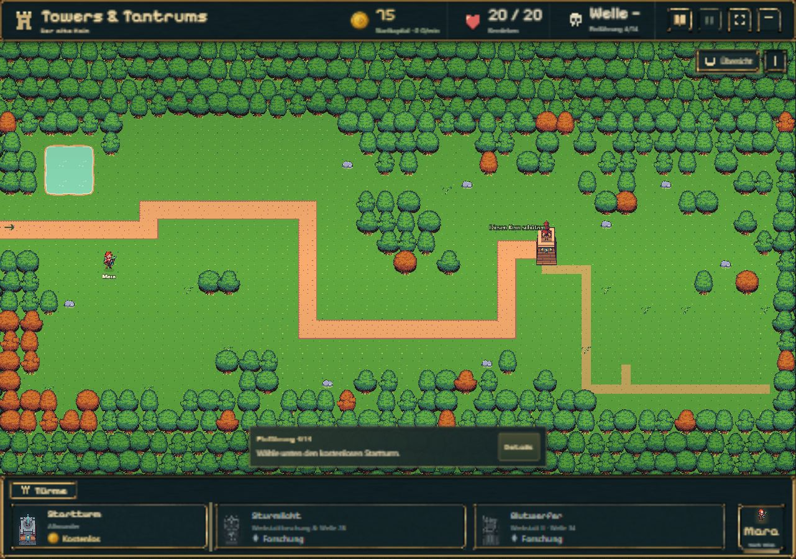
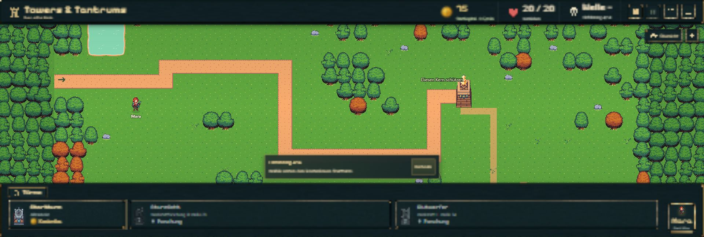
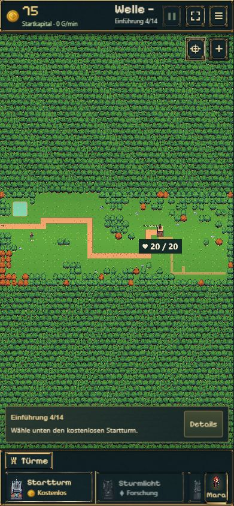
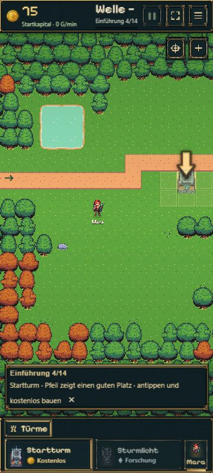

# Waldkanten · 08.11.2026

Auftrag: die geraden Schnittkanten im Hintergrundwald minimalinvasiv korrigieren, ohne Wege oder Bauflächen zu verändern; Desktop/Handy prüfen, anschließend committen und pushen.

Die vier bisherigen Außenstreifen enthalten jetzt ausschließlich Hintergrundgras. Vollständige vorhandene Baumframes bilden den Wald darüber; sie werden nicht mehr an den rechteckigen Kartengrenzen abgeschnitten. Kleine feste Versätze erzeugen eine unregelmäßige Silhouette. Dekorative Bäume überlappen die eigentliche Karte nur dort, wo bereits Baumfelder liegen. Selbst die transparenten Ecken ihrer Bildrechtecke dürfen kein freies Feld überdecken. Sie sind nicht interaktiv und werden nicht Teil der Navigation oder der Bauprüfung.

Geändert sind nur `forest.ts` und die kleine reine Geometriefunktion `forest-backdrop.ts`. `forest-world.ts`, `layout.ts`, Kamera, Wege, Hindernisse, Bauflächen, Spielregeln, Speicherformat und Originalgrafiken bleiben unverändert. Zusätzliche Dekoration wird nur beim Wechsel der benötigten Randgröße neu aufgebaut und beim Szenenende freigegeben. Ihre Positionen bleiben bei Größenwechseln stabil; keine Berechnung pro Animationsframe.

## Prüfung

- `node --import tsx --test experiments/idle-bastion/tests/forest-backdrop.test.ts experiments/idle-bastion/tests/forest-world.test.ts`: **4/4 bestanden**. Alle fünf Kartenfassungen: Rechteckprüfung gegen jedes Kartenfeld verhindert jede Überdeckung eines Nicht-Baum-Feldes; Layout und Terrain bleiben identisch. Stabile Dekorpositionen bei größerem Bildausschnitt. Vorhandene Tests bestätigen weiterhin erreichbare Bau-/Gebäudezugänge und unveränderte Hindernisse.
- `npm run build`: **bestanden**; TypeScript, Vite und Pages-Paket erfolgreich.
- Tatsächlicher Browserablauf mit frischem separatem Teststand: Desktop-Vorgaben **1280×900** und **1920×650**, Hochformat **390×844** und **360×800**. Gemessene CSS-Maße bis auf einen Rundungspixel passend. Die Browserprüfung erfolgt in Chromium mit Handy-Viewport, nicht auf einem physischen Smartphone.
- Desktopübersicht: obere freie Baumkante und unterer Anschluss vollständig; breite Ansicht: ganze seitliche Baum-Silhouetten statt senkrechter Schnitte, Wegeingang frei. Handy: Übersicht, normaler Zoom und Startturm-Auswahl zeigen freie Weg-/Bauflächen sowie intakte obere/untere Randbäume. Kein Turm und kein Gebäude wurde für diese Prüfung verändert.
- Keine Warnungen oder Fehler im Spielkonsolenprotokoll. Die Browser-Automation hatte zunächst Probleme mit dem vorhandenen Seitenzoom; nach Normalisierung wurden die tatsächlichen CSS-Abmessungen überprüft. Einzelne spätere Automationsklicks meldeten einen CDP-Timeout; die anschließend gelesene Spielansicht blieb intakt. Prüfviewport zurückgesetzt und eigener Prüftab geschlossen.

## Aufnahmen

Desktop, obere und untere Kante:

Breite Ansicht, linker und rechter Rand:

Handyübersicht und Bauauswahl:

