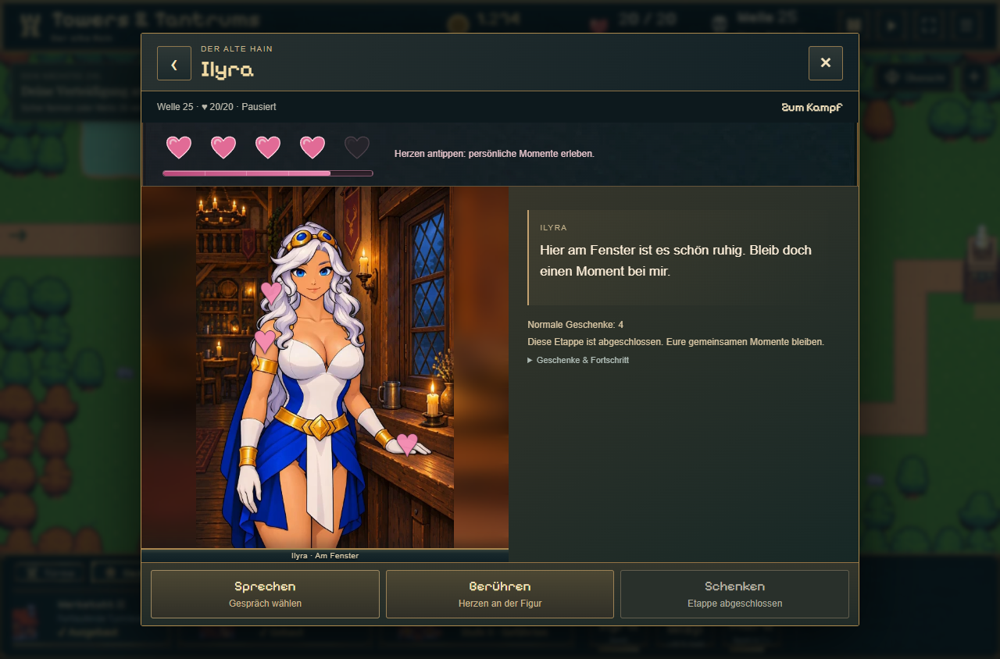
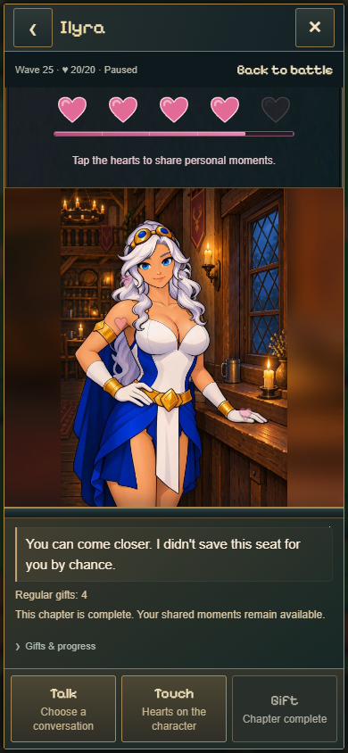

# Ilyras Fensterplatz und gemeinsame Main-Lieferung · 07.11.2026

Nutzer hat IF05 ausdrücklich freigegeben, IF01–IF05 zur Integration und den gesamten noch offenen Tavernen-/Turmstand zur Übernahme nach Main beauftragt. Weitere Clips bleiben gestoppt; IF06 wurde nicht gestartet.

## Änderung

- Alle fünf freigegebenen Fensterclips unverändert importiert, insgesamt 2.680.612 Byte. IF01 ist die korrigierte v2. [Prüfsummen](import.json).
- Für bereits verdientes Herz 4/5 über **Sprechen → Zum Fenster** erreichbar. Eigene Szene, Hintergrund, Ruhepose und Berührungspunkte. Gespräch/Geschenk → IF02, Haare → IF03, Schulter → IF04, Hand → IF05; danach IF01.
- Der ausdrücklich beauftragte Einbau des vorhandenen Basissatzes ersetzt die ältere Planvorgabe, mit Ilyra bis IF07 zu warten. IF06/Lachen und IF07/Annäherung werden nicht vorgetäuscht: diese beiden Aktionen fehlen am Fenster, bleiben am bisherigen Platz verfügbar. Kein Rückfall auf einen Clip aus dem falschen Raum.
- Vor Ortswechsel Ruhevideo und Hintergrund laden; bei Fehler bisherige Szene erhalten. Figurenwechsel/Schließen verwirft ausstehende Downloads. Persönliche Rückblicke nutzen ihre ursprüngliche Bühne und kehren danach zum Fenster zurück.
- Bestehende zufällige Reaktionsstimmen aus Ilyras Pool bei allen drei Berührungen erhalten. Keine neuen Audiodateien oder veränderte Tonregeln.
- Keine Änderung von Fortschrittsbedingungen, Geschenkzahlen oder Speicherformat. Die neue Herz-3→4-Strecke und spätere Inhalte bleiben geplant.

## Prüfung

32/32 gezielte Tests zu Szenenkatalog, Medien, Stimmen, Sozialfortschritt und Rückblickhistorie bestanden; TypeScript und normaler Produktions-/Pages-Build bestanden. Echte gebaute Oberfläche mit beiden Figuren auf Desktop 1280×844 und Handyformat 390×844, DE/EN: 18.316 untersuchte Anzeigeframes. Kein beobachteter schwarzer/transparent gefüllter Rahmen, falscher Raum, Größenwechsel oder Browserfehler. Alle vorhandenen Rollen, Rückkehr zur Ruhe, persönliche Geschichten, Wechsel zum ursprünglichen Platz und Reload geprüft. [Produktionsfälle](production/results.json).

Ilyra: 269 beobachtete Framefortschritte auf Desktop und 266 im Handyformat; dabei kein übersprungener nativer Frame zwischen aufeinanderfolgenden Stichproben derselben Reaktion. Native24FPS, keine Hochrechnung auf60FPS. Das ist eine lokale Chromeprüfung, keine Garantie für jedes Endgerät. Die tatsächlichen Screenshots wurden ebenfalls angesehen.

Ladefehler/Wiederholung, Abbruch durch Figurenwechsel, Herz-3-Sperre, drei Stimmenaufrufe aus Ilyras Pool und fehlende Aktionen ohne versehentlichen Ton separat geprüft: [Verhalten](behavior.json).

## Branchabgleich

Aktueller Remote-Main `dde9e79a` wurde vor der Integration übernommen. Die Frostkörper-/Scharfschützenkorrektur `4d771b86` und deren Veröffentlichungsdokumentation sind bereits enthalten. Zusätzlich aus diesem Arbeitsbranch: vollständige Mara-Tresenszene, geprüfte Fensterclips, gemeinsame Testansicht, aktuelle Dokumentation. Keine offenen aktuellen Tavernen-/Turm-Laufzeitcommits außerhalb dieses Standes gefunden. Der separate Archivbranch `codex/tavern-backup-ab9e5cf` enthält alte Rig-/Unity-Produktionssicherungen vom23.10.; er bleibt als Archiv erhalten und ist kein ausstehender Spielfix. Unabhängige Änderungen im alten Wurzelcheckout werden nicht mitveröffentlicht.

Main-Push und öffentlicher Deploy: Nachweis wird nach Abschluss ergänzt.

