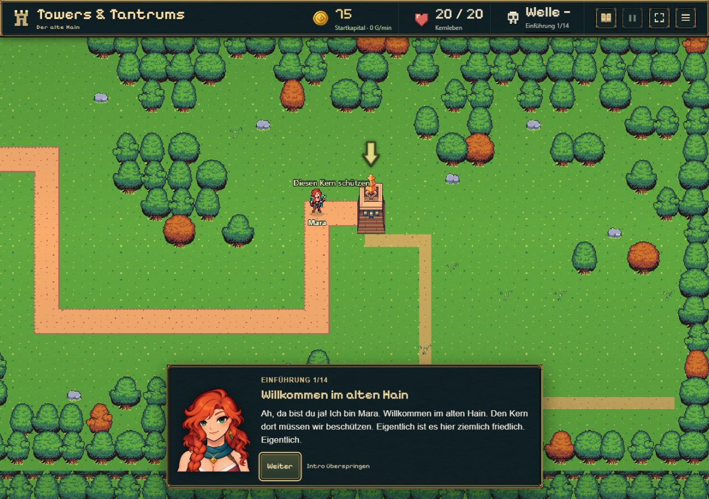
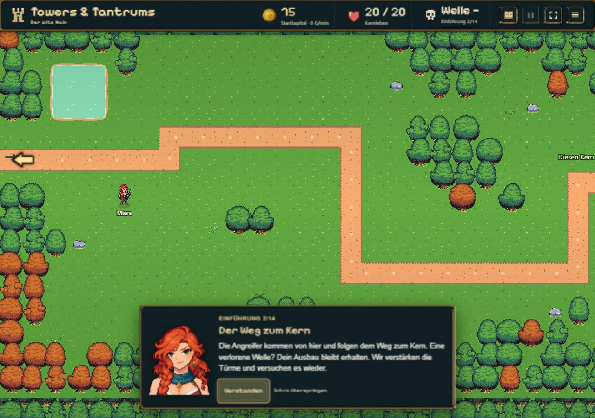
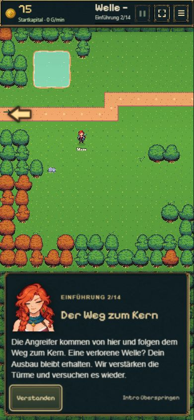

# Mara · Einführungs-Porträts · 08.11.2026

MI01 und MI02 wurden nach Sichtung ausdrücklich freigegeben. Anschließend hat der Nutzer den Einbau beider Clips sowie Commit/Push beauftragt. Die nachfolgenden Angaben dokumentieren die einzelnen Lieferungen; der aktuelle Aufgabenstatus steht in der Roadmap.

[Stumme Videoprobe](MI01/Mara_MI01_Begruessung_ComfyUI.mp4) · [Endbild](MI01/frame-end.png)

Auftrag: nur den ersten geplanten Mini-Clip erstellen. Mara winkt kurz mit ihrer eigenen Hand, lächelt und kehrt zur ruhigen Porträtpose zurück. Keine Spielintegration, keine weitere Clipproduktion.

- 480 × 576, 73 native Frames bei 24 FPS, 3,0417 Sekunden, 329.277 Byte.
- H.264, exakt eine Videospur, keine Audio-/Musikspur. Vollständig dekodiert und Framezahl geprüft.
- Lokaler MiniMax H3 W4A8 / ClipProj / quantisierter Textencoder / Video-VAE; bewährte Modell-, Sampler- und Decoderknoten aus dem freigegebenen M01 v2, 20 Schritte. Renderzeit 192,1 Sekunden.
- Originalquelle: `q4-mara-portraits/welcome-v2-source.png`, die hochauflösende Vorlage des vorhandenen Begrüßungsporträts. Lediglich proportional skaliert und für den RGB-Videotest auf #111c20 gelegt. Dieselbe Vorlage als erstes und letztes Referenzbild. Quellbild, transparentes Spielporträt und Spielcode unverändert.
- Ergebnis ohne Bewegungsinterpolation, Beschleunigung oder nachträgliche Retusche kopiert. Prompt, Workflow, technische Einstellungen und Prüfsummen liegen bei.
- Alle 73 Frames auf Kontaktbögen, 12 größere Handansichten und das Endbild visuell geprüft: keine beobachtete fremde Hand, zusätzlichen Finger oder auffällige Halsverschiebung. Die Hand ist am Ende wieder außerhalb des Ausschnitts, Augen offen, ruhiger freundlicher Ausdruck. Anschließend ausdrücklich vom Nutzer freigegeben.

Die MP4 ist eine separate **Vorschau mit dunklem Hintergrund**, noch kein transparent eingebundenes UI-Asset. Für einen später beauftragten Einbau: Alpha-/Hintergrundaufbereitung prüfen, einmal abspielen, anschließend das Endbild bis zum Weiterklicken halten; keine Wartesperre für den Spieler. MI03 bleibt ungestartet.

## MI02 · Der Weg zum Kern

[Stumme Videoprobe](MI02/Mara_MI02_Erklaerung_ComfyUI.mp4) · [Endbild](MI02/frame-end.png)

- Vorhandene hochauflösende Quelle `focused-v2-source.png`; derselbe Porträtmaßstab und dunkle Vorschauhintergrund wie MI01. Original und Spielporträt per Hash unverändert.
- Kurzer Seitenblick, kleines bestätigendes Nicken mit Blinzeln und Rückkehr zur ruhigen ursprünglichen Pose. Hände bleiben vollständig außerhalb des Bildes.
- 480 × 576, 56 native Frames / 24 FPS = 2,3333 Sekunden, 380.671 Byte. Das etablierte native H3-Bildraster liegt knapp über der Zieldauer von zwei Sekunden; keine Interpolation oder Tempoänderung.
- Gleiche Modell-/Sampler-/Decoderknoten wie der freigegebene MI01, 20 Schritte; Renderzeit 156,2 Sekunden. Native Ausgabe ohne Retusche oder Neucodierung kopiert.
- Vollständige Dekodierung, Framezahl und genau eine stumme Videospur geprüft. Alle 56 Frames sowie 12 vergrößerte Gesichts-/Halsansichten gesichtet: keine beobachtete zusätzliche Hand, abrupte Halsverschiebung oder geänderte Kleidung; Augen am Ende offen. Die Stärke des Nickens bleibt Teil der persönlichen Sichtabnahme.
- Anschließend ausdrücklich freigegeben und zusammen mit MI01 zur Spielintegration beauftragt. MI03 nicht begonnen.

## Integration und Prüfung

- MI01 begrüßt im ersten Intro-Schritt (3,04 s); MI02 erklärt im zweiten Schritt den Weg zum Kern (2,33 s). Einmalige stumme Wiedergabe, danach dauerhaft das letzte Frame bis zum Weiterklicken. Der dritte Schritt behält das ursprüngliche Standbild.
- `package.py` entfernt ausschließlich den mit dem äußeren Bildrand verbundenen dunklen Vorschauhintergrund, erhält Innenfarben/Kleidung, beschneidet die technische Auffüllung und skaliert proportional auf die bisherigen 272×320 Porträtpixel. Alle 129 Frames, Reihenfolge und 24 FPS bleiben erhalten. Die Originalvideos und statischen Porträts bleiben unverändert.
- Transparente WebP-Seiten mit je 16 Frames: MI01 1.309.532 Byte / fünf Seiten, MI02 1.081.958 Byte / vier Seiten. Ausschließlich die aktuelle Szene lädt Bilder. Nach einmaligem Abspielen werden die dekodierten Seitenreferenzen freigegeben; das Canvas hält das Endbild. Keine Browserabhängigkeit von Video-Alpha oder Autoplay.
- Vor und bei fehlgeschlagener Bilddekodierung bleibt das bisherige statische Porträt sichtbar; maximal fünf Sekunden Ladeversuch pro Seite. Reduzierte Bewegung lädt keine Atlanten. Spätes Laden nach Weiter/Überspringen ist durch Szenenkennung entwertet. Weder Laden noch Bewegung sperren Buttons. Bei vorübergehend versteckter Ansicht pausiert die Wiedergabe.
- Unverändert: Texte, Tutorialmodell/Speicherung, Spielregeln, Ton, bestehende Responsive-Maße und dritte Porträtszene. Keine weiteren Clips produziert.
- `node --import tsx --test experiments/idle-bastion/tests/intro-animation.test.ts experiments/idle-bastion/tests/mara-intro.test.ts experiments/idle-bastion/tests/tutorial-guide.test.ts`: 22/22 bestanden. Abgedeckt sind Endehalten, Szenenwechsel während Laden, Fehlerfallback, reduzierte Bewegung, verdeckte Zeit, Save-/Altstandsschutz und bestehende Tutorialführung. `npm run build`: bestanden.
- Im echten lokalen Spiel bei 1280×900, 390×844 und 360×800 geprüft: transparente Kanten ohne dunkle Rechtecke; unveränderte Porträtgrößen; MI01 hält Frame 72, MI02 Frame 55; Weiter während MI01 Frame 1 sofort möglich; Neuladen führt korrekt zu Schritt 2 zurück; Schritt 3 statisch; reguläres Ende und Überspringen übergeben an `build`. Bei 360 px kein horizontaler Überlauf. Keine Warnungen/Fehler im geprüften Browserablauf.
- Mobile Prüfung bedeutet Chromium mit Handy-Viewport, kein Test auf physischem iPhone/Android-Gerät. Die Darstellung nutzt normale Canvas-/WebP-Funktionen.

