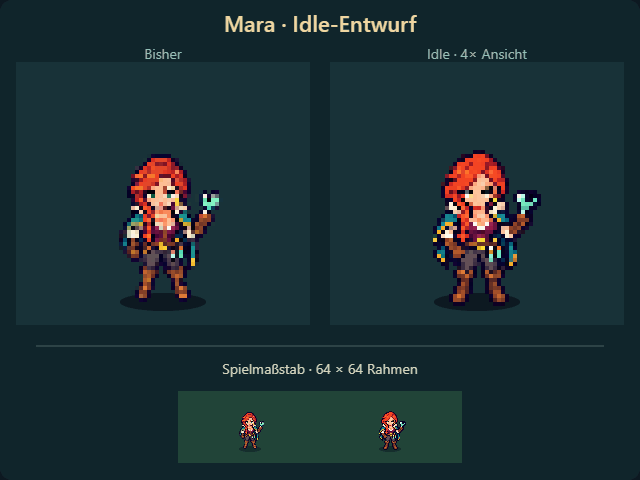

# Mara · Idle-Entwurf V1, Frontansicht

**Aktuell ist [V2 mit gröberer Bewegung und stabilen Originalpixeln](v2/README.md).**
Der Nutzer empfand V1 als zu kleinteilig und glitchartig. Diese Fassung bleibt als
vorheriger Entwurf erhalten.

25.10.2026 · Separate Animationsvorschau für die kleine Spielfigur.

[Video](mara-idle-comparison.mp4) · [64-Pixel-Spritesheet](mara-idle-front-64.png) ·
[Generierte Quelle](sources/idle-front-v1.png) · [vollständiger Imagegen-Prompt](PROMPT.md).

Links die bestehende Standpose, rechts acht neue Posen mit ruhigem Atmen,
kurzem Blinzeln und kleiner Bewegung von Haaren/Umhang. Die große Ansicht zeigt
die kleinen Spielpixel bei Faktor 4; darunter stehen beide im Maßstab 1.
Die Zielschleife dauert 2,62 Sekunden; der GIF-Export quantisiert auf 2,68 Sekunden.

Die Posen stammen aus dem eingebauten **Imagegen-Werkzeug**, mit
`public/assets/Hero Mara.png` als tatsächlicher Bildreferenz. Keine neue Figurengestaltung
beabsichtigt; leichte zeichnerische Abweichungen bleiben Teil dieses Entwurfs.
Die Rohdatei wird unverändert erhalten. Nur Zuschnitt, einheitliche Verkleinerung
um Faktor 0,1, Alpha-Normalisierung und Registrierung der Bootskontakte sind technisch
aufbereitet. Alle Rahmen sind 64×64 Pixel mit gemeinsamem Fußpunkt (32, 56).
Keine pro Frame unterschiedliche Skalierung, keine prozedural verformte Standpose.

`index.html` zeigt die bewegte Vergleichsansicht mit Pausebutton. Sie öffnet keinen
Spielstand und importiert keinen Spielcode. `packing.json` enthält Ausschnitte,
Anker und Dauer je Pose. Reproduktion: `SPIRE_SHARP_MODULE` auf ein installiertes
`sharp`-Paket setzen und `node artifacts/idle-bastion/previews/mara-idle/pack.mjs` ausführen.

Geprüft: acht unterschiedliche Rahmen, transparenter Außenrand, feste untere
Kontaktzeile, 700×610-/390×590-Browseransicht ohne Überlauf oder Browserfehler;
GIF und MP4 exportiert. [Browsernachweis](checks.json).
Die Vorschau ersetzt keine Abnahme der Bewegung durch den Nutzer.
