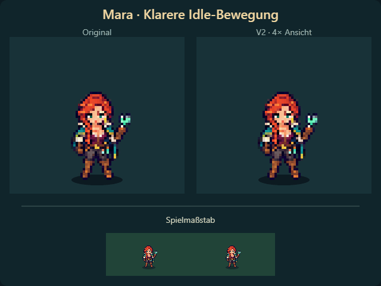

# Mara · Idle V2

Vier klare Haltungen: Oberkörper, Arme und Werkzeug bewegen sich zusammen um bis
zu drei ganze Spielpixel. Maras vorhandene Pixel bleiben gleich; Füße und Unterschenkel
stehen fest. Kein Blinzeln und keine einzeln wechselnden Haar-/Kleidungsdetails.

[Video](mara-idle-v2.mp4). Separate Frontvorschau auf `codex/mara-idle-preview`,
noch kein Einbau ins Hauptspiel. Die Bewegung wird aus der unveränderten Originalpose
gerendert; für V2 wurden keine neuen Imagegen-Posen gezeichnet.

Schleife: 2,5 Sekunden, kurze Übergänge und längere Ruhephasen. Desktop-/Handylayout
geprüft; keine Browserfehler. [Prüfdaten](checks.json) · [V1-Entwurf](../README.md).
