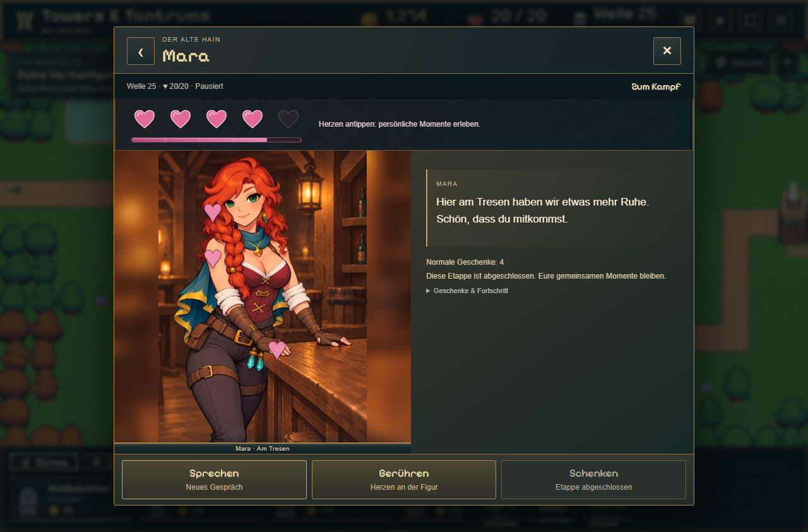
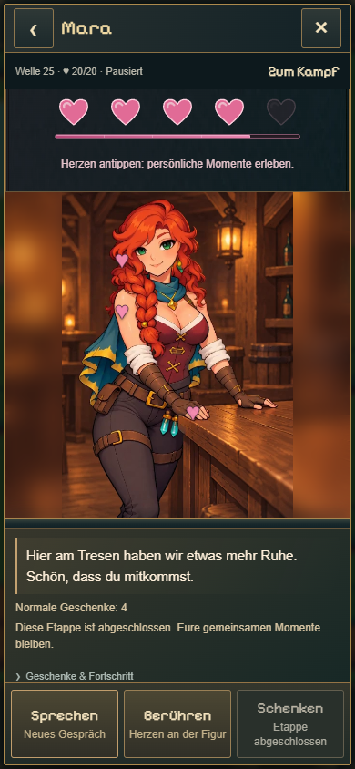

# Mara am Tresen: vollständige Szene · 07.11.2026

MC04, MC06 und die neue MC07 wurden ausdrücklich vom Nutzer freigegeben. Damit sind alle sieben Tresenclips abgenommen. Die alte 4,2-s-Rig-V2 bleibt unverändert erhalten. Auf `codex/tavern-counter-completion` ist das vollständige Set jetzt als eigener Ort integriert; noch kein Main-Deploy und noch keine menschliche Ingame-Sichtabnahme.

| Clip | Inhalt | Dauer | Status |
| --- | --- | ---: | --- |
| MC01 | Ruhige Grundpose | 3,75 s | freigegeben, integriert |
| MC02 | Gespräch | 2,33 s | freigegeben, integriert |
| MC03 | Haarreaktion | 3,04 s | freigegeben, integriert |
| MC04 | Schulterreaktion | 2,33 s | freigegeben, integriert |
| MC05 | Handreaktion | 3,04 s | freigegeben, integriert |
| MC06 | Kurzes Lachen | 3,04 s | freigegeben, integriert |
| MC07 | Näherlehnen, Blick halten, zurück | 4,46 s | neue Fassung freigegeben, integriert |

## Einbindung

- Alle Dateien liegen unverändert als native stumme H.264-MP4 mit 480 × 704 / 24 FPS im eigenen `mara-counter`-Verzeichnis. Kein erneutes Encoding und keine alten Medien gelöscht.
- Das Video enthält seinen eigenen Tresenraum. Der Außenbereich der Bühne verwendet die bereits vorhandene leere Tresengrafik, weichgezeichnet und ohne zweite Figur. Die Standardtaverne wird dort nicht unterlegt.
- Ruhe → MC01, Gespräch/Geschenk → MC02, Haare → MC03, Schulter → MC04, Hand → MC05, Lachen/Necken → MC06, Kompliment → MC07. Jede Reaktion endet wieder in MC01. Eigene Berührungsanker folgen der Tresenpose.
- Vor einem Ortswechsel werden Ruhevideo und Hintergrund geladen. Bei Fehlern bleibt der bisherige Ort bedienbar; ein erneuter Versuch ist möglich. Schließen oder Figurenwechsel verwirft ausstehende Szenenwechsel.
- Bereits verdiente vier oder fünf Herzen erlauben **Sprechen → Zum Tresen** und **Wieder an unseren Platz**. Keine neue Menüebene, keine automatische Szenenwahl und keine neue Save-Struktur.
- Persönliche Herzgeschichten werden ausdrücklich in ihrer ursprünglichen Standardbühne abgespielt; anschließend kehrt die Ansicht zum Tresen zurück. Kein alter Stehclip wird als normale Tresenreaktion verwendet.
- Die vorhandenen Stimmenaufrufe und Zufallspools bleiben erhalten. Ortswechsel geben keine Zuneigung oder Geschenke. Auf abgeschlossenen Legacy-Herz-4-Ständen bleibt Schenken regulär gesperrt; die lokale Geschenkzuordnung ist strukturell geprüft.
- Der neue Weg von Herz 3 nach 4, Einladungsbegegnungen und Ilyras vollständiger Fensterort bleiben Bulk 6. Diese Umsetzung hebt die bisherige Herz-3-Grenze nicht auf.

## Prüfung

13/13 gezielte Katalog-, Medien- und Stimmenregressionen, TypeScript, Produktionsbuild und Diffprüfung bestanden. Echte UI bei 1280 × 844 und 390 × 844: alle sieben Clips tatsächlich geladen, lokale Reaktionen und Rückkehr, Stimmenaufrufe, konstante Figurfläche, persönlicher Rückblick, fehlgeschlagener Download mit Wiederholung und abgebrochener Wechsel zu Ilyra geprüft. Mara unter Herz 4 und Ilyras unvollständiger Fensterort bleiben gesperrt. Zusätzlich zwei Fälle im kompilierten normalen Produktionsbuild DE/Desktop und EN/Handy mit beiden Figuren, Tresen, Rückkehr und Reload bestanden ([Produktionsprüfung](production/results.json)). Keine Browserfehler. Details: [Integration](integration/results.json), [Tests](tests.log), [Build](build.log).

## Lokal testen

[Direkter Teststarter](http://127.0.0.1:5278/tavern-test.html): „Früher verdiente 4 Herzen“, Mara, Besuch starten und gegebenenfalls Rückkehrbeleg bestätigen, dann **Sprechen → Zum Tresen**. Die normale Partie bleibt getrennt. [Alle sieben Clips einzeln](http://127.0.0.1:5278/tavern-counter-check.html).

## Produktionsnachweis der zuletzt erstellten Clips

MC04: 56 Frames / 174,1 s Renderzeit; MC06: 73 Frames / 222,1 s; MC07: 107 Frames / 348,2 s. Alle 236 Bilder einschließlich Hände, Gesicht und Übergangspose kontrolliert. Kein beobachteter Fremdhand- oder Halsfehler; dies ist keine absolute Fehlergarantie. MC07 öffnet beim Lächeln kurz den Mund. Der Nutzer hat die Ausgabe ausdrücklich akzeptiert.

Modell-/Sampler-/Decoderknoten entsprechen M01 v2, M03 und M05: 20 Schritte, native 24 FPS, keine Bewegungsinterpolation. Originaljobs, Referenzen, Prompts und Workflows bleiben erhalten. Die Vergleichsvideos zeigen links die gemeinsame Standreferenz und rechts die neue Probe, keine angebliche alte Spielanimation.
