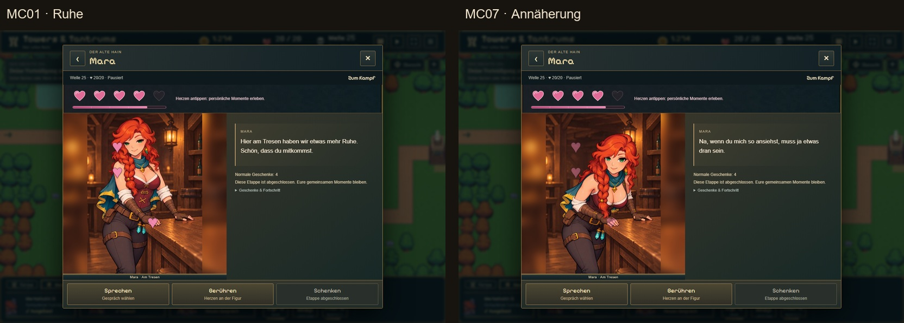
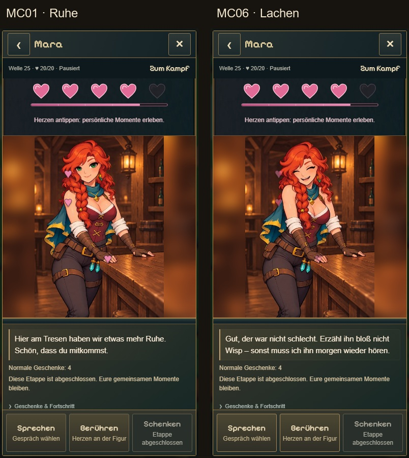

# Mara am Tresen · tatsächliche Ingame-Sichtprüfung · 07.11.2026

Geprüft wurde der gebaute Spielstand des Arbeitsbranches `codex/tavern-counter-completion` (Code `f1df9a0`), nicht die isolierte Clipprobe. Einstieg über die echte Siedlung/Taverne und **Sprechen → Zum Tresen**, eigener Testspielstand mit früher verdientem Herz 4. Keine Spielcodeänderung aus dieser Prüfung.

Desktop 1280×844 und mobiles Chromeformat 390×844: MC01/Ruhe, MC02/Gespräch, MC03/Haare, MC04/Schulter, MC05/Hand, MC06/Lachen und MC07/Annäherung über die echten Aktionen abgespielt; Necken nutzt ebenfalls die lokale MC06-Reaktion. Nach jeder Aktion wieder die Tresenruhe. Vorherige Integrationstests belegen die unveränderte Auswahl aus Maras Stimmenpool.

**Ergebnis:** 641 Desktop- und 1.412 Handy-Anzeigeframes untersucht (2.053 Stichproben). Keine beobachteten schwarzen oder transparenten Zwischenbilder/Ränder, keine falsche Szene, keine wechselnde Figurflächengröße, keine Browserfehler oder horizontale Überläufe. Die eigentlichen Screenshots wurden ebenfalls angesehen. Dies ist keine Fehlergarantie für sämtliche Geräte; die menschliche Ingame-Sichtabnahme bleibt offen.

[Messungen](results.json) · [Prüfablauf](check-frames.mjs). Die Rahmenprüfung wertet das tatsächlich angezeigte Canvas mit 96×140 Pixeln aus; CSS-Effekte, Szenenkennung und Bühnengröße werden zusätzlich verfolgt.

## Desktop: Ruhe und Annäherung

## Handyformat: Ruhe und Lachen

Original-PNGs und einzelne Messreihen bleiben in diesem Ordner erhalten. Die Vergleichsbilder zeigen unveränderte Screenshots mit ergänzten Beschriftungen, keine nachgezeichnete Spielansicht.
