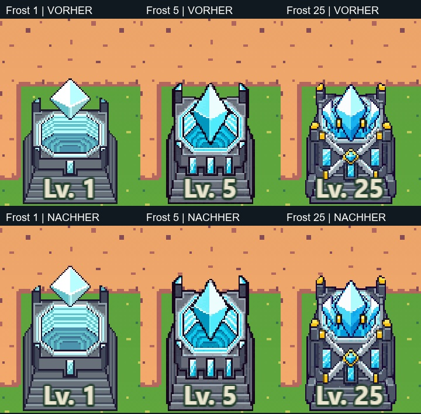
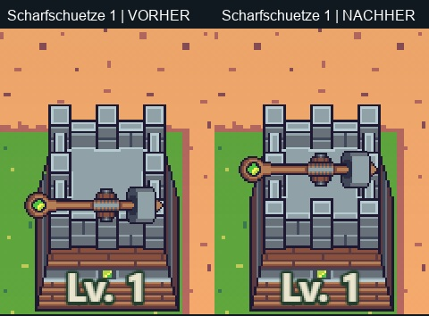
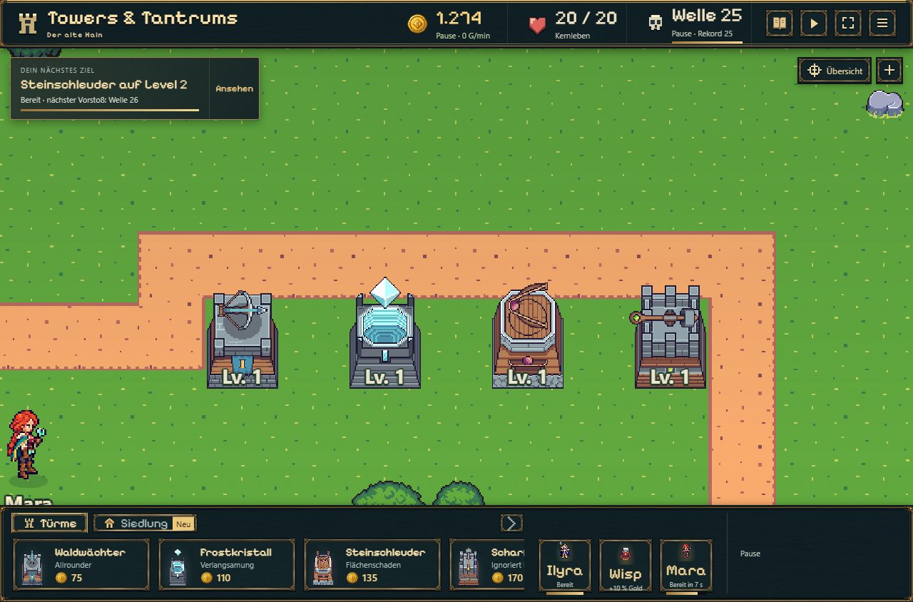

# Frostkörper und Scharfschützen-Montage · 07.11.2026

Der Frostturm erhält über alle acht Grafikstufen einen höheren Grundkörper. Beim Scharfschützen sitzt die originale Waffe auf Spiellevel 1–4 wieder mittig auf der Dachfläche. Originalbilder, Kampfwerte und Spielstände bleiben erhalten.

## Änderungen

| Frost-Grafikstufe | Körperhöhe vorher | Körperhöhe jetzt |
| --- | ---: | ---: |
| 1 | 45,36 | 53,55 |
| 2 | 44,73 | 55,44 |
| 3 (Spiellevel 3–4) | 49,14 | 57,96 |
| 5 / 10 / 15 / 20 / 25 | 51,66 | 57,96 |

Alle Maße sind Spieleinheiten. Nur der Frostkörper wird vertikal skaliert; Breite und exakter Bodenpunkt bleiben erhalten. Der Kristall behält seine Größe und folgt dem angepassten Montagepunkt. Leuchten und Bauvorschau verwenden dieselbe Geometrie. Die Körperhöhe nimmt beim Upgrade nicht ab; die Gesamtsilhouette kann durch unterschiedlich große Kristalle variieren.

Die frühen Scharfschützenwaffen waren rund 10 Spieleinheiten zu tief montiert. Die gemeinsame Dachmitte liegt in Originalzeile 65; diese steuert jetzt Waffe, Bauvorschau und Geschossursprung. Alle 17 Originalbilder und die Waffengröße bleiben erhalten. Rotierte Originalarme dürfen seitlich/oben überstehen; ein Gesamthöhenlimit darf die Waffe nicht erneut in die Frontfassade verschieben.

## Prüfung und Grenzen

- 18/18 gezielte Turm-/Art-/Einschlagtests und normales Produktionsbuild bestanden (`tests.log`, `build.log`).
- Echte BattleScene in isolierten Browserprüfungen: alle acht Froststufen, sämtliche 236 Kristallbilder, 64 Vorder-/Hinterturmpaare, Bodenpunkt, Leuchten und Bauvorschau geprüft. 544 Scharfschützenzustände mit allen Originalbildern und acht Richtungen; sämtliche Geschossursprünge korrekt. 40 Einzelaufnahmen und zwei Vergleichsreihen, keine Browserfehler (`final/results.json`).
- Geometrieprüfung über 20.160 Scharfschützenposen, Originalatlanten unverändert (`geometry.json`).
- Kontrollierte Diagnosezustände verwenden den tatsächlichen Renderer; dies ist keine neue umfassende Spielbalanceprüfung. Die persönliche Sichtabnahme des Nutzers bleibt offen.

## Tavernen-Zähler: ausschließlich geprüft und erklärt

150 frühere simulierte Siege ergeben keinen persönlichen Fortschritt: Der Zähler beginnt je Figur erst ab Herz 2. Neue normale Siege 10/20 öffnen die zwei Zwischengespräche, Sieg 30 das persönliche Geschenk für Herz 3. Eine andere Figur ohne Herz 2 bleibt bei null. Vorhandene normale Geschenke können die Zuneigung schnell bis 58 füllen, umgehen aber nicht die 30 neuen Siege. 21/21 Tavernen-/Begegnungstests bestanden; Audit in `tavern-counter-audit.json`. Nur Plantext präzisiert, keine Balanceänderung.

Veröffentlichung und aktuelle Checkboxen stehen in der [Roadmap](../../../experiments/idle-bastion/ROADMAP.md).
