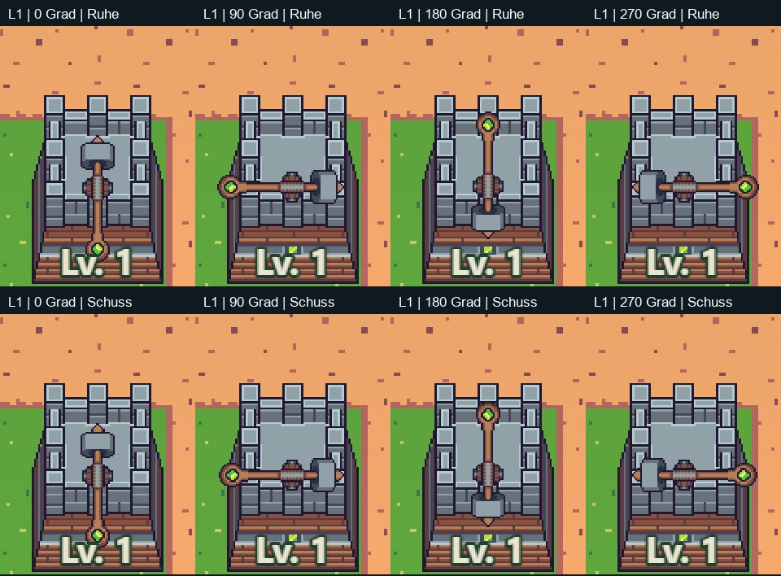
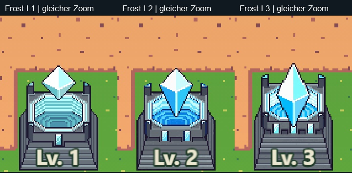

# Frostgröße und Scharfschützenhalterung · 07.11.2026

Auftrag: Probleme identifizieren und kleine Lösungsvorschläge machen. Keine Änderungen an Spielcode, Turmgrafiken, Kampfwerten oder Spielständen. Die Tavernen-Übernahme ist davon unabhängig.

## Tatsächliche Spielansicht

Die ersten statischen Quellenvergleiche waren für die Scharfschützenfrage nicht ausreichend. Nach dem Nutzerhinweis wurde deshalb die echte `BattleScene` im aktuellen Hauptspielmodul untersucht: isolierter Testspielstand, unveränderter `EvolutionView`, Level 1/2/3, vier Blickrichtungen und je Ruhe-/Schussphase. Dazu Frost 1/2/3 am selben Platz bei identischem Zoom. Insgesamt 27 Zustände, keine Browserfehler. `check-ingame.mjs` legt nur im Testbrowser die Scene zur Diagnose offen; kein Spielmodul wurde auf der Platte geändert. Die Kamera ist zur Sichtprüfung vergrößert, die Turmskalierung unverändert. Winkel und Schussalter sind kontrollierte Diagnosezustände, kein behaupteter aufgezeichneter Livekampf.

**Scharfschütze: der sichtbare Versatz ist nachvollziehbar.** Bei seitlicher Richtung liegt die Halterung vorn an der Zinne statt mittig auf der Dachfläche. Die nach oben gerichtete Grafik verdeckt das teilweise. Level 1–3 verwenden alle `weaponY: -0.5` und `weaponScale: 0.53`. Der gemessene Waffenursprung ist konstant `(64,64)` im 128×128-Frame. Die geprüften Schussphasen verändern weder diesen Ursprung noch den Befestigungspunkt. Es ist hier kein nachgewiesener wechselnder Atlasursprung oder kaputter Drehalgorithmus, sondern eine unpassende feste Montagehöhe.

Die Basis liegt bei `tower.y + 13`, mit Ursprung `102.4` im 128px-Bild und Faktor `0.63`. Daraus entspricht die aktuelle Halterung Basis-Bildzeile **80,97**, also dem vorderen Rand. Die sichtbar nutzbare Dachmitte liegt weiter oben. Schon `prototypes/scharfschuetze-evolution/pack-assets.py` schreibt für die drei Originalstufen pauschal `mount=-.5`; der aktive `EvolutionView.updateTower()` verwendet diesen Wert unmittelbar. Die vorhandene Größenprüfung bewertet die Außenhülle, nicht die Lage der Halterung auf dem Dach.

**Vorschlag:** in einer späteren kleinen Darstellungsprobe die Montage für Level 1–3 ungefähr **8–11 Spieleinheiten höher** ansetzen und anhand aller Richtungen fein abstimmen. Das ist ein Startbereich, kein freigegebener Endwert. Waffenbild/Animation erhalten; Projektilursprung und Bauvorschau müssen dieselbe Montage verwenden. Die bestehende maximale Außenhöhe muss anschließend über sämtliche 17 Schussframes und die Drehwinkel neu geprüft werden. Wenn sie nicht mehr eingehalten wird, Waffen-/Sockelproportionen gezielt abstimmen; eine Begrenzung der Außenhülle darf die Waffe nicht wieder an die falsche Stelle zwingen. Keine pauschale Verschiebung der höheren Stufen.

**Frost Level 1: vor allem ein Proportionsunterschied.** Die Skalierung ist im Spiel nicht versehentlich kleiner: Sockel und Kristall verwenden beide den vorgesehenen Faktor `0.63`. Das alte Level-1-Kristallbild ist sichtbar nur ungefähr 28 Quellpixel hoch, gegenüber 40/52 bei den späteren kompakten Kristallen. Das ergibt etwa **17,6 / 25,2 / 32,8 Spieleinheiten** vor der jeweiligen Animation. Der Level-1-Sockel ist zudem rund 15 % niedriger als der Waldwächter-Sockel; die gesamte Ruhedarstellung einschließlich schwebendem Kristall ist dagegen nur etwa 5 % niedriger als die üblichen 58 Einheiten. Luft zwischen Kristall und Sockel trägt zur geringen optischen Masse bei.

**Vorschlag:** zunächst nur Level 1 als Vergleichsprobe mit etwa **15–20 % größerem Kristall** und stimmiger Schwebehöhe darstellen, bei unverändertem Bodenanker. Falls die Wirkung dann noch zu schwach ist, die obere Sockelpartie geringfügig anpassen. Alle Originalframes und Angriffsphasen erhalten und deren Außenmaße prüfen. Keine globale Vergrößerung des Frostturms und keine Änderung an Reichweite, Schaden oder Auswahlposition.

## Belege und Grenzen

- `ingame/results.json`: tatsächlich geladene Texturen, Frames, Positionen, Ursprünge und Maßstäbe aller 27 Zustände.
- `ingame/`: unveränderte Bildschirmaufnahmen der Diagnosezustände.
- `measurements.json`: ergänzende statische Alphamaße. Sie ersetzen nicht die bewegte Ingame-Prüfung.
- `current-scale-comparison.png` und `sniper-current-pivots.png`: ursprüngliche statische Hilfsbilder; die obigen Ingame-Aufnahmen sind der maßgebliche visuelle Befund.
- Die vorgeschlagenen Korrekturen sind noch nicht umgesetzt oder visuell abgenommen. Zwei kontrollierte Schussphasen reichen für den hier sichtbaren Montagebefund; die vollständige Frame-/Winkelprüfung gehört erst zur späteren Umsetzung.
