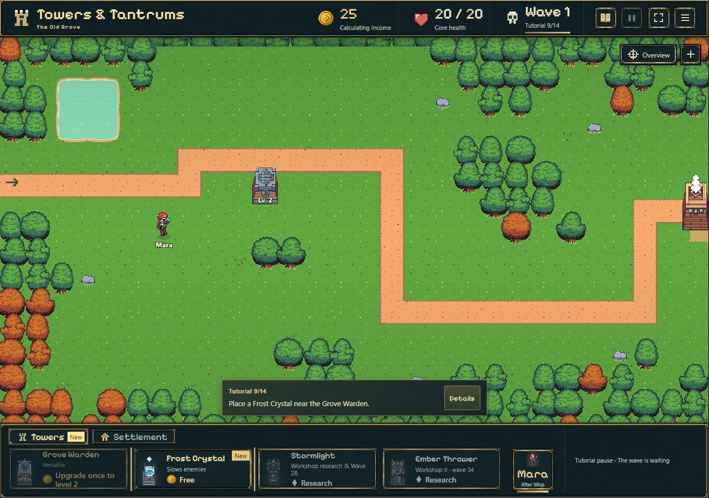
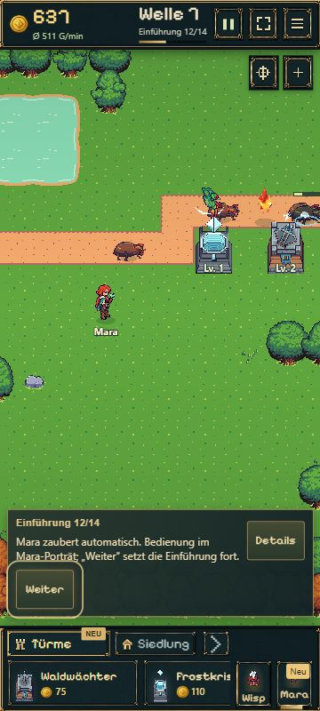

# Tutorial: fünf begrenzte Korrekturen · 07.11.2026

Basis: `origin/main` / `a0064fe1`. Arbeitsbranch: `codex/tutorial-guidance-fixes`.
Vier Laufzeitdateien geändert; lokale Prüfstände ergänzt. Keine Änderungen an Spielbalance, Preisen, Save-Schema, Art oder Tavernen-/Turminhalten.

## Prüfung

- 37/37 Tests aus `tutorial-guide`, `tutorial-progress`, `quick-win-guidance`, `onboarding` und `discovery` bestanden.
- `npm run build` (TypeScript, Vite, Pages-Paket) bestanden; `git diff --check` bestanden.
- Echter Hauptspiel-Browser, 1280×900 und 360×800, DE/EN. Prüfstände berechnen die nötigen Meilensteine über die reguläre Simulation und verwenden eigene Probe-Spielstände. Die folgenden Übergänge wurden über die sichtbaren Spielcontrols ausgeführt.

| Fall | Beobachtung |
| --- | --- |
| Werkstatt über Siedlungskachel | 7/14 → 8/14, Forschung sofort aktiv bei 85 Gold; Reload erhält 8/14. |
| Werkstatt über Karten-Gebäude auf Handy | 7/14 → 8/14; ohne Schließen/Neuöffnen erforschbar. |
| Werkstatt über Tutorialbutton | Forschung sofort aktiv, bisheriger Weg erhalten. |
| Frostforschung und Bau | Einmalig 60 Gold abgezogen (85 → 25). „New“ am Reiter und Frostkarte; verschwindet nach erstem kostenlosen Frostbau auf Desktop und Handy. |
| Mara 12/14 | Kurztext sichtbar, `discovery-next` ist das hervorgehobene Ziel. DE auf Desktop/Handy, EN auf Handy visuell geprüft. |
| Steinschleuder ansehen / direkt auswählen | Beide Wege bleiben auf 13/14; Abbruch und Reload ebenfalls. |
| Steinschleuder bauen | Erfolgreicher Bau führt zu 14/14, 135 Gold regulär abgezogen. |
| Steinschleuder „Später“ | Sowohl ursprünglicher Hinweis als auch Hinweis nach Ansehen/Abbruch führen zu 14/14. |
| Lager | Nach regulär besiegter Welle 8 Nutzen „8 statt 2 Stunden Offline-Gold“ ohne Aufklappen sichtbar, Desktop und Handy. |

Im geprüften Browserlauf keine erfassten JavaScript-Warnungen/Fehler. Gezielte Nachprüfung der fünf Änderungen; kein weiterer Komplettdurchlauf sämtlicher Spielinhalte. Persönliche Sichtabnahme durch den Nutzer bleibt möglich.

## Screenshots aus dem tatsächlichen Spiel

