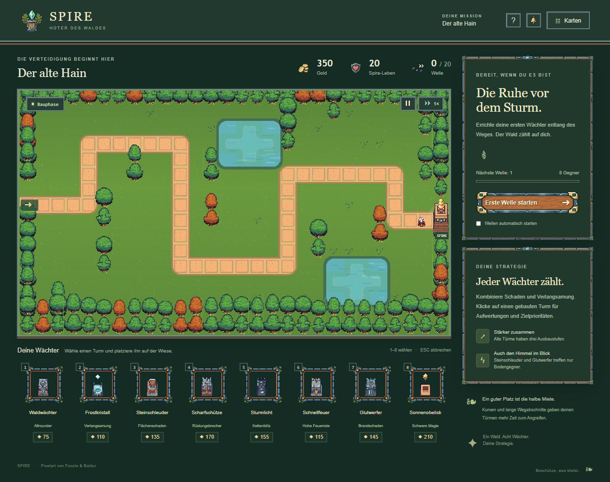
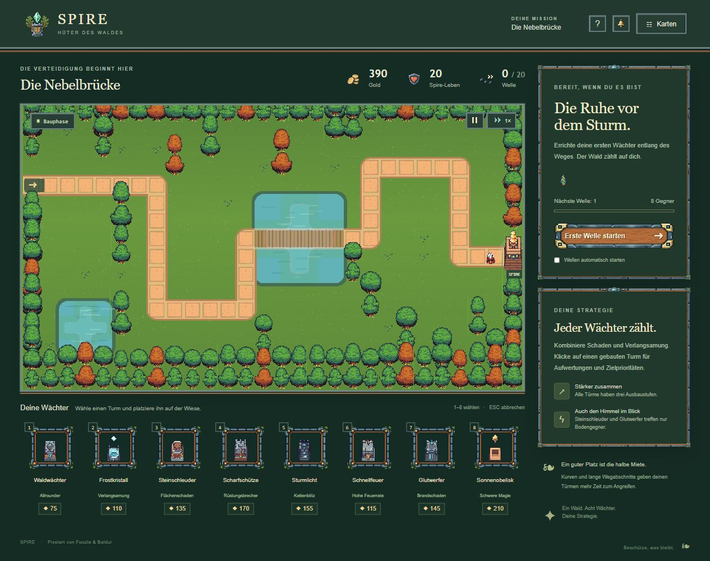
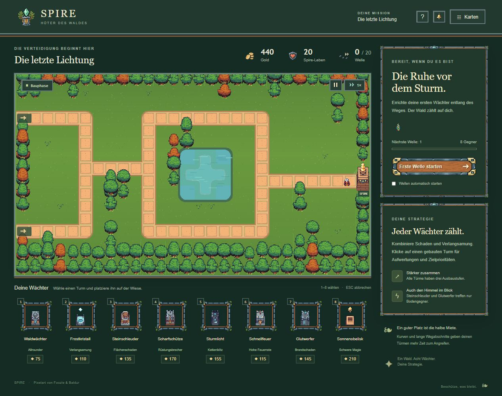

# M0 – gesicherte und spielbare Originalreferenz

Stand: 16.10.2026. **M0 abgeschlossen.** Drei ursprüngliche Karten sind separat spielbar, im Browser angesehen und dokumentiert. Die grafische Verbesserung und die Nutzerabnahme des künftigen Stils stehen noch aus.

Dieser Bericht beschreibt den gesicherten Tag `m0-original-reference`. Danach erfolgten auf Nutzerwunsch [Baum- und Wasserkorrekturen](../terrain-fix/REPORT.md); die folgenden historischen Hashvergleiche und Screenshots gelten für den M0-Stand.

## Ergebnis und Start

Im Projektordner `ORIGINAL SPIEL STARTEN.cmd` doppelklicken. Die Startdatei öffnet `reference/Spire-Original.html`. Entwicklung: `npm run reference:dev`, Adresse `http://127.0.0.1:5180/`. Weitere Befehle: [Referenz-README](../../reference/README.md).

Die neuere Fünf-Karten-Version bleibt unter ihrem bisherigen Startpfad erhalten. Ihr Quellcode, ihre Grafiken, `dist/` und `Spire.html` wurden nicht ersetzt. Die Referenz liegt vollständig separat unter `reference/`.

## Sicherung und Herkunft

| Bestandteil | Nachweis |
| --- | --- |
| Dateisicherung vor M0 | `backups/2026-10-16-before-m0/project.zip`: 554 Dateien; 244.326.396 Quellbytes; 210.382.506 Archivbytes. Alle Einträge aus dem Archiv zurückgelesen und per SHA-256 mit der Quelle verglichen. |
| Sicherungsmanifest | `backups/2026-10-16-before-m0/manifest.json`, mit Einzelhashes. Ausgenommen: `node_modules`, `.git`, `backups`. |
| Versionierung | Lokales Git eingerichtet. `before-m0` zeigt auf `2df171c`; abgeschlossene Referenz als `m0-original-reference` markiert. |
| Historische Quelle | Abgeschlossene Dateiänderungen aus „Tower-Defense-Spiel planen“ und den damaligen zugehörigen Prüfaufgaben vom 14.10.2026; letzter rekonstruierter Eintrag: 21:02:05 UTC / 23:02:05 Berliner Zeit. |
| Rekonstruktion | 55 protokollierte Änderungen zu 25 Dateien, chronologisch mit exakter Prüfung der Patch-Kontexte angewendet. [Herkunft und Hashes](recovery.json); [unveränderter rekonstruierter Quellstand](historical-source.zip). |
| Spielgrafiken | 84 PNGs stimmen bytegenau mit den erhaltenen Foozle-Paketen überein. [Asset-Nachweis](asset-provenance.json). |
| Oberfläche | Sieben vorhandene Wald-UI-PNGs wiederverwendet. Diese sind eigene frühere UI-Grafiken, keine Foozle-Geländetiles. |

**Einordnung:** Es handelt sich um einen neuen Build aus rekonstruiertem historischen Quellcode. Eine unveränderte historische Startdatei oder ein vollständiger damaliger Dependency-Lock wurde nicht gefunden. Verwendet werden die aktuell im Projekt installierten, über dessen Lockdatei festgelegten Entwicklungsabhängigkeiten. Ein pixelidentischer Vergleich mit einer originalen historischen Bildschirmaufnahme ist damit nicht belegt.

**Anpassungen gegenüber dem rekonstruierten Quellstand:** eigener Speichername, eigener Seitentitel, Dateiname `Spire-Original.html`, eigener Port 5180, Paketname, Startdateien, Build-Einbindung, Dokumentation und zusätzliche Speicherprüfungen. `src/data.ts`, `src/simulation.ts` und `src/scene.ts` stimmen unverändert mit den historischen Hashes überein. Die übrigen Abweichungen sind im [Integritätsnachweis](integrity.json) aufgeführt.

## Prüfung

| Prüfung | Ergebnis und Aussagegrenze |
| --- | --- |
| TypeScript und Produktionsbuild | Erfolgreich. Referenz-HTML erzeugt, ungefähr 13,61 MB. |
| Paketprüfung | Alle 84 Spiel- und sieben UI-PNGs in Quelle, Build und Offline-Paket bytegleich; Frameangaben geprüft; keine externen Script-, CSS-, Font- oder Bildabhängigkeiten im Paket. |
| Simulation | 24 Tests bestanden, darunter simulierte Siege über alle 20 Wellen auf allen drei Karten, Wirtschaft, Kampf und Routen. Dies ist kein vollständiger visueller Browserdurchlauf jeder Karte; die historische Balanceprüfung bildet die später vom Renderer gesetzten Dekorationshindernisse nicht vollständig ab. |
| Bedienung und Speichern | 11 DOM-Prüfungen bestanden: ursprüngliche neun Prüfungen plus Schutz des bestehenden Speicherschlüssels und Laden von Sternen/Tutorial in einer frischen Anwendung. Die Darstellung ist dabei simuliert. |
| Tatsächlicher Browser | Alle drei Karten geöffnet und angesehen. Turmbau 350 → 275 Gold, Aufwertung auf Stufe 2 → 211 Gold; erste Welle im alten Hain erfolgreich beendet, 20 Leben, acht besiegte Gegner. |
| Weitere echte Bedienung | Gegner auf beiden Routen der letzten Lichtung sichtbar; 1×/2×, Pause/Fortsetzen und Kartenneustart geprüft. Neustart stellt 440 Gold, 20 Leben und Welle 0 wieder her. |
| Tatsächliches Neuladen | Geschlossene Einführung bleibt nach Neuladen geschlossen. Ergebnis-Speicherung und Schutz bestehender Daten zusätzlich automatisiert geprüft. |
| Gebündelte Ausgabe | Genau die erzeugte `Spire-Original.html` im Browser über den lokalen Server geöffnet und mit der Entwicklungsansicht verglichen. Keine gemeldeten Browserfehler in beiden Varianten. Ein separater Windows-Doppelklick-/`file:`-Test ist nicht dokumentiert. |

Vorhandene Browser-Spielstände wurden **nicht exportiert**. Sie bleiben durch den eigenen Schlüssel `spire-reference-save-v1` erhalten; der Referenzserver nutzt zusätzlich einen eigenen Port. Die Testdaten wurden ausschließlich in der Referenz angelegt. Der ursprüngliche Stand speichert Ergebnisse und Einstellungen, aber keine laufende Bauphase nach Schließen/Neuladen. Diese neuere Funktion muss später gezielt übernommen werden.

## Die drei Karten

Die Aufnahmen zeigen den tatsächlichen rekonstruierten Spielstand, keine Konzeptbilder.

### Der alte Hain

Übersichtliche Einstiegsroute, zusammenpassende ursprüngliche Türme und Vegetation. Die einzelnen gerahmten Wegkacheln und schematischen Wasserflächen sind bereits in dieser Rekonstruktion sichtbar.

### Die Nebelbrücke

Eigenständige Route über eine zentrale Wasserfläche mit Brücke. Gleiche Bildsprache und Objektmaßstäbe wie auf der ersten Karte; Ufer und Wasser verlangen später gezielte Ausarbeitung.

### Die letzte Lichtung

Zwei Zugänge und ein gemeinsames Ziel. Beide Routen sind erkennbar; auch hier bleiben Wegkacheln, Wasserform und die große historische Seitenleiste Teil der Referenz.

Weitere Nachweise: [Turmbau, Aufwertung und Welle 1](01-bauen-aufwerten-welle1.jpg), [Gegner auf beiden Routen](03-gegner-auf-beiden-routen.jpg), [Pause](03-pause-nach-welle1.jpg), [gebündelte Ausgabe](01-offline-paket.jpg).

## Urteil und nächster Schritt

Die ursprünglichen Karten liefern wieder eine nachvollziehbare gemeinsame Grundlage. Das ist ein brauchbarer Ausgangspunkt, noch kein professionell fertig gestaltetes Spiel. Ihre Stärken sind die gemeinsame Bildsprache und erkennbare Kartenstruktur. Sichtbare Wegkacheln, Wasseranschlüsse und Platzverteilung der Oberfläche bleiben konkrete Verbesserungsaufgaben.

**Als Nächstes M1:** ein kleiner tatsächlicher Spielausschnitt mit Originalboden, Wegkurve, Ufer, Baum, Turm, Gegner, Wisp und Mara. Dort zuerst Anschlüsse, Maßstab und Bewegung lösen und dokumentieren. Nach visueller Nutzerabnahme folgt die vollständige Waldkarte. Für M0 wurden keine neuen Bilder generiert und keine weiteren Regionen ausgearbeitet.
