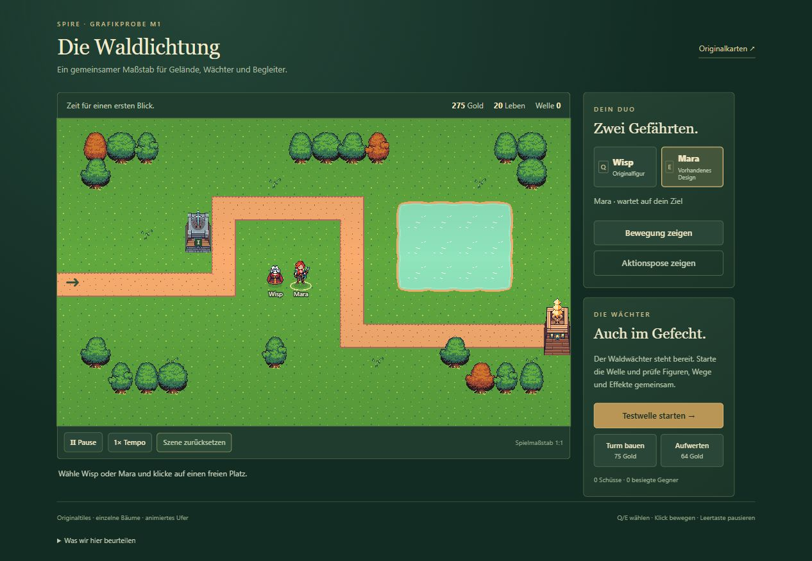
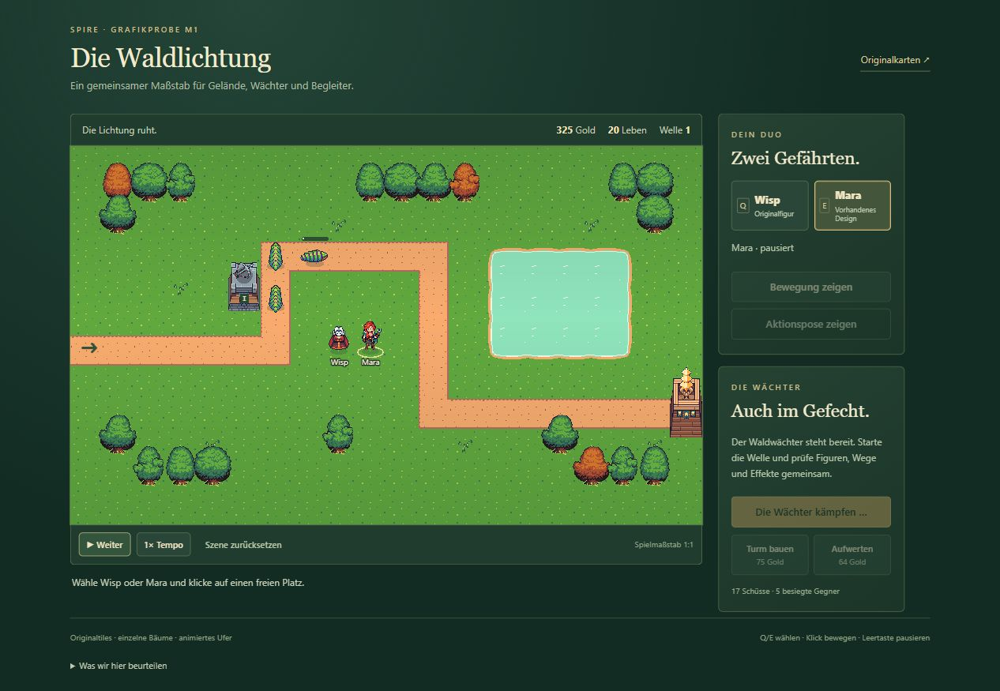
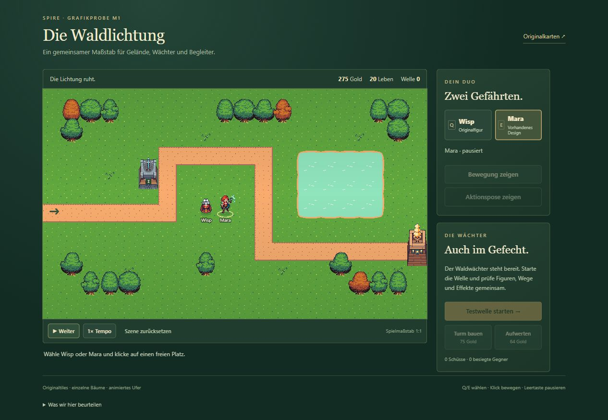

# M1 – spielbare Grafikprobe

16.10.2026. **Technisch und visuell geprüft; Nutzerabnahme des gemeinsamen Stils noch offen.** M2 wurde nicht begonnen. Ausgangspunkt ist der vom Nutzer bestätigte Stand `reference-terrain-fixed`.

## Ergebnis und Start

`GRAFIKPROBE STARTEN.cmd` im Projektordner öffnet `reference/Spire-Style.html` (15,06 MiB). Entwicklungsansicht: `http://127.0.0.1:5180/style.html`. Der separate Ausschnitt umfasst 20 × 12 Zellen mit unverändert 40 Spieleinheiten je Zelle.

- Originalgras mit einem tatsächlich gefüllten Ausschnitt, zusammenhängende Wegkurven, einzeln platzierte Bäume und das originale animierte Wasser.
- Original-Wisp, vorhandene Mara, Originalturm und Gegner in gemeinsamer Spielgröße.
- Figurenauswahl per Q/E oder Schaltfläche, Bewegung per Bodenklick, Hindernisse, Bewegungsdemo in vier Richtungen und Aktionsposen.
- Echte vorhandene Kampfsimulation: Testwellen, Turmbau, Aufwertung des ersten Waldwächters, Treffer, Gold, Leben, Pause, 2× und Zurücksetzen.
- Die Probe speichert keinen Fortschritt. Die drei bestätigten Originalkarten bleiben separat erreichbar.

## Asset-Befund und Korrekturen

Die Mara-Quelle ist 1254 × 1254 groß und lässt sich nicht sauber in ganzzahlige 313er Zellen aufteilen. Ihre linke Aktionspose ragt zudem über die nominelle Zellgrenze. Die 16 Ausschnitte sind deshalb einzeln vermessen und auf einen gemeinsamen Fußpunkt ausgerichtet. Ein einheitlicher Maßstab 1÷7 und eine klare Alphakontur ersetzen die fehleranfällige pauschale Rasterteilung. Die Quelldatei bleibt unverändert.

Die Probe verwendet einen echten Grasbereich x128/y64. Der alte Ausschnitt x64/y64 war transparent; die alte Referenz wirkte durch ihren Grundton und zusätzliche Zeichnung trotzdem grün. Diese Änderung gilt ausschließlich für die neue Probe. Einzelbäume und Wasser übernehmen die zuvor bestätigte Korrektur.

Es wurden **keine neuen Bilder generiert**. Maße, Farbannahmen, Quellen, Ausschnitte, Fußpunkte und Animationsregeln stehen in der [Grafikreferenz](../../reference/STYLE_GUIDE.md). [SHA-256-Nachweise](asset-provenance.json) halten die verwendeten Hauptquellen fest; die übrigen Originaldateien werden beim Build gegen die Foozle-Pakete geprüft.

## Durchgeführte Prüfung

| Prüfung | Ergebnis |
| --- | --- |
| TypeScript und M1-Produktionsbuild | Bestanden; `npm run reference:style:build` |
| Original-Produktionsbuild | Bestanden; `npm run reference:build` |
| Simulation, Wegfindung, Zuschnitte und Wasserbereinigung | 29 Tests bestanden; darunter vier neue M1-Prüfungen für Hindernisse, Umwege und Framegrenzen |
| Bestehende Bedienungs- und Speicherverträge | 11 DOM-Prüfungen bestanden; einschließlich aller drei Originalkarten und getrennter Spielstände |
| Originalpaket | 84 Spiel-PNGs und sieben UI-PNGs stimmen in Quelle, Produktionsausgabe und eingebetteter Einzeldatei überein |
| M1-Paket | 85 Spiel-PNGs einschließlich unveränderter Mara-Quelle sowie sieben UI-PNGs stimmen überein; keine externen Skript-, CSS-, Schrift- oder Bildabhängigkeiten |
| Browser: Auswahl und Bewegung | Q/E, Zielklick und Richtungswechsel im Demo geprüft; Wasserziel abgewiesen; Wegfindung lässt keine diagonalen Abkürzungen durch gesperrte Zellen zu |
| Browser: Bauen und Aufwerten | Aufwertung 275 → 211 Gold, weiterer Turm 211 → 136; Bau auf Maras belegter Zelle abgewiesen |
| Browser: Kampf | Gegner laufen und drehen an Kurven; Feuer und Treffer wirken. Finale Einzeldatei mit 17 Schüssen und fünf besiegten Gegnern aufgenommen; zuvor zwei Wellen und 2× im Entwicklungsstand geprüft |
| Browser: Pause | Zwei vollständige Aufnahmen einer pausierten Szene waren bytegleich; Figuren und Wasser stehen. Fortsetzen und Zurücksetzen geprüft |
| Browser: Ausgabe | Die tatsächlich erzeugte `Spire-Style.html` über localhost geladen, Ansicht, Bewegung, Aktionspose und Kampf geprüft; keine gemeldeten Warnungen oder Fehler |
| Originalkarte nach Neubau | `Spire-Original.html` geöffnet, „Der alte Hain“ gestartet und angesehen; bestätigte Darstellung erhalten |

Die grafische Prüfung erfolgte im echten Browser, zusätzlich zu den Logik- und DOM-Prüfungen. Die Einzeldatei wurde über localhost angesehen; der Windows-Doppelklick selbst wurde nicht automatisiert ausgeführt. Der Paketcheck prüft die vollständige Einbettung der benötigten Daten. Auf schmalerer Ansicht stehen die Bedienelemente unter dem Spielfeld; auf breiterer Ansicht daneben. Beide Layouts wurden im Browser gesehen.

## Grenzen und nächster Schritt

- Mara besitzt aktuell zwei Gehposen je Richtung. Das ist für die Größen- und Stilprobe ausreichend, aber keine fertige Produktionsanimation. Fußfolge, Körperkonsistenz und einzelne Konturpixel brauchen vor der Waldkarten-Abnahme eine weitere Prüfung bzw. Überarbeitung.
- Aktionsposen demonstrieren vorhandene Grafik. Fertige Begleiterfähigkeiten, Aufträge und Bauphasen-Wiederherstellung gehören zu M2.
- Die kleine Lichtung ist ein Prüfausschnitt. Dekorationsdichte, vollständiges Leveldesign und Spielbalance sind hier nicht als fertige Karte abgenommen. Ein einzelner Demonstrationsturm hält nicht jeden Gegner auf.
- Weitere Regionen, neue Tileset-Serien und Story wurden nicht ausgearbeitet.

**Nächste Entscheidung:** Passt der gemeinsame Maßstab von Wisp, Mara, Bäumen, Gegnern und Türmen? Erst nach dieser konkreten Nutzerabnahme beginnt gemäß [Roadmap](../../ROADMAP.md) die vollständige Waldkarte. Versionsmarke für diese Probe: `m1-style-preview`.
