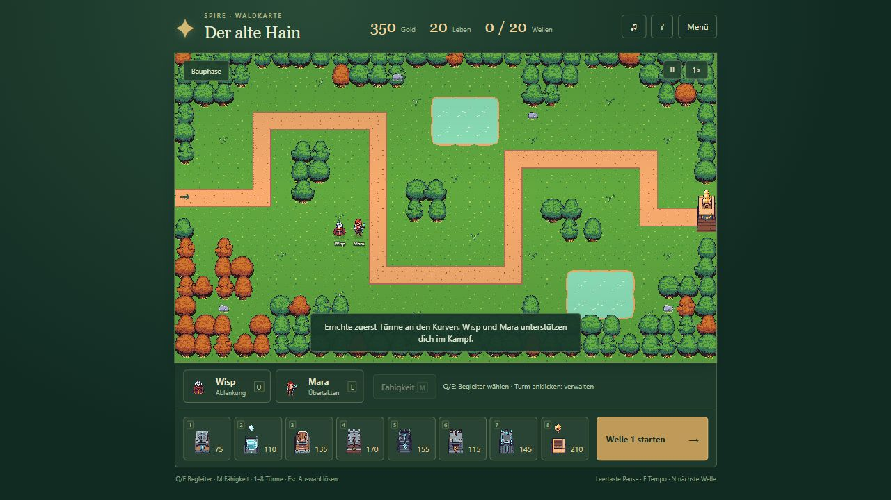
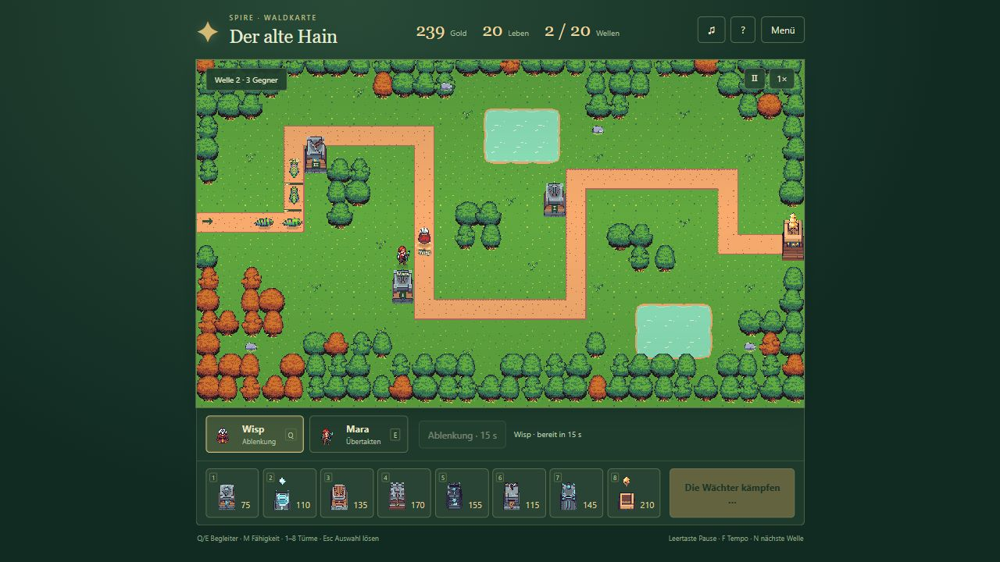

# M2 – vollständige Waldkarte

Stand: 16.10.2026. **Umgesetzt und gezielt geprüft; Nutzerabnahme der vollständigen Karte steht noch aus.** Grundlage ist die ausdrücklich bestätigte M1-Grafikprobe. Die übrigen Regionen und die Story wurden nicht bearbeitet.

## Spielen

- Projektordner: `WALDKARTE STARTEN.cmd` oder `reference/Spire-Wald.html` öffnen.
- Laufender Entwicklungsserver: `http://127.0.0.1:5180/woodland.html`.
- Die ausgelieferte Einzeldatei ist auch unter `http://127.0.0.1:5180/Spire-Wald.html` erreichbar.
- Bauen mit 1–8; Turmklick für Aufwertung, Zielpriorität und Verkauf. Q/E wählt Wisp/Mara, Bodenklick bewegt die Figur. Während einer Welle M drücken und den Fähigkeitsort bzw. Turm wählen. Leertaste pausiert, F schaltet das Tempo, N startet die nächste Welle.



## Umsetzung

**Karte:** „Der alte Hain“ bildet die Grundlage. Wegverlauf, Flugroute, beide Teiche, Startbudget von 350 Gold und die 20 ursprünglichen Wellen bleiben erhalten. Baumgruppen, Waldrand, Felsen und kleine Vegetationsflächen wurden gezielt gesetzt. Kurven und Verteidigungsflächen bleiben frei. Sichtbare Bäume, Felsen, Wasser und das Spire-Ziel stimmen mit den gesperrten Feldern überein.

**Grafik:** Abgenommene M1-Maßstäbe, Originalboden und Weganschlüsse, einzelne Bäume ohne fremde Pixelspalte sowie korrekt zusammengesetztes animiertes Wasser. Vorhandene Wisp- und Mara-Grafiken werden weiterverwendet. Mara nutzt ihre beiden Gehposen nun direkt im Wechsel, ohne eingeschobene Standpose; Fußpunkte und getrennte Richtungen bleiben erhalten. Keine neuen Bildgenerationen.

**Begleiter:** Beide Figuren lassen sich auswählen und über begehbare Flächen bewegen. Wasser, Bäume, Felsen und Türme werden umgangen. Ein neu gebauter Turm löst eine Neuberechnung des Weges aus. Gebäude können nicht auf einer Begleiterposition errichtet werden.

- Wisp läuft zum gewählten Ort und lenkt dort nach seiner Aktion nahe Bodengegner ab: 45 % Verlangsamung in 110 Spieleinheiten Umkreis, 5 Sekunden Wirkung, 22 Sekunden Abklingzeit.
- Mara läuft auf ein erreichbares Nachbarfeld des gewählten Turms, wendet sich ihm zu und übertaktet ihn nach ihrer Aktion: 50 % höhere Feuerrate für 8 Sekunden, 30 Sekunden Abklingzeit.
- Abklingzeiten beginnen erst mit der Wirkung. Verkaufte Ziele und beendete Wellen brechen noch ausstehende Fähigkeitsaufträge ab. Pause und Tempo greifen über den gemeinsamen Spieltakt.

**Spieloberfläche:** Kompaktes HUD, zwei Begleiter, acht Turmtypen, Wellenstart, Turmverwaltung und Anleitung. Die Darstellung berücksichtigt bei breiteren Fenstern auch die verfügbare Höhe, damit Karte und Bedienleiste gemeinsam sichtbar bleiben. Menü, Sieg/Niederlage, Sterne, Bestwert und Neustart sind integriert.

**Speichern:** Eigene Kennung `spire-woodland-v1`. Bauphasen sichern Gold, Leben, Welle, Türme samt Stufen/Prioritäten, Begleiterpositionen und Abklingzeiten. Nach Neuladen wird im Menü die gespeicherte Bauphase angeboten. Eine unterbrochene Welle beginnt mit dem Stand vor ihrem Start. Bewegungsaufträge werden beim Laden aufgehoben. Nach Sieg/Niederlage wird der Zwischenstand entfernt; das Ergebnis bleibt gespeichert. Die anderen Spielstände bleiben unter ihren bisherigen Kennungen erhalten.

## Gezielte Prüfung

Auf Nutzerwunsch wurden keine umfangreichen wiederholten Prüfserien durchgeführt.

| Prüfung | Ergebnis |
| --- | --- |
| Fünf gezielte M2-Tests | Bestanden: vollständiger Kartenablauf, Fähigkeiten erst nach Ankunft, echte Verlangsamung, Wiederherstellung und abgebrochene Ziele |
| Vollständiger Sieg in Simulation | Alle 20 Wellen mit normalem Budget gewonnen: 20 Leben, 376 besiegte Gegner, 17 Türme; keine Begleiterfähigkeit als Voraussetzung für die Gewinnbarkeit |
| Verlust in Simulation | Unverteidigte Karte endet regulär mit 0 Leben und Niederlage |
| Browser – Bauen/Aufwerten | Drei Waldwächter gebaut, einen auf Stufe II aufgewertet, Zielpriorität geändert |
| Browser – Neuladen | Bauphase nach Reload geladen: drei Türme, Aufwertung und 61 Restgold wiederhergestellt |
| Browser – echter Kampf | Erste Welle abgeschlossen; zweite Welle gespielt. Mara meldet die tatsächliche Übertaktung, Wisp löst seine Ablenkung aus; Abklingzeiten werden angezeigt |
| Browser – Bedienung | Pause/Fortsetzen, Menü, Neustart, Auswahl und Turmdetails verwendet; Karte und Dock gemeinsam angesehen |
| Produktionsbuild | TypeScript und Vite erfolgreich; `Spire-Wald.html` erzeugt, etwa 15,08 MiB |
| Paketprüfung | 85 Spielgrafiken und sieben eingebettete UI-Grafiken stimmen bytegleich mit den Quellen überein; keine externen Skript-, Stil-, Schrift- oder Bildabhängigkeiten |
| Finale Ausgabe | Tatsächlich erzeugte `Spire-Wald.html` über localhost geöffnet, neue Verteidigung gestartet und visuell mit der Entwicklungsfassung verglichen |

Die 20 Wellen wurden vollständig in der Simulation geprüft, nicht zusätzlich in Echtzeit im Browser durchgespielt. Der Browserdurchlauf konzentrierte sich auf die neu integrierten Funktionen. Der Windows-Doppelklick wurde nicht automatisiert betätigt; geprüft wurde dieselbe eingebettete HTML-Datei über localhost.



## Grenzen und nächster Schritt

Mara nutzt weiterhin zwei vorhandene Gehposen je Richtung. Die Schrittfolge ist bereinigt; zusätzliche Zwischenposen wurden nicht erzeugt. Die volle Waldkarte steht zur spielerischen und visuellen Nutzerabnahme bereit. Erst danach wird Laternenmoor als nächste Region des gemeinsamen Spiels umgesetzt.

Originalvergleich und M1-Probe bleiben erhalten. Versionsmarke: `m2-woodland-playable`. Die künftigen Regionen sollen in dieselbe Spielstruktur aufgenommen werden; die separaten Vergleichsdateien sind keine geplante Aufteilung der Kampagne in einzelne Spiele.

Reproduktion aus dem Projektordner:

```text
npm run reference:forest:build
node node_modules/tsx/dist/cli.mjs --test reference/tests/woodland.test.ts
```
