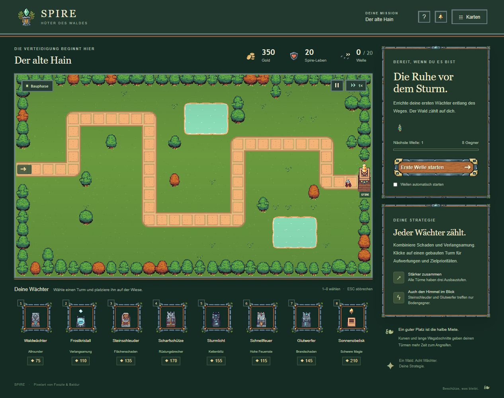
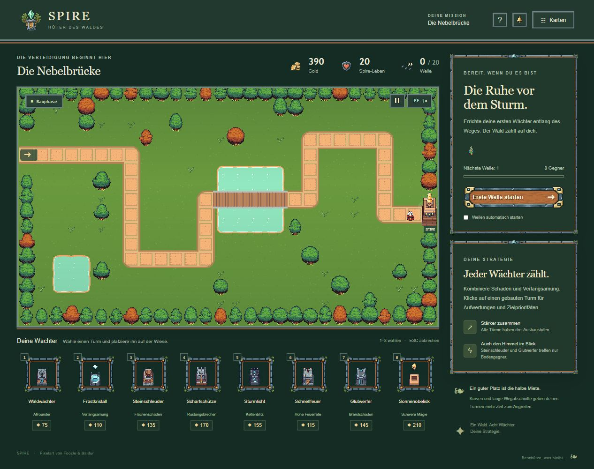
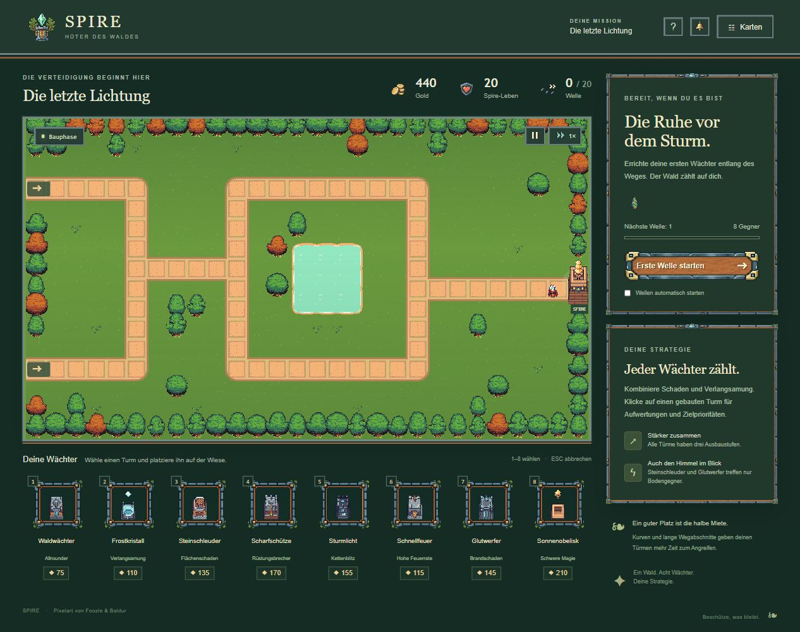

# Korrektur: einzelne Bäume und Wasser aus dem Originaltileset

16.10.2026, nach M0 und vor M1. Betrifft ausschließlich die separat spielbare Version unter `reference/`. Ausgangspunkt bleibt Git-Tag `m0-original-reference`.

## Ursache und Änderung

| Befund | Korrektur |
| --- | --- |
| Alte Baumframes waren 64 × 128 Pixel groß und enthielten zwei übereinanderstehende Bäume. | Vier grüne und vier herbstliche Einzelbäume verwenden jeweils eine 64 Pixel hohe Zelle. |
| Im Originalatlas ist Spalte x=832 neben den grünen Bäumen tatsächlich grün und undurchsichtig. | Zuschnitt seitlich jeweils um einen Pixel eingerückt: 62 × 64 Pixel, gleicher horizontaler Mittelpunkt. Fremde Pixelspalte ausgeschlossen; PNG unverändert. |
| Der komplette 448 × 448 große, kreuzförmige Wasser-Konstruktionsbogen wurde pro Teich skaliert und mit 18 % Deckkraft über eine gemalte Fläche gelegt. | Ufer, vier Außenecken und Innenflächen werden aus passenden 32-Pixel-Teilen zusammengesetzt. Gleichmäßiger Maßstab: 64 Quellpixel entsprechen 40 Spieleinheiten. |
| Gras im Wasserbogen erzeugte einen andersfarbigen rechteckigen Außenrand. | Nur zusammenhängendes äußeres Gras wird in einer Laufzeitkopie transparent gesetzt. Ufer, Wasser und eingeschlossene Details bleiben erhalten. Original-PNG unverändert. |
| Das alte Wasser lag auch über der Brücke. | Getrennte Zeichenebenen: Boden, Wasser, Weg/Brücke, Bäume und Spielobjekte. |

Verwendet werden alle zehn ursprünglichen Wasserframes mit jeweils 100 ms Dauer. Alle Teilstücke laufen synchron. Pause, Kartenmenü und Geschwindigkeit verwenden weiterhin die gemeinsame Animationsuhr.

Kartenwege, Teichgrenzen, Bauhindernisse und Baumpositionen bleiben erhalten. Die Baumformen variieren nun zwischen den acht tatsächlichen Einzelmotiven. Es wurden keine neuen Bilder generiert und keine Originalassets überschrieben.

## Nachweise

- TypeScript, Produktionsbuild und Paketprüfung bestanden; Browser- und Offline-Ausgabe enthalten bytegleich dieselben 84 Original-Spielgrafiken und sieben UI-Grafiken.
- Gezielter Regressionstest bestanden: Die Freistellung entfernt äußeres Gras in getrennten Animationsframes, erhält aber eingeschlossene grüne Details und das Wasser.
- Alle drei Karten im Browser angesehen; Brücke bleibt vollständig über dem Wasser sichtbar. Keine gemeldeten Browserfehler.
- [Wasser-Bewegungsprüfung](animation-check.json): sechs tatsächliche Bildschirmaufnahmen zeigen vier unterschiedliche Pixelbilder. Drei Aufnahmen bei Pause sind pixelgleich. Die Pause-Ansicht enthält den normalen Pause-Effekt der Oberfläche.
- Die neu gebaute `reference/Spire-Original.html` wurde im Browser über den lokalen Server geöffnet und visuell geprüft. Ein Windows-Doppelklick-Test ist nicht Teil dieses Nachweises.
- Alte M0-Nachweise bleiben als historische Vergleichsbasis erhalten.

## Aktuelle Spielansichten

[Gebündelte Offline-Ausgabe](04-offline-hain.jpg) · [Original-Wasserframe mit Koordinatenraster zur Analyse](water-source-grid.png)

## Für M1 vorgemerkt

Die Teiche folgen weiterhin den rechteckigen Kartendaten; organischere Geländeformen wären eine eigene Layoutänderung. Die bisherigen Wegkacheln bleiben ebenfalls bestehen. Zusätzlich wurde beim Asset-Audit festgestellt, dass der alte Graszuschnitt `(64,64,64,64)` transparent ist: Die Grundfarbe stammt derzeit aus dem Spielhintergrund plus Schattierung und Streumuster. Die Auswahl einer echten Bodenfläche gehört in die gemeinsame M1-Grafikprobe und wurde in dieser gezielten Korrektur nicht geändert.
