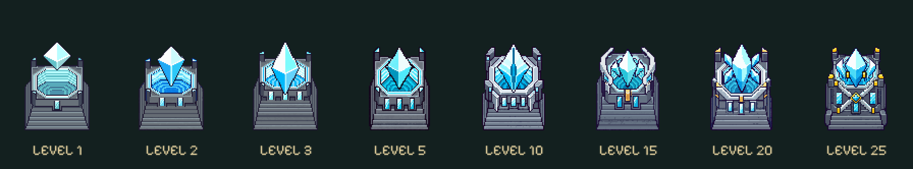

# Frostkristall · isolierte Grafikstudie

Stand: 29.10.2026, Animationen Revision 2. Ursprung der Grafikstudie: `823d2ea88a583ef29a3e1c847ff322773bb65e3f` auf `main`.

[Vorschau auf GitHub Pages](https://emfau88.github.io/TD/prototypes/frostkristall-evolution/?revision=2) · [Vergleich aller acht Stufen](comparison.png) · [Neue Einzelassets](assets/compact/)

## Ergebnis und Herkunft

Staffelung ausschließlich in dieser Vorschau: **1 / 2 / 3 / 5 / 10 / 15 / 20 / 25**. Keine Spielintegration, kein Kongregate-Export, keine Änderung an Kampf, Verlangsamung, Balance, Saves oder produktivem Rendering.

Das vorhandene Assetpack enthält tatsächlich drei Frostsockel und drei Kristall-/Angriffs-, Projektil- und Trefferstufen. Das Spiel schaltet diese bisher bei **1 / 4 / 7** um, ebenso wie beim Waldwächter. Die Dateibezeichnungen Level01/02/03 sind Grafikstufen; zusätzliche Atlasframes sind Animationen und keine weiteren Skins. Originalfarben: Cyan / Bernstein / Grün.

Auf Nutzerfeedback bleibt die Studie durchgehend **Eisblau / Cyan / Weiß**, mit wenigen Metall- und Goldakzenten. Die ursprünglichen frühen Bauformen bleiben erkennbar: kompaktere Originalsockel, Originalkristall 1, separate eisblaue Varianten für 2/3. Die umgefärbten Varianten stammen aus Imagegen und sind keine pixelidentischen Originale. Alle Originalquellen bleiben unverändert; Kopien liegen unter `assets/original/`.

Die fünf neuen Skins 5–25 entwickeln Fassung, Streben und Kristallform weiter. Sockel und schwebender Kristall bleiben getrennt. Generierte Quellen und Prompts liegen in `sources/`; `pack-assets.py` beschneidet, skaliert mit Nearest Neighbor und packt die transparenten Komponenten. Keine neuen Dateien im produktiven Assetverzeichnis.

## Größenrahmen und Nachbarreihen

- Originaler Renderfaktor `0.63`, Frost-Basisanker `166.4` Grafikpixel und Bodenversatz `+13` Kartenpixel; unveränderter Fußpunkt.
- Höchstens **64 Grafikpixel Breite** und **92 Grafikpixel / 57.96 Kartenpixel Gesamthöhe**. Die neuen Stufen sind etwa 51.7–53.6 Kartenpixel hoch; spätere Stärke entsteht nicht durch höhere Gebäude.
- Kompakte Originalsockel bewahren ihre Frontfelder; der Höhenrahmen berücksichtigt vorsorglich sämtliche vorhandenen Angriffsframes aller drei Originalstufen.
- Nachgebildeter Kartenausschnitt mit Originaltextur, 40 Kartenpixel Feldabstand, gleicher Perspektive, Tiefensortierung und Kameraformel wie im Spiel. Bei 390×844: Zoom 1.31875, Feldabstand 52.75 px; bei 320×568: Zoom 0.8875, Feldabstand 35.5 px.
- Zwei Reihen zeigen alle acht Stufen; dritte Reihe wahlweise Frost oder kompakte Waldwächter. Geometrieprüfung: alle **64 Frost/Frost- und 64 Frost/Waldwächter-Kombinationen** lassen hintere Kristalle frei. Die Waldwächterprobe verwendet die kompakten Prototypen, nicht die höheren produktiven Altsockel. Das ist kein vollständiger Kampf-/Effekt-Stresstest.

## Angriffsanimationen · Revision 2

Alle acht Stufen haben jetzt einen abgestimmten Ablauf aus Aufladen, Abschuss und Rückkehr. Level 1 behält alle Originalframes. Die eisblauen Stufen 2–25 kombinieren die unveränderten, vom Nutzer freigegebenen Kristallgrafiken mit eigenen Bewegungsprofilen, einem achtteiligen Eispartikelatlas, kurzem Facettenlicht und leuchtenden Sockeleinlagen. Ab Level 10 öffnen sich seitliche Facetten um höchstens zwei native Pixel. Die Gebäude werden weder skaliert noch gedreht; nach 0.86 s ist wieder exakt die Ruhepose erreicht.

Ein sichtbares Frostgeschoss pro Vergleichszyklus; Startpunkt folgt der angehobenen Kristallmitte beim Abschuss. Alle Ansichten teilen Pause, Tempo und Zeitregler. Kartenreihen, Vergleichskarten und 2×/3×/4×-Detailansicht laufen auch weiter, wenn die obere Schussprobe nicht sichtbar ist. Nur sichtbare Ansichten werden laufend gerendert. Verborgene Zeit wird nicht nachgeholt; reduzierte Bewegung startet pausiert.

Die Animationen sind **im Prototyp fertig umgesetzt**, als Kombination aus bestehenden Sprites, Effektatlas und Code in `attack-motion.js`/`preview.js`. Es wurden keine sieben Ersatzatlanten mit neu gezeichneten Kristallen erzeugt. Eine Übernahme in den produktiven Renderer und ein Kampf-/Leistungstest im echten Spiel sind ausdrücklich nicht Bestandteil dieses Auftrags.

Neue Effektquelle und Prompt: [ATTACK-PROMPT.json](sources/ATTACK-PROMPT.json), erzeugt mit dem eingebauten Imagegen-Werkzeug; [gepackter Effektatlas](assets/frost-cast-v2.png), [Packskript](pack-attack-fx.py), [Metadaten](attack-fx.json).

## Prüfungen · Revision 2

- 14/14 gezielte Tests bestanden: 9 Frost, 5 benachbarte Waldwächtertests. Alle Stufen/Phasen, acht Effektframes, vollständige Rückkehr, deterministisches Zurückspulen, ein Projektil, acht Richtungen, FPS 15/30/60/144, Vierteltempo und Pause/unsichtbare Zeit.
- Asset-/Geometrieprüfung bestanden: **12.607 neue Animationsposen**, sämtliche Original-Angriffsframes und **128 Nachbarpaarungen**. Höhe weiterhin höchstens 57.96 Kartenpixel; hintere Kristalle bleiben frei. Originale und alle freigegebenen Basis-/Kristall-/Projektilgrafiken bytegleich erhalten. [Geometrie](geometry-check.json).
- `npm run build` inklusive Pages-Kopie und separate JS-Syntaxprüfung bestanden. [Buildlog Revision 2](build-v2-result.txt). Keine erneute vollständige Spieltestsuite behauptet: keine Änderung am Spielcode.
- Tatsächlicher Browser bei 390×844, 320×568 und Desktop 1100×900: alle acht Stufen, Aufladen/Abschuss/Flug/Treffer/Ruhe, acht Richtungen, Zeitlupe, Zeitregler, Zurückspulen, globale Pause/Fortsetzen, animierte Frost-/Mischreihen, vergrößerte Facetten und Reload geprüft. Keine Konsolenfehler oder horizontaler Seitenüberlauf. Keine Messung auf physischer Smartphone-Hardware; Reduced-Motion-Pfad beibehalten, keine Betriebssystemeinstellung für den Test geändert.
- Die erste Vorschau hatte 11/11 Tests; deren ursprüngliche Provisoriumsprüfung wurde durch Prüfungen der fertigen Abläufe ersetzt, Originalframe- und Timinganforderungen bleiben bestehen.

## Sichtnachweise

Die Kartenbilder stammen aus der laufenden isolierten Vorschau mit echten Originaltexturen und Spielmaßen, nicht aus dem produktiven Kampf und nicht aus gestalteten Mockups.

- [Revision 2: Abschussvergleich](screenshots/attacks-desktop.jpg)
- [Revision 2: 390 px mit Frostnachbarn](screenshots/attacks-390.jpg)
- [Revision 2: 320 px mit Waldwächtern](screenshots/attacks-320.jpg)
- [Desktopvergleich aller acht Stufen](screenshots/desktop-comparison.jpg)
- [390×844: kompakte Mischreihen](screenshots/map-390.jpg)
- [320×568: kompakte Mischreihen](screenshots/map-320.jpg)

## Kritische Bewertung

Die gemeinsame Frostpalette liest sich schlüssiger als wechselnde Elemente. Die frühen Formen und die spät hinzukommenden Streben/Facetten sind wiedererkennbar; die Größe bleibt ruhig. Echte neue Silhouetten funktionieren hier besser als bloße kleine Abzeichen. Auf 320 px sind einzelne Übergänge, besonders 3→5 und 5→10, dennoch subtil. 15/20/25 unterscheiden sich in der Fassung klarer; eine exakte Rangfolge allein am Bild ist nicht in jeder Situation selbstverständlich. Diese Grenze ist für die gemeinsame Sichtprüfung offengelegt. Der Nutzer hat die statischen Skins am 29.10.2026 mit „sieht gut aus“ freigegeben. Die neuen Angriffsabläufe stehen noch zur Sichtprüfung. Sie sind absichtlich kurz und zurückhaltend; die stärkeren Stufen nutzen Facettenöffnung statt größerer Gebäude oder großflächiger Lichtwolken.

Revision 1 veröffentlicht als `c8c05a55deecb19d45feeb80f26b12747d379031` auf `main`. [Pages-Lauf 40947405969](https://github.com/emfau88/TD/actions/runs/40947405969) einschließlich Build und Publish erfolgreich. Öffentliche Revision 1 anschließend im Browser geprüft: alle acht Stufen geladen, eisblaue Stufe 2 im Flugbild, Mischreihen und Vergleich sichtbar, keine Konsolenfehler. [Live-Screenshot](screenshots/live-comparison.jpg).

Revision 2: technische und lokale visuelle Prüfung abgeschlossen; Veröffentlichung wird nach dem Pages-Lauf dokumentiert.
