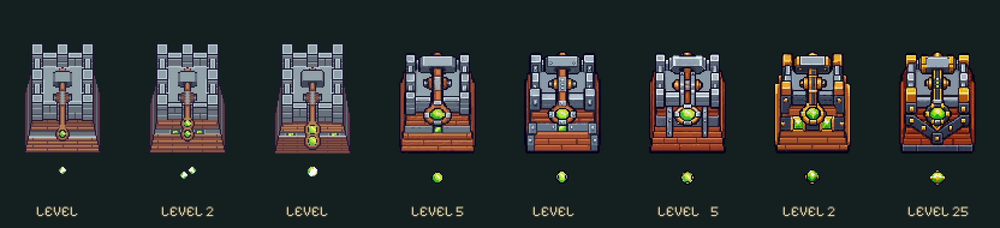

# Scharfschütze / Sharpshooter · Testbranch

[Im Spiel testen](https://emfau88.github.io/TD/previews/tower-evolution/tower-test.html) → **Scharfschütze**. Acht Stufen: **1 / 2 / 3 / 5 / 10 / 15 / 20 / 25**.

- 1–3: vorhandene Tower-04-Basen, kompakter Unterbau; unveränderte 17-Frame-Waffenatlanten und originale Projektile. Lange Originalarme werden mit 0,53 statt 0,63 dargestellt, damit sie beim Drehen nicht über die kompakte Boden-/Höhenhülle ragen. Grundfläche und Basisskalierung 0,63 bleiben erhalten.
- 5–25: fünf neue Pixelart-Konstruktionen, getrennte Basis (64×128), drehbarer Wurfarm (128×128) und ein grünes Geschoss pro logischem Schuss. Materialentwicklung von Holz/Eisen zu Stahl/Gold. Kurzer Rückstoß bei echten Angriffen, bestehende Einschläge unverändert; keine neue vollständige Wurf-/Nachladeanimation.
- Alle Stufen maximal 57,96 Kartenpixel ruhende Höhe; neue Stufen 53,55. Grundfläche 40,32 Pixel breit. 2.880 Zielrichtungen inklusive Rückstoßreserve der neuen Waffen geprüft: unter 58 Pixeln, keine Waffe unterhalb des Bodenabschlusses. Getrennte Angriffsprojektile der Originalatlanten sind keine Gebäudefläche.
- Quellen mit vollständigen Prompts in `sources/`, neue Laufzeit-PNGs in `assets/compact/`, Montage/Originalprüfsummen in `manifest.json`. Eingebautes Imagegen-Werkzeug; Zuschnitt, Alpha-Schwelle, Nearest-Neighbor und 32-Farben-Packung. Keine Originaldatei überschrieben.

Reproduzieren mit `python prototypes/scharfschuetze-evolution/pack-assets.py`; prüfen mit `python prototypes/scharfschuetze-evolution/verify-assets.py` (Pillow). Nur Branch `codex/tower-evolution-playtest`, kein Main-Merge, keine Balance-/Save-/Offlineänderung, kein Kongregate-Export.

**Sichtbewertung:** Die massivere Mechanik und goldenen Fassungen bleiben kompakt. 5/10 unterscheiden sich subtiler als 15/20/25; feine Schrauben und Inlays sind bei 320 px kaum erkennbar. Die gestalterische Nutzerabnahme bleibt offen.
