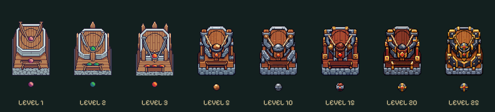

# Steinschleuder / Stone Slinger · Testbranch

Acht optische Stufen: **1 / 2 / 3 / 5 / 10 / 15 / 20 / 25**. Nur im Branch `codex/tower-evolution-playtest` integriert.

[Im echten Spiel testen](https://emfau88.github.io/TD/previews/tower-evolution/tower-test.html) → **Steinschleuder** wählen. Eine Stufe oder alle acht sind verfügbar.

- 1–3: Originalgrafiken von Tower 03; nur untere Basis verkürzt. Unveränderte originale Waffen- und Projektilanimationen.
- 5–25: neue Holz-/Eisen-/Goldkonstruktionen aus dem integrierten Imagegen-Werkzeug, jeweils getrennte Basis, drehbare Schleuder und Steinprojektil. Kurzer Rückstoß bei echten Schüssen; rotierender Einzelstein mit bestehendem Steineinschlag. Keine zusätzlichen logischen Schüsse oder Schadenseffekte.
- Basis 64 × 128, Waffe 96 × 96; Skalierung 0,63. Aufstellpunkt und Grundfläche erhalten. Ruhende Gesamthöhe höchstens 57,96 Kartenpixel, neue Stufen 52,92. Neue Waffen in allen 360 Ausrichtungen unter 58 Pixeln Gesamthöhe.
- Unveränderte Kampfwerte, Originalassets, Saveformat und Offline-Regeln. Kein Main-Merge und kein Kongregate-Export.

`assets/compact/` enthält die spielbaren PNGs. `sources/` enthält generierte Ausgangsgrafiken und vollständige Prompts einschließlich der gezielten Projektilkorrektur bei Level 10. `manifest.json` dokumentiert Montage und Originalprüfsummen. Verpackung mit `python prototypes/steinschleuder-evolution/pack-assets.py`, Prüfung mit `python prototypes/steinschleuder-evolution/verify-assets.py` (Pillow). Nur Alpha-Schwelle, Zuschnitt, Palette und Nearest-Neighbor-Skalierung; keine Farbfilter.

**Sichtbewertung:** Die Verstärkungen sind bei normaler Größe lesbar, ohne höheren Turmkörper. 20/25 unterscheiden sich vor allem durch Panzerplatten und die Form der Schleudergabel; auf 320 px sind diese kleinen Unterschiede weniger deutlich. Die späteren Stufen haben bislang eine kurze Rückstoßreaktion, keine neue mehrphasige Spann-/Nachladeanimation. Die bestehenden Einschlagsanimationen werden weiterverwendet. Die gestalterische Abnahme durch den Nutzer bleibt offen.
