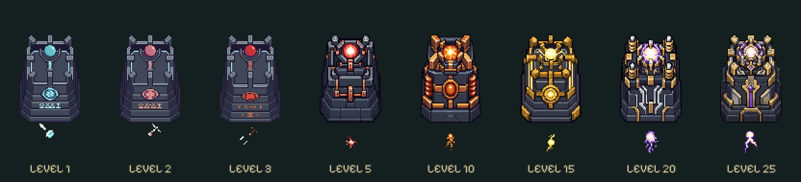

# Sturmlicht · acht optische Stufen im Testbranch

[Im echten Kampf testen](https://emfau88.github.io/TD/previews/tower-evolution/tower-test.html): **Sturmlicht** und „Alle acht Stufen nebeneinander“ wählen. Für einen einzelnen starken Turm Level 20 oder 25 wählen. Ausschließlich `codex/tower-evolution-playtest`, keine Main-Integration.

Die Stufen **1 / 2 / 3 / 5 / 10 / 15 / 20 / 25** bleiben 57,96 Kartenpixel hoch und 40,32 breit. Originale frühe Steinfassungen, separate Waffen und Angriffsatlanten erhalten; nur die unteren Sockelfassaden auf die gemeinsame Höhe gepackt. Cyan / Rosa / Rot der drei vorhandenen Originalstufen bleiben erhalten. Ab 5 verstärkte Fassungen, ab 10 Kupferspulen, ab 15 Goldpanzerung, ab 20 helle Blitzkanäle, bei 25 segmentierter Meisterring. Keine wachsenden Mauern oder höhere Befestigungspunkte.

## Dateien und Herkunft

- `assets/compact/level-{N}-{base,weapon,projectile}.png`: transparente native PNGs, separate Sockel und senkrecht stehende Emitter. Originalatlanten bleiben unangetastet. Neue Geschosse zur gemeinsamen Aufwärtsachse des Renderers ausgerichtet.
- `sources/level-{5,10,15,20,25}-generated.png`: neue Bitmap-Bauteile mit **eingebautem Imagegen** und Original-Tower-05 als Referenz erzeugt. Die vollständigen Prompts stehen in [sources/prompts.json](sources/prompts.json).
- [manifest.json](manifest.json): Maße, Montage und SHA-256 der Originaldateien. `pack-assets.py` erledigt ausschließlich Freistellung, Ausschnitt, Nearest-Neighbor-Verkleinerung, achsengerechte Drehung und Palette; keine Farbfilter. `verify-assets.py` prüft alle acht Stufen, harte Alphakanten, gemeinsame Höhe und Originalhashes.
- Laufzeitdarstellung unter `experiments/idle-bastion/src/{tower-evolution,evolution-view,storm-visuals,evolution-impacts,combat-effects}.ts`; gemeinsame Trefferzeichnungen in `prototypes/tower-impact-study/effects.js`.

## Angriffe und Treffer

Originalbewegungen und Projektile der ersten drei Stufen erhalten. Neue Stufen: kurze vorberechnete Abschussreaktion, eigenständige Geschosse, gezackter farblich passender Kettenblitz. Ein Sprite folgt jedem logischen Kettenschuss, wechselt am echten Treffer seine Flugbahn zum nächsten Ziel; keine zusätzlichen Schadensereignisse. Weiter höchstens drei Ziele nach unveränderter Kampfregel.

Treffer wachsen vom Stromkontakt zu roten Lichtbögen, bernsteinfarbenem Donnerschlag, goldener Kettenkrone und violettweißem Meistersturm. Höhere Stufen erhalten weitere Verzweigungen, gebrochene Ringe und kurze Nachimpulse. Dauer 250–450 ms; keine Kameraerschütterung und kein Flächenblitz. [Animierter Vergleich](https://emfau88.github.io/TD/previews/tower-evolution/prototypes/tower-impact-study/?revision=6).

40 vorab erzeugte Impact-Atlanten für alle fünf Türme: 14,06 MiB rohe Pixel, zusätzlich 2,11 MiB für fünf Sturmlicht-Abschussatlanten; CPU-/GPU-Verwaltung nicht mitgezählt. Bestehende Grenzen von 96 Treffer-Sprites und 48 kurzlebigen Kettenlinien bleiben erhalten. Kein echter Smartphone-Leistungsbenchmark behauptet.

## Prüfung und Einschätzung

437/437 Tests und Produktionsbuild erfolgreich. Alle 54 vorbereiteten Aufstellungen, alle 40 optischen Einzelstufen mit realen Schüssen, Aufwerten, Verkauf und Save-Roundtrip. Zusätzliche Sturmlicht-Tests für jede Kettenetappe, Reload-Fortsetzung, exakte Blitz-Endpunkte und Aufräumen. 872 Effektposen geprüft; die Zeichenoperationen der vier bereits freigegebenen Reihen bleiben exakt identisch. Neue Formen liegen in ihren 96-Pixel-Frames.

Echter Browser bei 1280×720, 390×844 und 320×568; alle acht Sturmlicht-Skins sichtbar, Kampf bis Welle 43, Pause/Reload erhält Gold, Gegner und Türme. Keine Warnungen oder JavaScript-Fehler. Die vollständige Einzelstufenmatrix ist automatisiert geprüft, nicht jeder Einzelfall zusätzlich manuell angeklickt. Desktop-Viewport-Emulation ersetzt kein physisches Smartphone.

Die Silhouette bleibt kompakt; ab 5 machen Bauform und Material die Steigerung gut erkennbar. 20 und 25 bleiben bewusst eng verwandt, der Meisterring und der stärker verzweigte Treffer trennen sie. Bei 320 px in der Gesamtansicht sind feine Spulen kaum erkennbar; Farbflächen und Zoom helfen. Noch keine gestalterische Nutzerfreigabe für Main.

[Spielaufnahmen und Veröffentlichungsnachweis](../../artifacts/idle-bastion/acceptance/tower-evolution-playtest/REPORT.md).
