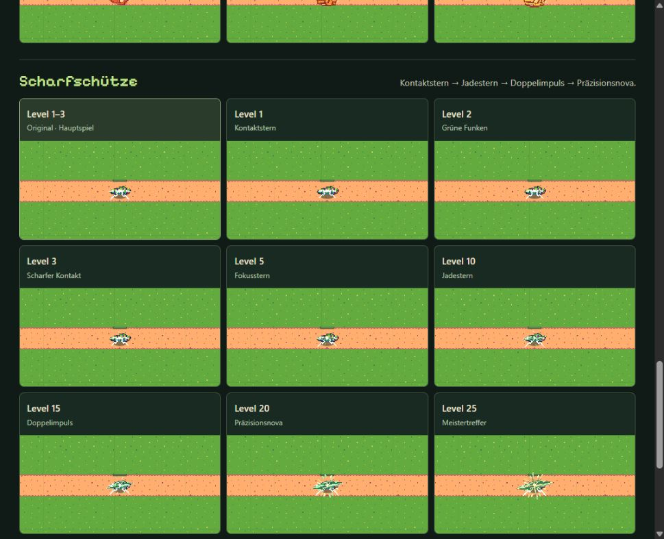
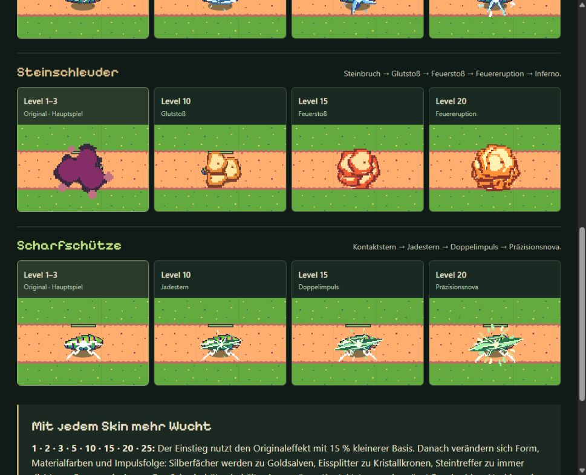
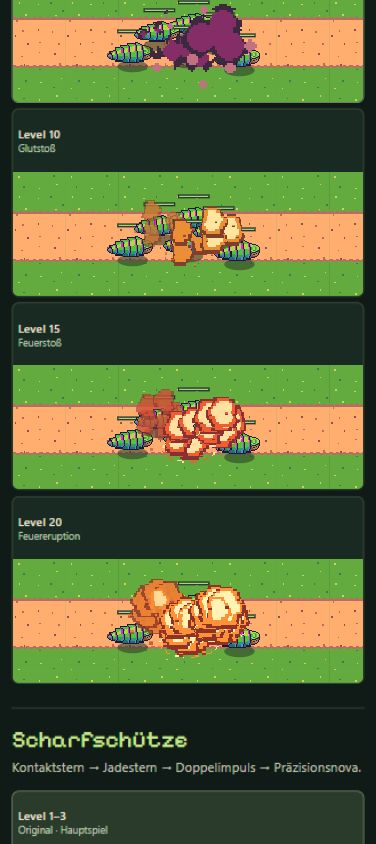

# Impact-Studie · Revision 5 · Zusammenhängende Stein- und Scharfschützenentwicklung

[Animierte Vergleichsvorschau](https://emfau88.github.io/TD/previews/tower-evolution/prototypes/tower-impact-study/?revision=5)

**Nur Vorschau im Branch `codex/tower-evolution-playtest`. Keine neuen Impacts im Spiel, keine Änderung an Kampfwerten, Saveformat oder Offline-System.** Revision 5 korrigiert auf Nutzerfeedback den Stilbruch bei Stein 20/25 und die wechselnden Trefferformen beim Scharfschützen. Waldwächter und Frost bleiben exakt wie in Revision 4.

## Vergleich

Links stehen unveränderte Originalprojektile und Impacts niedriger Main-Türme (Level 1–3, dort gemeinsame Grafikstufe 1). Quelle ist `93703cb66e369ed7f3a724f0e42575775cc12bc4`. Standardmäßig folgen die Entwürfe 10/15/20. „Original + alle 8 Skins“ zeigt zusätzlich alle Stufen **1/2/3/5/10/15/20/25**. Hauptspielreferenz und neue Reihe sind ausdrücklich getrennt beschriftet.

| Turm | Entwicklung der neuen Trefferwirkung |
|---|---|
| Waldwächter | Holz-/Stahlsplitter, ab 5 gerichtete Kerben, bei 10 Silberfächer, 15 Goldspaltung, 20 zwei smaragdgrüne Fächer, 25 drei versetzte goldhelle Salven |
| Frostkristall | Eissplitter und Eisbruch, 10 Kristallkrone, 15 blaues Prismenkreuz, 20 heller sechszackiger Polarstern, 25 violett gerandeter Aurorabruch mit acht Facetten |
| Steinschleuder | Steinsplitter und Steinbruch, 10 bernsteinfarbener Glutstoß, 15 rote Feuerwolke mit Bodenimpuls, 20 volle Feuereruption mit sieben Flammenloben und Nachbrand, 25 achtteiliger, weißgoldener Infernostoß mit zweitem Bodenimpuls |
| Scharfschütze | Gemeinsamer grünweißer Kontaktstern in allen acht Stufen; 5 gerichteter Durchschlag, 10 diagonale Jadestrahlen, 15 zusätzliche versetzte Impulse, 20 grün-goldene Präzisionsnova, 25 heller Nachimpuls. Jede höhere Stufe behält die Formen ihrer Vorgänger |

Neue Level 1/2/3 behalten die Originalbasis mit 85/90/95 % Größe und zusätzlichen frühen Splittern. Ab 5 stammen die zusätzlichen Formen aus eigenen Pixelzeichnungen in `effects.js`. Der Scharfschütze behält in allen Stufen ausdrücklich seinen originalen Kontaktstern als Grundlage; dessen neue Dauer wächst von 350 bis 550 ms. Die frühe Originalbewegung wird dadurch nicht mehr auf 300 ms verkürzt. Die flammenartigen Wolken des Steinturms unterscheiden sich bewusst von Frostfacetten. Hohe Stufen erhalten mehr Farben, Nachimpulse, Splitter und Projektilspuren. Maximal 550 ms Trefferwirkung, kein Bildschirmblitz oder Kamerawackeln.

## Quellen und technische Grenzen

`baseline-main.json` dokumentiert Originalpfade, Frame-Metadaten und acht SHA-256-Prüfsummen; Originalassets bleiben unverändert. Die zusätzlich vorhandene rote Original-Steinexplosion gehört zum früheren Entwurf und wird in Revision 4 nicht geladen. Projektile stammen unverändert aus den vier Skin-Prototypen, ihre Atlasframes aus `shot-frames.json`.

Originalimpact-Maßstäbe 0,6/0,8/1,6/0,6; Dauer 500/500/500/350 ms. Originalprojektile 10 fps, Maßstab 0,45/0,5/0,85/0,85. Vergleich mit originalem Leafbug und Gelände bei gleichem Kameramaßstab, fester 240-ms-Flugzeit und 1,7-s-Zyklus. Ein Vergleichsprojektil je Treffer; keine komplette Schadenssimulation und keine vollständige Waldwächter-Mehrfachsalve. Dichtvergleich: sechs Gegner, drei versetzte Treffer.

Neue Effekte werden einmal in 10 Frames à 96×96 Pixel vorberechnet. Danach genügt ein Sprite-Zeichenaufruf pro Impact. Höchstens 32 Profile, etwa **11,25 MiB rohe Pixel** bei allen Stufen (Standardvergleich etwa 4,22 MiB; zusätzliche Browser-/GPU-Verwaltung nicht enthalten). Pixelraster ohne geglättete geometrische Kanten. Unsichtbare Vergleichsfelder werden nicht laufend neu gezeichnet, Hintergrundtabs halten an, Reduced Motion startet pausiert. Keine Bibliotheken, Spielimporte oder Speicherzugriffe.

## Tatsächliche Prüfung

- JS-Syntax und Pages-Packaging erfolgreich.
- 32 Profile / 2.720 Zeitposen: endliche Koordinaten, Alpha 0–1, balancierter Canvas-Zustand, kein Zeichnen nach Ablauf. 358.401 geprüfte Pixel-Zeichenaufrufe; eigene Formen reichen höchstens 35 Pixel vom Mittelpunkt und passen in die 96-Pixel-Frames.
- Originalreferenzen unverändert. Zusätzlich alle Zeichenoperationen der 16 Wald-/Frostprofile gegen Revision 4 verglichen: exakt identisch. Die maximale stark deckende Fläche der neuen Stein-/Scharfschützenformen wächst bei 5/10/15/20/25 jeweils strikt; diese technische Hilfsprüfung ersetzt keine visuelle Beurteilung.
- Desktop: Original/10/15/20 sowie alle 36 Felder, Pause, Zeitlupe, Spielgröße und Detailansicht geprüft. 390×844: Dichtvergleich mit Feuereruption und Nachbrand. 320×568: alle 36 Felder und angepasste Beschreibung, kein horizontaler Overflow. Keine Browserwarnungen/-fehler.
- Aktuelle Detail-/Scharfschützen-/390-Aufnahmen unten. Browserverbindung nach Sitzungswechsel einmal neu initialisiert, anschließend Sichtprüfung vollständig möglich. 320-Pixel-Prüfung ohne eigene Bildserie.
- Spielcode und Spieltests unverändert. Letzte Vollsuite weiterhin 428/428 vom Turmauftrag; kein neuer Vollsuite-Lauf für diese isolierte Vorschau. Kein Kongregate-Export.

Der sichtbare Mikrobenchmark zeichnet 96 Treffer pro Bild, 40 Frames je Stufe, acht Aufwärmframes verworfen. Gemessen: L1 Ø 0,21 ms / P95 0,40 ms; L10 Ø 0,19 ms / P95 0,40 ms; L25 Ø 0,19 ms / P95 0,40 ms. **CPU-Zeichenzeit im vorhandenen Desktopbrowser; keine GPU-Gesamtkosten, keine Spielsimulation, keine Messung auf echter Smartphone-Hardware.** [Rohwert](screenshots/impact-v5-performance.txt).

## Sichtbewertung

Die Kritik an Revision 4 war berechtigt: Die schmale Meteorspitze verlor die Masse der Feuerwolke, und beim Scharfschützen wechselten Form und Farbe zu stark. Jetzt bleibt die Feuerwolke bei 20/25 erhalten und wird dichter, heißer und mehrphasig. Der Scharfschütze behält eine gemeinsame grüne Trefferform, deren Strahlen, Breite und Nachimpulse aufeinander aufbauen. Die kleinen frühen Stufen bleiben bewusst eng verwandt. Bei drei hohen Steintreffern wird die zentrale Gegnergruppe während der Spitze sichtbar verdeckt; dieser kurze Feuerwerksmoment muss bei einer späteren Spielintegration in gemischten Kämpfen bewertet werden.

**Gestalterische Nutzerfreigabe und ein späterer Belastungstest im vollständigen Spiel stehen aus.** Revision 3 wurde als `9b7efa0` mit [Pages 40971886603](https://github.com/emfau88/TD/actions/runs/40971886603) veröffentlicht. Revision 4 ist als `03520cf61662cbec430215ecf8d8da5d16a85bb8` gepusht; [Pages 40974609788](https://github.com/emfau88/TD/actions/runs/40974609788) erfolgreich inklusive Produktionsbuild. Öffentliche Metadaten/Browserseite geprüft, keine Warnungen oder Fehler. Alle 604 Main-Dateien wurden bytegleich erhalten; Main bleibt `93703cb66e369ed7f3a724f0e42575775cc12bc4`.

Revision 5: lokale Prüfung abgeschlossen; Veröffentlichung wird nach Commit/Push ergänzt.

### Aktuelle Browseraufnahmen

Scharfschütze, alle Stufen im Spielmaßstab:

Detailansicht 2×:

390×844, dichtes Gefecht:

[Vorher: Revision 4](screenshots/impact-v4-detail.png). Frühere Bilder dokumentieren verworfene oder überarbeitete Entwürfe und sind keine Abnahme dieser Revision.
