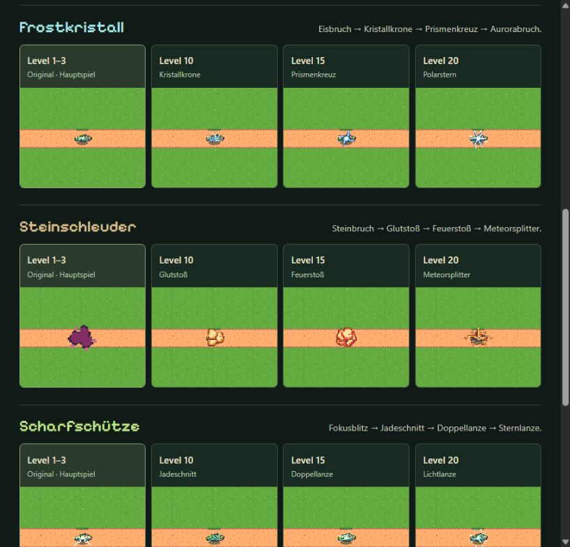
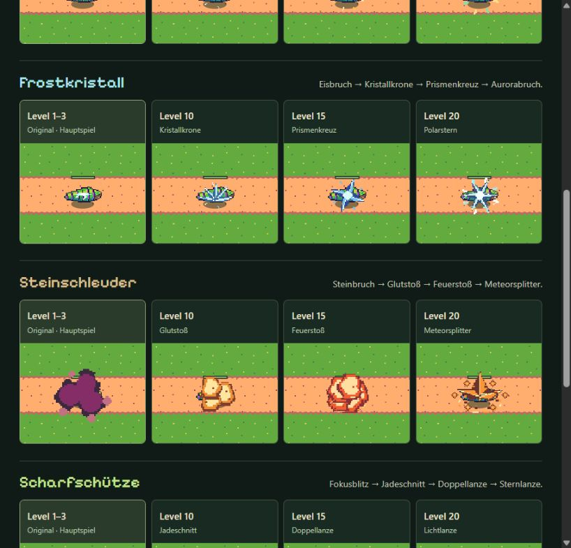
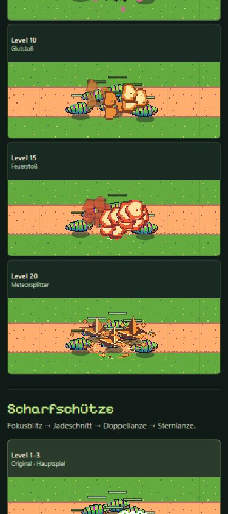

# Impact-Studie · Revision 4 · Eigene Formen, Farben und Trefferfolgen

[Animierte Vergleichsvorschau](https://emfau88.github.io/TD/previews/tower-evolution/prototypes/tower-impact-study/?revision=4)

**Nur Vorschau im Branch `codex/tower-evolution-playtest`. Keine neuen Impacts im Spiel, keine Änderung an Kampfwerten, Saveformat oder Offline-System.** Revision 4 ersetzt die überwiegend über Größe/Splitterzahl gesteigerte Revision 3 durch eigene Pixelgrafik und unterschiedliche Abläufe.

## Vergleich

Links stehen unveränderte Originalprojektile und Impacts niedriger Main-Türme (Level 1–3, dort gemeinsame Grafikstufe 1). Quelle ist `93703cb66e369ed7f3a724f0e42575775cc12bc4`. Standardmäßig folgen die Entwürfe 10/15/20. „Original + alle 8 Skins“ zeigt zusätzlich alle Stufen **1/2/3/5/10/15/20/25**. Hauptspielreferenz und neue Reihe sind ausdrücklich getrennt beschriftet.

| Turm | Entwicklung der neuen Trefferwirkung |
|---|---|
| Waldwächter | Holz-/Stahlsplitter, ab 5 gerichtete Kerben, bei 10 Silberfächer, 15 Goldspaltung, 20 zwei smaragdgrüne Fächer, 25 drei versetzte goldhelle Salven |
| Frostkristall | Eissplitter und Eisbruch, 10 Kristallkrone, 15 blaues Prismenkreuz, 20 heller sechszackiger Polarstern, 25 violett gerandeter Aurorabruch mit acht Facetten |
| Steinschleuder | Steinsplitter und Steinbruch, 10 bernsteinfarbener Glutstoß, 15 rote Feuerwolke mit Bodenimpuls, 20 Meteorspitze mit heißen Trümmern, 25 weißgoldener Sonnenbruch |
| Scharfschütze | Grüne Kontaktfunken, 5 Fokusblitz, 10 Jadeschnitt, 15 versetzte Doppellanze, 20 cyanweiße Lichtlanze, 25 drei Nadelimpulse mit grün-goldenen Strahlen |

Neue Level 1/2/3 behalten die Originalbasis mit 85/90/95 % Größe und zusätzlichen frühen Splittern. Ab 5 stammen die Formen vollständig aus eigenen Pixelzeichnungen in `effects.js`; keine bloßen Farbfilter oder vergrößerten Originalanimationen. Die flammenartigen Wolken des Steinturms unterscheiden sich bewusst von Frostfacetten. Hohe Stufen erhalten mehr Farben, Nachimpulse, Splitter und Projektilspuren. Maximal 550 ms Trefferwirkung, kein Bildschirmblitz oder Kamerawackeln.

## Quellen und technische Grenzen

`baseline-main.json` dokumentiert Originalpfade, Frame-Metadaten und acht SHA-256-Prüfsummen; Originalassets bleiben unverändert. Die zusätzlich vorhandene rote Original-Steinexplosion gehört zum früheren Entwurf und wird in Revision 4 nicht geladen. Projektile stammen unverändert aus den vier Skin-Prototypen, ihre Atlasframes aus `shot-frames.json`.

Originalimpact-Maßstäbe 0,6/0,8/1,6/0,6; Dauer 500/500/500/350 ms. Originalprojektile 10 fps, Maßstab 0,45/0,5/0,85/0,85. Vergleich mit originalem Leafbug und Gelände bei gleichem Kameramaßstab, fester 240-ms-Flugzeit und 1,7-s-Zyklus. Ein Vergleichsprojektil je Treffer; keine komplette Schadenssimulation und keine vollständige Waldwächter-Mehrfachsalve. Dichtvergleich: sechs Gegner, drei versetzte Treffer.

Neue Effekte werden einmal in 10 Frames à 96×96 Pixel vorberechnet. Danach genügt ein Sprite-Zeichenaufruf pro Impact. Höchstens 32 Profile, etwa **11,25 MiB rohe Pixel** bei allen Stufen (Standardvergleich etwa 4,22 MiB; zusätzliche Browser-/GPU-Verwaltung nicht enthalten). Pixelraster ohne geglättete geometrische Kanten. Unsichtbare Vergleichsfelder werden nicht laufend neu gezeichnet, Hintergrundtabs halten an, Reduced Motion startet pausiert. Keine Bibliotheken, Spielimporte oder Speicherzugriffe.

## Tatsächliche Prüfung

- JS-Syntax und Pages-Packaging erfolgreich.
- 32 Profile / 2.720 Zeitposen: endliche Koordinaten, Alpha 0–1, balancierter Canvas-Zustand, kein Zeichnen nach Ablauf. 317.393 geprüfte Pixel-Zeichenaufrufe; eigene Formen reichen höchstens 38 Pixel vom Mittelpunkt und passen in die 96-Pixel-Frames.
- Acht Originalreferenzen durch SHA-256 bestätigt.
- Desktop: Original/10/15/20 sowie alle 36 Felder, Pause, Zeitlupe, Spielgröße und Detailansicht geprüft. 390×844: Dichtvergleich mit aktualisierten Feuerformen. 320×568: alle 36 Felder und angepasste Beschreibung, kein horizontaler Overflow. Keine Browserwarnungen/-fehler.
- Aktuelle Desktop-/Detail-/390-Aufnahmen unten. Screenshotaufnahme war zwischendurch unzuverlässig; keine vollständige separate 320-Pixel-Bildserie behauptet.
- Spielcode und Spieltests unverändert. Letzte Vollsuite weiterhin 428/428 vom Turmauftrag; kein neuer Vollsuite-Lauf für diese isolierte Vorschau. Kein Kongregate-Export.

Der sichtbare Mikrobenchmark zeichnet 96 Treffer pro Bild, 40 Frames je Stufe, acht Aufwärmframes verworfen. Gemessen: L1 Ø 0,10 ms / P95 0,20 ms; L10 Ø 0,10 ms / P95 0,20 ms; L25 Ø 0,13 ms / P95 0,20 ms. **CPU-Zeichenzeit im vorhandenen Desktopbrowser; keine GPU-Gesamtkosten, keine Spielsimulation, keine Messung auf echter Smartphone-Hardware.** [Rohwert](screenshots/impact-v4-performance.txt).

## Sichtbewertung

Die Entwicklung ist jetzt auch über Formen und Farben erkennbar, besonders bei Frostkrone/Prismenkreuz/Polarstern sowie Gold-/Smaragdsalven. Die hohen Steinwirkungen dürfen den getroffenen Gegner kurz verdecken und wirken im Dichtvergleich deutlich lebhafter. Ihr Stil ist bewusst kräftig und grafisch; wie gut die gesamte Effektmischung im laufenden Spiel harmoniert, ist vor einer Integration noch gemeinsam zu beurteilen. Die frühen Stufen bleiben enger verwandt. Ein Standbild zeigt die versetzten Salven nur teilweise.

**Gestalterische Nutzerfreigabe und ein späterer Belastungstest im vollständigen Spiel stehen aus.** Revision 3 wurde als `9b7efa0` mit [Pages 40971886603](https://github.com/emfau88/TD/actions/runs/40971886603) veröffentlicht. Nachweis der aktuellen Veröffentlichung folgt unten.

### Aktuelle Browseraufnahmen

Spielmaßstab:

Detailansicht 2×:

390×844, dichtes Gefecht:

Ältere Bilder mit „Heute“ bzw. `impact-v3-` dokumentieren frühere Entwürfe und sind keine Abnahme dieser Revision.
